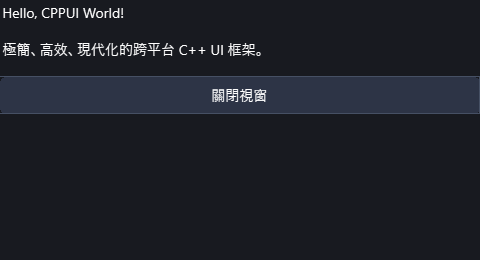
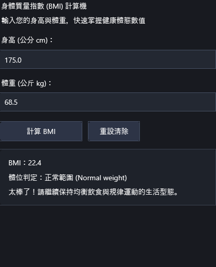
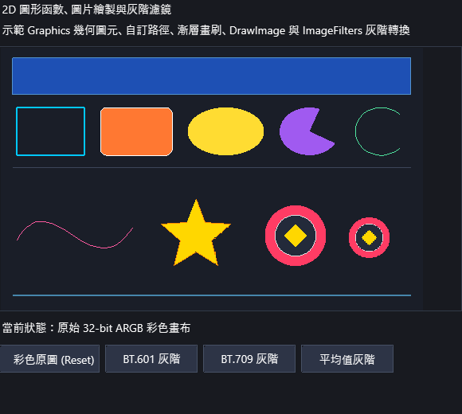
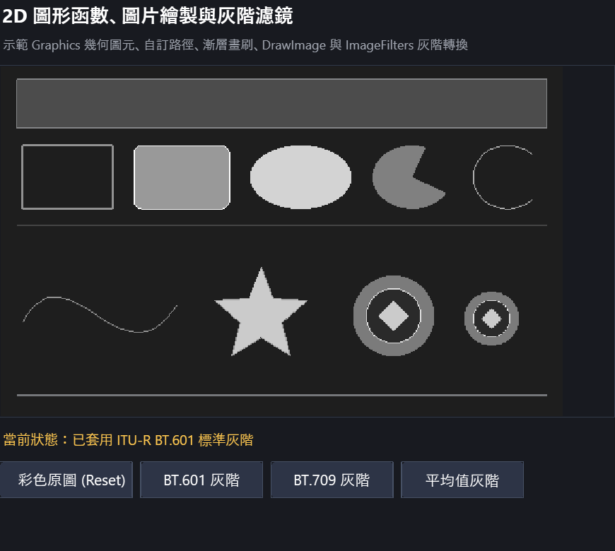

# CPPUI: Modern High-Performance Cross-Platform C++ UI Framework

<div align="center">

[](include/compat/Compat.hpp)
[-success.svg)](tests/)
[](docs/specs/02_coding_standards_compat.md)
[](LICENSE)
[](docs/api/guides/cross_platform_architecture.md)

<p>
  <strong>結合 Skia 向量渲染底層、HarfBuzz/ICU 工業級文字排版、Avalonia 雙階段佈局機制，<br/>並具備 Windows Forms 極速直覺 RAD 開發體驗的現代 C++ 跨平台 UI 框架。</strong>
</p>

[快速入門](#-快速上手-quick-start) • [展示畫廊](#-視覺成果展示-visual-showcase) • [核心特性](#-核心架構與功能亮點) • [範例導覽](#-範例專案索引-examples-gallery) • [API 文件](docs/api/README.md) • [建置指南](#-建置與測試指南)

</div>

---

## 📸 視覺成果展示 (Visual Showcase)

CPPUI 專案具備完整開箱即用的現代深淺主題、高分屏 DPI 自動感知換算、以及直覺美觀的桌面元件：

| 快速入門範例視窗 (`quickstart`) | 健康指數計算機 (`bmi_calculator`) |
| :---: | :---: |
|  |  |
| *高階 Application + Form 生命週期與 Fluent 排版* | *深色卡片主題、即時數值運算與動態狀態反饋* |

| 2D 向量繪圖與幾何路徑 (`graphics_drawing_demo`) | 灰階影像濾鏡 (`graphics_drawing_demo`) |
| :---: | :---: |
|  |  |
| *GDI+ 風格 Graphics API、線性漸層畫刷與幾何貝茲路徑* | *高吞吐多執行緒並發像素處理 (PixelOps & ImageFilters)* |

---

## 🚀 快速上手 (Quick Start)

只需小於 40 行標準現代 C++ 程式碼，即可建立具備現代深色質感、事件響應與流式排版的桌面視窗：

```cpp
#include <ui/app/Application.hpp>
#include <ui/dsl/Fluent.hpp>
#include <ui/controls/Button.hpp>
#include <ui/controls/TextBlock.hpp>
#include <compat/Compat.hpp>

int main() {
    using namespace cppui::dsl;

    // 1. 建立頂層視窗實例
    auto form = std::make_shared<cppui::app::Form>();
    form->SetTitle("CPPUI 現代桌面應用程式");
    form->SetSize(460, 320);

    // 2. 宣告介面元件
    auto label = Text("歡迎使用 CPPUI 框架！")
        .FontSize(20)
        .Build();

    auto button = Button("點擊體驗直覺互動")
        .Padding(16, 8)
        .OnClick([label]() {
            label->SetText("🎉 成功觸發事件！感受極致開發體驗。");
        })
        .Build();

    // 3. 透過 Fluent RAD DSL 組合佈局
    form->SetContent(
        VStack({ label, button })
            .Spacing(20)
            .Center()
            .Build()
    );

    // 4. 啟動低延遲事件循環
    return cppui::app::Application::Run(form);
}
```

---

## 🌟 核心架構與功能亮點

### 1. 雙渲染後端架構 (Dual-Backend Rendering Pipeline)
- **Google Skia (m151) 向量繪圖核心**：支援 GPU 硬體加速（Direct3D / Metal / Vulkan / OpenGL）無縫光柵化。
- **純 C++ 軟體光柵器 (SoftwareRenderTarget)**：零外部第三方相依，在 Headless 伺服器、CI 容器或輕量環境中自動平滑回退。

### 2. 記憶體零堆積分派命令錄製 (LinearArena DisplayList)
- 採用線性記憶體池 (`LinearArena`) 錄製繪圖命令串流 (`DisplayList`)。
- 達成每秒數千萬次繪圖指令錄製與重播，畫格重繪結束後 $O(1)$ 指標重置，消除堆積記憶體碎片。

### 3. 工業級文字排版管線 (Text Shaping & Typography)
- 整合 **HarfBuzz** 字形塑形器與 **ICU** 斷詞分析。
- 完整實作 **Unicode UAX #9** 雙向文字分析器（BiDi LTR / RTL）與 **UAX #14** 換行斷詞規範（支援 CJK 標點避頭尾禁則）。
- 支援動態 TTF/OTF 字型檔案與記憶體字型載入，並提供雙向亞像素命中測試 (`HitTestPoint` / `HitTestTextPosition`)。

### 4. Windows Forms 風格極速直覺開發體驗 (Intuitive RAD API)
- 具備 Windows Forms 開發者熟悉的 `Application::Run`、`Form` 多視窗生命週期、關閉攔截與驗證 (`FormClosingEventArgs`)。
- 內建 `Dispatcher` 主執行緒非同步調度與跨平台低延遲計時器 (`Timer`)。

### 5. 宣告式 Fluent RAD DSL 與響應式信號 (Signals & Reactive)
- 提供 `VStack`, `HStack`, `Grid`, `Border`, `Button`, `TextBox`, `PictureBox` 等流式建構器。
- 提供 `Signal<T>` 響應式資料流與雙向綁定機制，代碼量精簡 70% 以上。

### 6. 現代 MVVM 與依賴反轉容器 (MVVM & IoC)
- 遵循微軟架構標準的 `ViewModelBase`、`RelayCommand` 雙向指令機制。
- 具備微型輕量 `ServiceCollection` / `IServiceProvider` 依賴注入容器，支援 Singleton 與 Transient 生命週期。

### 7. GDI+ 風格進階圖形排程與濾鏡 (Advanced Graphics & Filters)
- 支援直覺式 `Graphics` 類別，封裝 `Pen`, `Brush`, `LinearGradientBrush`, `GraphicsPath`, `Bitmap`。
- 提供多執行緒並發影像處理管線 (`ImageFilters::Grayscale`, `ImageFilters::GaussianBlur`, `Convolution::Convolve3x3`)。

### 8. 智慧派送對話方塊系統 (Dialogs & File Pickers)
- 包含 `MessageBox`, `OpenFileDialog`, `SaveFileDialog`。
- **Auto 智慧派送**：Windows 下優先使用原生 COM Shell 介面 (`IFileOpenDialog` / `IFileSaveDialog`)；Linux 或單元測試環境透明切換為純 CPPUI 自繪主題視窗 (`FileDialogForm`)。

### 9. 集中式設計代幣與動態主題中樞 (Theme & Design Tokens)
- 封裝色彩、字型排版與間距圓角之語意代幣 (`ColorTokens`, `TypographyTokens`, `MetricTokens`)。
- 全域 `ThemeManager` 單例中樞支援執行期深色 (`Dark`)、淺色 (`Light`) 與高對比度 (`HighContrast`) 模式熱切換。

### 10. 全編譯器零警告與全面向下相容 (Zero-Warnings & compat.hpp)
- 在 MSVC (`/W4`)、GCC (`-Wall -Wextra -Wpedantic`)、Clang 下維持 **0 Warnings / 0 Errors**。
- 單標頭檔 [`compat.hpp`](include/compat/Compat.hpp) 提供 `string_view`, `span`, `expected`, `ranges`, `format`, `print` 等現代 C++ 標準墊片，保證 C++14/17/20/23 跨標準相容。

### 11. 視覺化表單設計器核心體系 (Visual Form Designer Architecture)
- **核心領域 AST 模型 (`cppui::designer::model`)**：高內聚、鬆耦合、具備深常數性 (Deep Constness) 的節點抽象樹，內建 C++ 識別字檢驗、容器基數驗證、反應式異動信號與完整的 Undo/Redo 命令狀態機。
- **多目標程式碼發射管道 (`cppui::designer::codegen`)**：支援同時輸出宣告式 Fluent DSL、Classic Code-Behind (.designer.hpp/.hpp/.cpp) 與 CMakeLists.txt，並具備雙向 SourceMap 行號追蹤。
- **視覺化畫布設計表面 (`cppui::designer::surface`)**：提供真實 UIElement 裝飾層 (Adorner)、8 向選取控制框、智慧對齊導引線 (Smart Snap Guides) 與拖曳排版互動。
- **型別安全屬性與事件檢查器 (`cppui::designer::inspector`)**：支援繼承鏈自動聚合、多選交集編輯 (`<Multiple Values>`)、動態附加屬性感測與主題語意代幣 (Theme Tokens) 整合。
- **即時代碼預覽、試運行與專案匯出 (`cppui::designer::preview` & `exporter`)**：5 模式即時程式碼展示、一鍵無裝飾器「真實執行」獨立 Form 視窗、以及 CMake 專案匯出增量使用者程式碼保護機制。

---

## 📁 範例專案索引 (Examples Gallery)

專案提供 19 個完整的模組化範例程式，涵蓋從基礎視窗到高階架構的各項功能（詳見 [📖 **範例專案全覽手冊**](examples/README.md)）：

| 範例目錄 | 名稱 | 涵蓋技術重點 | 專屬說明文件 |
| :--- | :--- | :--- | :--- |
| [`examples/hello_world/`](examples/hello_world/) | Hello World 極簡起步 | `Application::Run`、`Form`、Fluent DSL 基礎視窗 | [📄 說明文檔](examples/hello_world/README.md) |
| [`examples/bmi_calculator/`](examples/bmi_calculator/) | BMI 健康指數計算機 | 卡片式深色主題、輸入校驗、數值解析與色彩視覺反饋 | [📄 說明文檔](examples/bmi_calculator/README.md) |
| [`examples/graphics_drawing_demo/`](examples/graphics_drawing_demo/) | 2D 向量繪圖與影像濾鏡 | GDI+ 風格 `Graphics`、幾何路徑、影像縮放與灰階濾鏡處理 | [📄 說明文檔](examples/graphics_drawing_demo/README.md) |
| [`examples/drawing_cardioid_example/`](examples/drawing_cardioid_example/) | 心臟線動畫與自訂繪圖 | 數學幾何運算、`DrawingContext` 畫布自繪與雙緩衝重繪 | [📄 說明文檔](examples/drawing_cardioid_example/README.md) |
| [`examples/dialog_gallery/`](examples/dialog_gallery/) | 對話方塊與檔案選取器展示 | MessageBox、OpenFileDialog、SaveFileDialog 與雙後端派送 | [📄 說明文檔](examples/dialog_gallery/README.md) |
| [`examples/popup_gallery/`](examples/popup_gallery/) | 彈出層與浮動控制項展示庫 | `OverlayLayer`、ToolTip、ContextMenu、ComboBox 與 Auto-Flip | [📄 說明文檔](examples/popup_gallery/README.md) |
| [`examples/virtualized_list_demo/`](examples/virtualized_list_demo/) | UI 虛擬化與高階展示控制項 | `ListBox` 100k 筆資料虛擬化、`TreeView`、`DataGrid`、原生剪貼簿 | [📄 說明文檔](examples/virtualized_list_demo/README.md) |
| [`examples/devtools_gallery/`](examples/devtools_gallery/) | 視覺化診斷工具 (DevTools) | F12 Visual Tree 檢視器、Element Picker 吸管拾取、Dirty Rect 高亮 | [📄 說明文檔](examples/devtools_gallery/README.md) |
| [`examples/mvvm_example/`](examples/mvvm_example/) | 現代 MVVM 計數器 | `ViewModelBase`、`RelayCommand` 雙向綁定與狀態分離 | [📄 說明文檔](examples/mvvm_example/README.md) |
| [`examples/ioc_example/`](examples/ioc_example/) | 依賴注入 (IoC) 購物車訂單 | `ServiceCollection` 依賴注入、服務介面解耦與業務表單 | [📄 說明文檔](examples/ioc_example/README.md) |
| [`examples/async_events_example/`](examples/async_events_example/) | 非同步調度與計時器 | `Dispatcher` 跨執行緒安全派送、`Timer` 低延遲背景工作 | [📄 說明文檔](examples/async_events_example/README.md) |
| [`examples/platform_skia_example/`](examples/platform_skia_example/) | Skia 雙引擎切換展示 | Skia GPU 與 Software 渲染引擎動態熱切換驗證 | [📄 說明文檔](examples/platform_skia_example/README.md) |
| [`examples/m1_window_demo/`](examples/m1_window_demo/) | M1 平台抽象視窗範例 | 底層 PAL 原生視窗建立與事件循環 | [📄 說明文檔](examples/m1_window_demo/README.md) |
| [`examples/m2_displaylist_demo/`](examples/m2_displaylist_demo/) | M2 DisplayList 錄製範例 | 二進位命令串流與高速 Arena 記憶體重播 | [📄 說明文檔](examples/m2_displaylist_demo/README.md) |
| [`examples/m3_text_demo/`](examples/m3_text_demo/) | M3 文字塑形與多行排版 | HarfBuzz 塑形、BiDi 雙向分析與 CJK 斷詞展示 | [📄 說明文檔](examples/m3_text_demo/README.md) |
| [`examples/m4_layout_demo/`](examples/m4_layout_demo/) | M4 佈局排版管線展示 | StackPanel, Border, Canvas 雙階段排版求解 | [📄 說明文檔](examples/m4_layout_demo/README.md) |
| [`examples/m5_input_demo/`](examples/m5_input_demo/) | M5 路由事件與焦點管理 | Tunneling/Bubbling 路由、鍵盤 TabIndex 焦點尋路 | [📄 說明文檔](examples/m5_input_demo/README.md) |
| [`examples/m6_fluent_rad_demo/`](examples/m6_fluent_rad_demo/) | M6 宣告式 RAD 綜合範例 | Fluent Builder DSL 與 Signals 響應式資料流 | [📄 說明文檔](examples/m6_fluent_rad_demo/README.md) |
| [`examples/m7_mvvm_app_demo/`](examples/m7_mvvm_app_demo/) | M7 高階桌面架構整合範例 | Form 生命週期狀態機、關閉攔截與 IoC 整合驗證 | [📄 說明文檔](examples/m7_mvvm_app_demo/README.md) |

---

## 📚 文件與指南 (Documentation)

| 類別 | 文件連結 | 說明 |
| :--- | :--- | :--- |
| **API 參考** | [📖 **CPPUI API 參考總覽 (API Reference)**](docs/api/README.md) | MSDN / MS Learn 風格完整全模組 API 文件 |
| **入門教學** | [🚀 **快速入門手冊 (Quickstart)**](docs/api/guides/quickstart.md) | 5 分鐘建立第一個桌面視窗程式 |
| **實戰教學** | [💡 **打造 BMI 健康計算機 (Tutorial)**](docs/api/guides/tutorial_bmi_calculator.md) | 從零打造卡片式現代深色應用程式 |
| **繪圖教學** | [🎨 **2D 圖形繪圖與影像濾鏡指南 (Tutorial)**](docs/api/guides/tutorial_graphics_drawing.md) | 掌握向量繪圖、畫刷路徑、圖檔載入與灰階處理 |
| **對話方塊** | [📂 **對話方塊與檔案選取器指南**](docs/api/guides/dialogs_and_file_picker_guide.md) | 深入 MessageBox 與 FileDialog 雙後端派送架構 |
| **架構架構** | [🏗️ **MVVM 與 IoC 依賴注入架構**](docs/api/guides/mvvm_and_ioc_architecture.md) | 視圖模型、指令綁定與依賴反轉實踐 |
| **跨平台** | [🐧 **跨平台抽象與 Linux X11 支援**](docs/api/guides/cross_platform_architecture.md) | PAL 抽象層、X11 原生視窗與通用視窗支援 |
| **表單設計器** | [📐 **表單設計器 API 參考**](docs/api/namespaces/cppui_designer.md) • [📜 **架構設計規範**](docs/specs/06_visual_form_designer_architecture.md) | 深度解析五階段視覺化設計器架構、AST 領域模型、Pimpl 深常數性與專案匯出保護 |
| **設計規範** | [📜 **設計規範 01 ~ 06 (Design Specs)**](docs/specs/01_architecture_layers.md) | 三層架構分離、代碼規範、記憶體架構、事件標準、現代 Pimpl 與表單設計器規範 |

---

## 🛠️ 建置與測試指南 (Build & Test Guide)

### 系統與環境需求
- **C++ 標準**：C++20 (相容 C++14/17/23)
- **建置工具**：CMake 3.20+、Ninja 或 MSBuild
- **支援編譯器**：
  - **Windows**：Visual Studio 2022 (MSVC `cl.exe` 19.30+)、Clang++ 14+、MinGW-w64 GCC 11+
  - **Linux**：GCC 11+ 或 Clang 14+ (需安裝 X11 開發庫 `libx11-dev`)
  - **macOS**：Apple Clang (Xcode 14+)

### 1. 快速建置 (CMake)

```bash
# 複製倉庫
git clone https://github.com/willy050209/CPP-UI.git
cd CPP-UI

# 設定與生成建置目錄 (以 Release 為例)
cmake -B build -DCMAKE_BUILD_TYPE=Release

# 編譯所有目標 (包含核心庫、單元測試與範例專案)
cmake --build build --config Release
```

### 2. 執行單元測試套件 (CTest)

專案包含 41 組高覆蓋率自動化單元測試，全面驗證平台抽象、佈局排版、雙引擎渲染、路由事件、MVVM/IoC、對話框、鍵盤碼、虛擬化、自適應 (AutoSize)、記憶體安全、高並發、跨平台穩定性、以及 Visual Form Designer 全五階段領域管線（AST 模型、Code-Behind 程式碼發射、Design Surface 畫布命中與智慧導引線、屬性檢查器多選交集、Live Form 試運行與 CMake 專案匯出）：

```bash
# 執行 CTest 自動化測試 (41/41 PASS)
ctest --test-dir build -C Release --output-on-failure
```

### 3. 安裝與導出 (CMake Install & Packaging)

CPPUI 遵循標準現代 CMake 函式庫發布規範，支援直接安裝至系統或特定目錄：

```bash
# 安裝頭文件與靜態庫至自訂路徑
cmake --install build --prefix /path/to/install

# 下游專案可在 CMakeLists.txt 中直接引用：
# find_package(CPPUI REQUIRED)
# target_link_libraries(my_app PRIVATE CPPUI::cppui_core)
```

---

## 🛡️ 記憶體安全與 AddressSanitizer (ASan)

CPPUI 專案全面支援並預設啟用 **AddressSanitizer (ASan)** 記憶體安全檢測機制：

- **CMake 設定開關**：
  - `-DCPPUI_ENABLE_ASAN=ON` (預設為 `ON`，可透過 `-DCPPUI_ENABLE_ASAN=OFF` 關閉)
- **跨編譯器支援**：
  - **MSVC**：自動套用 `/fsanitize=address` 與 `/INCREMENTAL:NO`
  - **GCC / Clang**：自動套用 `-fsanitize=address -fno-omit-frame-pointer`
- **全編譯器零警告保證**：
  - 本專案所有原始碼在 **MSVC (`/W4`)**、**GCC (`-Wall -Wextra -Wpedantic`)** 及 **Clang** 嚴格編譯設定下均通過 **0 Errors / 0 Warnings** 嚴格驗證。

---

## ⚖️ 授權與第三方致謝 (License & Attributions)

- **CPPUI 框架**：採用 **[MIT 授權條款](LICENSE)**。
- **第三方授權聲明**：詳細第三方函式庫與開源標註請參見 **[THIRD_PARTY_NOTICES.md](THIRD_PARTY_NOTICES.md)**。
  - **Google Skia**：採用 BSD 3-Clause License。
  - **Microsoft DirectWrite**：適用 Windows SDK 授權。
