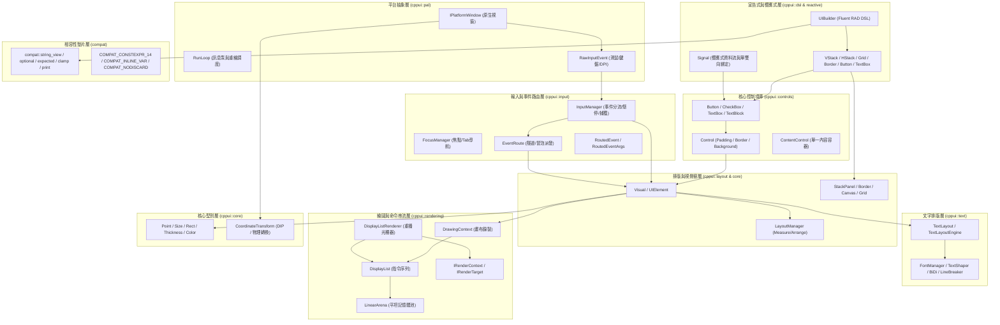

# CPPUI API 參考文件 (API Reference)

歡迎查閱 **CPPUI** 跨平台高效能現代 C++ UI 框架的官方 API 參考文件。本文件體系比照微軟 **MSDN / Microsoft Learn** 規範編寫，提供完整的型別定義、語法宣告、參數說明、微架構備註與實例程式碼。

---

## 1. 架構分層與模組索引 (Architecture & Module Index)

CPPUI 採用嚴格解耦的分層架構設計，自底向上分為平台抽象層 (PAL)、繪圖與命令錄製層 (Rendering)、核心幾何資料型別 (Core)、排版容器 (Layout)、文字管線 (Text)、路由輸入與焦點中樞 (Input)、核心控制項與排版網格 (Controls & Grid)、宣告式 RAD DSL 與響應式信號 (DSL & Reactive) 以及向下相容層 (Compat)：

---

## 2. 命名空間目錄 (Namespaces Directory)

| 命名空間 (Namespace) | 模組標題 | 簡述與職責 | 核心型別導覽 |
| :--- | :--- | :--- | :--- |
| [`cppui::dsl`](namespaces/cppui_dsl.md) | **宣告式 Fluent RAD DSL** | 提供極簡鏈式 UI 建構樣板 `UIBuilder<T>` 與 `VStack`, `HStack`, `Grid`, `Button` 等語意化元件工廠函式。 | [`UIBuilder<T>`](namespaces/cppui_dsl.md), `VStack`, `HStack`, `Grid`, `Border`, `Button`, `TextBox`, `CheckBox`, `Label` |
| [`cppui::reactive`](namespaces/cppui_reactive.md) | **響應式資料流與信號** | 提供零依賴、型別安全且具備弱引用生命週期保護之 `Signal<T>` 狀態信號，實現資料到介面的自動同步與綁定。 | [`Signal<T>`](classes/reactive_signal.md) |
| [`cppui::controls`](namespaces/cppui_controls.md) | **核心 UI 控制項庫** | 實作基礎控制項樣式基底 `Control`、單內容容器 `ContentControl`、互動按鈕 `Button`、核取方塊 `CheckBox` 與文字編輯框 `TextBox`。 | [`Control`](classes/controls_control.md), [`ContentControl`](classes/controls_contentcontrol.md), [`Button`](classes/controls_button.md), [`CheckBox`](classes/controls_checkbox.md), [`TextBox`](classes/controls_textbox.md), [`TextBlock`](classes/controls_textblock.md) |
| [`cppui::core`](namespaces/cppui_core.md) | **核心幾何與色彩** | 提供 2D 坐標、尺寸、矩形邊界、厚度與 RGBA 顏色等基礎 POD 數值型別，座標轉換中樞 [`CoordinateTransform`](classes/core_coordinatetransform.md)，以及視覺樹根基 [`Visual`](classes/core_visual.md) 與排版核心 [`UIElement`](classes/core_uielement.md)。 | [`Visual`](classes/core_visual.md), [`UIElement`](classes/core_uielement.md), [`CoordinateTransform`](classes/core_coordinatetransform.md), [`Point`](classes/core_point.md), [`Size`](classes/core_size.md), [`Rect`](classes/core_rect.md), [`Color`](classes/core_color.md), [`Thickness`](classes/core_thickness.md) |
| [`cppui::input`](namespaces/cppui_input.md) | **輸入管線與路由事件** | 實作微軟 WPF / Avalonia 風格之雙向（隧道 Tunneling + 冒泡 Bubbling）事件路由系統、游標懸停追蹤、指標捕獲與鍵盤 Tab 焦點巡訪中樞。 | [`RoutedEvent`](classes/input_routedevent.md), [`RoutedEventArgs`](classes/input_routedeventargs.md), [`EventRoute`](classes/input_eventroute.md), [`PointerEventArgs`](classes/input_pointereventargs.md), [`KeyEventArgs`](classes/input_keyeventargs.md), [`FocusManager`](classes/input_focusmanager.md), [`InputManager`](classes/input_inputmanager.md) |
| [`cppui::layout`](namespaces/cppui_layout.md) | **排版容器與調度** | 提供雙階段微架構排版管線容器（`Grid`、`StackPanel`、`Border`、`Canvas`）與頂層排版調度管理器 `LayoutManager`。 | [`Grid`](classes/layout_grid.md), [`Panel`](classes/layout_panel.md), [`StackPanel`](classes/layout_stackpanel.md), [`Border`](classes/layout_border.md), [`Canvas`](classes/layout_canvas.md), [`LayoutManager`](classes/layout_layoutmanager.md) |
| [`cppui::pal`](namespaces/cppui_pal.md) | **平台抽象層 (PAL)** | 封裝作業系統原生視窗生命週期、主執行緒低延遲事件循環 (RunLoop) 以及統一輸入事件模型。 | [`IPlatformWindow`](classes/pal_iplatformwindow.md), [`PlatformWindowFactory`](classes/pal_platformwindowfactory.md), [`RunLoop`](classes/pal_runloop.md), [`RawInputEvent`](classes/pal_rawinputevent.md) |
| [`cppui::rendering`](namespaces/cppui_rendering.md) | **繪圖與渲染管線** | 實作高效命令錄製架構，透過自研二進位 DisplayList 與連續平坦 LinearArena 徹底隔離 UI 與光柵化後端。 | [`DrawingContext`](classes/rendering_drawingcontext.md), [`DisplayList`](classes/rendering_displaylist.md), [`DisplayListRenderer`](classes/rendering_displaylistrenderer.md), [`LinearArena`](classes/rendering_lineararena.md), [`DrawOp`](classes/rendering_drawop.md) |
| [`cppui::text`](namespaces/cppui_text.md) | **文字排版與塑形管線** | 雙軌架構文字引擎，支援系統字型匹配、OpenType 字形塑形、BiDi 雙向分析、UAX #14 斷行、多行折行、省略號與雙向命中測試。 | [`FontDescriptor`](classes/text_font.md), [`FontManager`](classes/text_fontmanager.md), [`TextShaper`](classes/text_textshaper.md), [`BiDiAnalyzer`](classes/text_bidianalyzer.md), [`LineBreaker`](classes/text_linebreaker.md), [`TextLayout`](classes/text_textlayout.md), [`TextLayoutEngine`](classes/text_textlayoutengine.md) |
| [`compat`](namespaces/compat.md) | **向下相容與微架構層** | 提供零依賴現代 C++ Polyfill（C++14/17/20/23/26 雙軌切換）與 12 大功能模組。 - [視圖與管道 (`compat::views`)](namespaces/compat_views.md) - [範圍與演算法 (`compat::ranges`)](namespaces/compat_ranges.md) - [錯誤處理 (`compat::expected`)](namespaces/compat_expected.md) - [格式化與終端 (`compat::format/print`)](namespaces/compat_format_print.md) | `compat::string_view`, `compat::span`, `compat::views::*`, `compat::optional`, `compat::expected`, `compat::format`, `compat::print`, `COMPAT_CONSTEXPR_14` |

---

## 3. 核心類別快速索引 (Type Quick Reference)

### 核心控制項與排版網格 (Milestone 6 Controls & Grid)
* [`Control`](classes/controls_control.md)：控制項抽象基底，提供 Padding、Background、Foreground、BorderBrush、BorderThickness、CornerRadius 與 Deflate/Inflate 邊界度量。
* [`ContentControl`](classes/controls_contentcontrol.md)：單內容控制項容器，支援動態文字字串與任意 `UIElement` 自訂子元件。
* [`Button`](classes/controls_button.md)：互動式按鈕，具備 Hover、Pressed、Disabled、獲焦霓虹外框與空白鍵/Enter 點擊狀態機，發布 `ClickEvent`。
* [`CheckBox`](classes/controls_checkbox.md)：核取方塊，具備向量抗鋸齒對稱勾號繪製、狀態切換與 `CheckedEvent`/`UncheckedEvent`。
* [`TextBox`](classes/controls_textbox.md)：單行文字編輯框，支援輸入、退格、Delete、方向鍵左右移動、Home/End、Placeholder、焦點外框與 `TextChangedEvent`。
* [`Grid`](classes/layout_grid.md)：多儲存格網格排版容器，支援 Pixel、Auto、Star (*) 行列比例求解與 `SetRow` / `SetColumn` / `SetRowSpan` / `SetColumnSpan` 附加屬性。
* [`Signal<T>`](classes/reactive_signal.md)：輕量響應式屬性信號樣板，支援值變更推播與弱引用安全的控制項屬性自動綁定。

### 輸入事件與焦點 (Input & Routed Events System)
* [`RoutedEvent`](classes/input_routedevent.md)：路由事件標識元與傳播策略（Tunnel, Bubble, Direct），包含 `StandardEvents` 集合。
* [`RoutedEventArgs`](classes/input_routedeventargs.md)：路由事件參數基底，支援 `SetHandled(true)` 傳播短路。
* [`EventRoute`](classes/input_eventroute.md)：路由管線執行器，依序執行「由根向葉隧道派發」與「由葉向根冒泡派發」。
* [`PointerEventArgs`](classes/input_pointereventargs.md)：指標事件參數，提供客戶區座標、局部座標轉換 (`GetPosition`)、按鍵與滾輪數值。
* [`KeyEventArgs` / `TextInputEventArgs`](classes/input_keyeventargs.md)：實體按鍵（VirtualKey/ScanCode）與文字合成輸入參數。
* [`FocusEventArgs`](classes/input_focuseventargs.md)：焦點轉移參數，提供 `GetOldFocus` 與 `GetNewFocus`。
* [`FocusManager`](classes/input_focusmanager.md)：全域焦點中樞，提供 Tab / Shift+Tab 鍵盤導航與解構保護。
* [`InputManager`](classes/input_inputmanager.md)：輸入中樞，連接 PAL 與視覺樹，管理 Hover 狀態與指標捕獲 (Pointer Capture)。

### 視覺樹與排版 (Visual Tree & Layout Engine)
* [`Visual`](classes/core_visual.md)：視覺樹基底類別，維護親緣關係、局部位移、邊界、座標轉換 (`PointToScreen`)、反向 Z-Order 命中測試與指令流派發。
* [`UIElement`](classes/core_uielement.md)：具備 Margin、Alignment、Min/Max 幾何約束，`Measure` / `Arrange` 雙階段排版管線、髒標記追蹤、事件註冊 (`AddHandler`) 與焦點屬性。
* [`Panel`](classes/layout_panel.md)：多子元件排版容器抽象基底。
* [`StackPanel`](classes/layout_stackpanel.md)：垂直/水平流式排版容器，支援 Spacing 間距與 Collapsed 忽略。
* [`Border`](classes/layout_border.md)：裝飾容器，支援 BorderBrush、BorderThickness、CornerRadius、Background 與 Padding 內縮。
* [`Canvas`](classes/layout_canvas.md)：絕對定位畫布容器，支援 `Canvas::SetLeft` 與 `Canvas::SetTop` 附加屬性。
* [`LayoutManager`](classes/layout_layoutmanager.md)：頂層視窗排版調度器，支援雙階段管線執行與度量統計。
* [`TextBlock`](classes/controls_textblock.md)：文字展示控制項，橋接 M3 文字排版管線並實作顏色修改之純 Visual 髒標記隔離。

### 幾何與數值 (Core Types)
* [`CoordinateTransform`](classes/core_coordinatetransform.md)：坐標轉換類別，提供物理像素與設備無關邏輯像素（DIP）的雙向安全換算。
* [`Point`](classes/core_point.md)：2D 浮點數坐標結構。
* [`Size`](classes/core_size.md)：2D 寬高尺寸結構。
* [`Rect`](classes/core_rect.md)：2D 矩形區域結構，支援交集運算 (`Intersect`) 與點包含測試 (`Contains`)。
* [`Color`](classes/core_color.md)：32-bit RGBA 顏色結構，包含 `Colors` 預設調色盤常數。
* [`Thickness`](classes/core_thickness.md)：邊界厚度結構，用於 Margin / Padding / Border 測量，提供 `Horizontal()` 與 `Vertical()` 輔助方法。

### 平台與視窗 (Platform & Windowing)
* [`IPlatformWindow`](classes/pal_iplatformwindow.md)：跨平台原生視窗抽象介面。
* [`PlatformWindowFactory`](classes/pal_platformwindowfactory.md)：原生視窗實例建構工廠。
* [`RunLoop`](classes/pal_runloop.md)：主執行緒低延遲事件循環與重繪驅動器。
* [`RawInputEvent`](classes/pal_rawinputevent.md)：平台統一原生事件封裝（滑鼠客戶區排版坐標、物理坐標、邏輯坐標、鍵盤、視窗幾何、DPI 變更）。

### 繪圖與命令錄製 (Rendering Pipeline)
* [`DrawingContext`](classes/rendering_drawingcontext.md)：公開畫布錄製介面，提供矩形、圓角矩形、線段繪製與剪裁棧操作。
* [`DisplayList`](classes/rendering_displaylist.md)：二進位繪圖命令串流容器，提供 $O(1)$ 重設與連續記憶體迭代。
* [`DisplayListRenderer`](classes/rendering_displaylistrenderer.md)：命令重播器，負責 Clip Stack 與 Opacity Stack 狀態機維護並分發至後端。
* [`LinearArena`](classes/rendering_lineararena.md)：高速連續平坦記憶體池，保證 8 字節對齊與零鎖定指標位移分配。
* [`DrawOp`](classes/rendering_drawop.md)：二進位命令協定（`DrawOpHeader` 與各負載結構）。
* [`IRenderContext`](classes/rendering_irendercontext.md)：渲染後端介面與雙緩衝光柵化目標 (`IRenderTarget`)。

### 文字排版與字型 (Text Pipeline & Typography)
* [`FontDescriptor`](classes/text_font.md)：字型規格與樣式描述（字號、粗細 `FontWeight`、傾斜 `FontStyle`、字型度量 `FontMetrics`）。
* [`FontManager`](classes/text_fontmanager.md)：系統字型匹配與快取中樞（預設 UI 字型、繁中字型、等寬字型）。
* [`TextShaper`](classes/text_textshaper.md)：OpenType 字符塑形器與連續塑形切片 (`ShapedRun`, `ShapedGlyph`)。
* [`BiDiAnalyzer`](classes/text_bidianalyzer.md)：Unicode UAX #9 雙向文字段落分析器（LTR / RTL 區段切分與視覺重排）。
* [`LineBreaker`](classes/text_linebreaker.md)：Unicode UAX #14 換行斷詞分析器（支援 CJK 標點禁則規範）。
* [`TextLayout`](classes/text_textlayout.md)：多行排版模型，支援多行折行、居中/靠右對齊、省略號裁切與雙向精準命中測試 (`HitTestPoint`, `HitTestTextPosition`)。
* [`TextLayoutEngine`](classes/text_textlayoutengine.md)：高階排版求解器與每秒百萬次高速文字度量工廠 (`MeasureText`)。

---

## 4. 實戰與概念指南 (Guides & Tutorials)

* [**宣告式 Fluent RAD DSL 與響應式信號開發指南**](guides/fluent_rad_dsl_and_signals.md)：詳解以 `< 50` 行程式碼使用 `VStack`, `HStack`, `Grid`, `Button`, `TextBox` 與 `Signal<T>` 快速宣告桌面 UI、自動雙向資料綁定與事件串接。
* [**快速入門 (Quickstart)**](guides/quickstart.md)：從零建立第一個 CPPUI 原生視窗、綁定事件循環並完成每秒 60 FPS 畫面繪製。
* [**輸入管線、路由事件與焦點管理實戰指南**](guides/input_and_routed_events.md)：深入探討雙向路由事件體系（Tunneling + Bubbling）、`e.Handled` 短路阻斷、游標懸停追蹤、指標捕獲與鍵盤 TabIndex 尋路演算法。
* [**高分屏 DPI 與座標轉換指南**](guides/dpi_and_coordinates.md)：說明設備獨立像素 (DIP)、物理像素、客戶區排版空間與 `CoordinateTransform` 類別的最佳實踐。
* [**DisplayList 二進位錄製深度解析**](guides/display_list_recording.md)：深入探討命令錄製架構、記憶體池重用、Clip Stack 矩形剪裁與每秒數千萬次操作之微架構調優。
* [**工業級文字排版與雙向命中測試指南**](guides/text_shaping_and_layout.md)：詳解文字塑形、多行折行、CJK 標點禁則、省略號裁切與文字編輯器游標定位技術。
* [**雙階段排版管線與髒標記追蹤指南**](guides/layout_pipeline_and_dirty_tracking.md)：詳解 Measure / Arrange 雙階段排版微架構、容器約束、對齊求解與精確髒標記隔離機制。

---

## 5. 跨標準相容性契約 (Compatibility Matrix)

本 API 在以下主流編譯器與語言標準下通過了全矩陣測試（**108/108 通過，12 賽道 x 9 標靶，零報錯、零警告**）：

| 編譯器 | C++14 | C++17 | C++20 | C++23 / Latest | 通過率 |
| :--- | :---: | :---: | :---: | :---: | :---: |
| **Clang++ (LLVM 19)** | ✔ 通過 (9/9) | ✔ 通過 (9/9) | ✔ 通過 (9/9) | ✔ 通過 (9/9) | 36/36 (100%) |
| **G++ (MinGW UCRT64 14.2)** | ✔ 通過 (9/9) | ✔ 通過 (9/9) | ✔ 通過 (9/9) | ✔ 通過 (9/9) | 36/36 (100%) |
| **MSVC (cl.exe 19.50)** | ✔ 通過 (9/9) | ✔ 通過 (9/9) | ✔ 通過 (9/9) | ✔ 通過 (9/9) | 36/36 (100%) |
| **矩陣合計** | **27/27 PASS** | **27/27 PASS** | **27/27 PASS** | **27/27 PASS** | **108/108 (100%)** |
