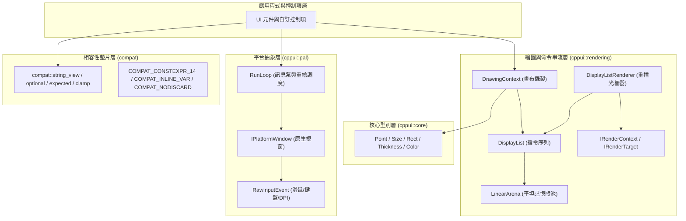

# CPPUI API 參考文件 (API Reference)

歡迎查閱 **CPPUI** 跨平台高效能現代 C++ UI 框架的官方 API 參考文件。本文件體系比照微軟 **MSDN / Microsoft Learn** 規範編寫，提供完整的型別定義、語法宣告、參數說明、微架構備註與實例程式碼。

---

## 1. 架構分層與模組索引 (Architecture & Module Index)

CPPUI 採用嚴格解耦的分層架構設計，自底向上分為平台抽象層 (PAL)、繪圖與命令錄製層 (Rendering)、核心幾何資料型別 (Core) 以及向下相容層 (Compat)：

---

## 2. 命名空間目錄 (Namespaces Directory)

| 命名空間 (Namespace) | 模組標題 | 簡述與職責 | 核心型別導覽 |
| :--- | :--- | :--- | :--- |
| [`cppui::core`](namespaces/cppui_core.md) | **核心幾何與色彩** | 提供 2D 座標、尺寸、矩形邊界、厚度與 RGBA 顏色等基礎 POD 數值型別，支援編譯期求值 (`constexpr`)。 | [`Point`](classes/core_point.md), [`Size`](classes/core_size.md), [`Rect`](classes/core_rect.md), [`Color`](classes/core_color.md), [`Thickness`](classes/core_thickness.md) |
| [`cppui::pal`](namespaces/cppui_pal.md) | **平台抽象層 (PAL)** | 封裝作業系統原生視窗生命週期、主執行緒低延遲事件循環 (RunLoop) 以及統一輸入事件模型。 | [`IPlatformWindow`](classes/pal_iplatformwindow.md), [`PlatformWindowFactory`](classes/pal_platformwindowfactory.md), [`RunLoop`](classes/pal_runloop.md), [`RawInputEvent`](classes/pal_rawinputevent.md) |
| [`cppui::rendering`](namespaces/cppui_rendering.md) | **繪圖與渲染管線** | 實作高效命令錄製架構，透過自研二進位 DisplayList 與連續平坦 LinearArena 徹底隔離 UI 與光柵化後端。 | [`DrawingContext`](classes/rendering_drawingcontext.md), [`DisplayList`](classes/rendering_displaylist.md), [`DisplayListRenderer`](classes/rendering_displaylistrenderer.md), [`LinearArena`](classes/rendering_lineararena.md), [`DrawOp`](classes/rendering_drawop.md) |
| [`compat`](namespaces/compat.md) | **向下相容與微架構層** | 提供零依賴現代 C++ Polyfill（C++14/17/20/23 跨標準切換）與內聯/分支最佳化巨集契約。 | `compat::string_view`, `compat::optional`, `compat::expected`, `compat::clamp`, `COMPAT_CONSTEXPR_14`, `COMPAT_INLINE_VAR` |

---

## 3. 核心類別快速索引 (Type Quick Reference)

### 幾何與數值 (Core Types)
* [`Point`](classes/core_point.md)：2D 浮點數座標結構。
* [`Size`](classes/core_size.md)：2D 寬高尺寸結構。
* [`Rect`](classes/core_rect.md)：2D 矩形區域結構，支援交集運算 (`Intersect`) 與點包含測試 (`Contains`)。
* [`Color`](classes/core_color.md)：32-bit RGBA 顏色結構，包含 `Colors` 預設調色盤常數。
* [`Thickness`](classes/core_thickness.md)：邊界厚度結構，用於 Margin / Padding / Border 測量。

### 平台與視窗 (Platform & Windowing)
* [`IPlatformWindow`](classes/pal_iplatformwindow.md)：跨平台原生視窗抽象介面。
* [`PlatformWindowFactory`](classes/pal_platformwindowfactory.md)：原生視窗實例建構工廠。
* [`RunLoop`](classes/pal_runloop.md)：主執行緒低延遲事件循環與重繪驅動器。
* [`RawInputEvent`](classes/pal_rawinputevent.md)：平台統一原生事件封裝（滑鼠、鍵盤、視窗幾何、DPI 變更）。

### 繪圖與命令錄製 (Rendering Pipeline)
* [`DrawingContext`](classes/rendering_drawingcontext.md)：公開畫布錄製介面，提供矩形、圓角矩形、線段繪製與剪裁棧操作。
* [`DisplayList`](classes/rendering_displaylist.md)：二進位繪圖命令串流容器，提供 $O(1)$ 重設與連續記憶體迭代。
* [`DisplayListRenderer`](classes/rendering_displaylistrenderer.md)：命令重播器，負責 Clip Stack 與 Opacity Stack 狀態機維護並分發至後端。
* [`LinearArena`](classes/rendering_lineararena.md)：高速連續平坦記憶體池，保證 8 字節對齊與零鎖定指標位移分配。
* [`DrawOp`](classes/rendering_drawop.md)：二進位命令協定（`DrawOpHeader` 與各負載結構）。
* [`IRenderContext`](classes/rendering_irendercontext.md)：渲染後端介面與雙緩衝光柵化目標 (`IRenderTarget`)。

---

## 4. 實戰與概念指南 (Guides & Tutorials)

* [**快速入門 (Quickstart)**](guides/quickstart.md)：從零建立第一個 CPPUI 原生視窗、綁定事件循環並完成每秒 60 FPS 畫面繪製。
* [**DisplayList 二進位錄製深度解析**](guides/display_list_recording.md)：深入探討命令錄製架構、記憶體池重用、Clip Stack 矩形剪裁與每秒數千萬次操作之微架構調優。
* [**高分屏 DPI 與座標轉換指南**](guides/dpi_and_coordinates.md)：說明設備獨立像素 (DIP)、物理像素與 Windows 多螢幕動態 DPI 縮放的計算原理與事件對接。

---

## 5. 跨標準相容性契約 (Compatibility Matrix)

本 API 在以下主流編譯器與語言標準下通過了全矩陣測試（36/36 通過，零報錯、零警告）：

| 編譯器 | C++14 | C++17 | C++20 | C++23 / Latest |
| :--- | :---: | :---: | :---: | :---: |
| **Clang++ (LLVM)** | ✔ 通過 | ✔ 通過 | ✔ 通過 | ✔ 通過 |
| **G++ (MinGW UCRT64)** | ✔ 通過 | ✔ 通過 | ✔ 通過 | ✔ 通過 |
| **MSVC (cl.exe)** | ✔ 通過 | ✔ 通過 | ✔ 通過 | ✔ 通過 |
