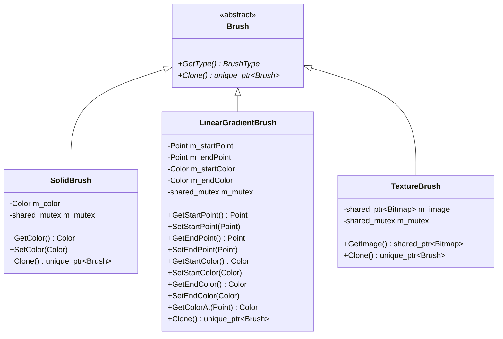

# Brush 類別家族 (cppui::graphics::Brush)

`Brush` 家族為 CPPUI 封閉幾何圖形區域填滿（如矩形、多邊形、橢圓、路徑）與文字繪製的樣式基底。它借鏡 GDI+ 設計，提供多型畫刷架構，包含**純色畫刷 (`SolidBrush`)**、**線性漸層畫刷 (`LinearGradientBrush`)** 以及**紋理材質畫刷 (`TextureBrush`)**。

所有畫刷內部皆封裝讀寫鎖（`mutable std::shared_mutex`），保證跨執行緒安全存取與防止資料競爭 (Data Race)。

---

## 1. 元資料與類別層級 (Hierarchy & Metadata)

* **命名空間**：[`cppui::graphics`](../namespaces/cppui_graphics.md)
* **標頭檔**：`#include "ui/graphics/Brush.hpp"`
* **實作檔**：`src/graphics/Brush.cpp`



---

## 2. 跨執行緒自動同步模型 (Thread Safety Architecture)

為了支援現代 UI 框架的高並發場景（如：後台背景執行緒動態更新漸層色彩，UI 渲染執行緒並行採樣），所有具體畫刷類別皆採用嚴格的讀寫鎖協議：

1. **並發讀取（無阻塞）**：
   - 包含 `GetColor()`, `GetStartPoint()`, `GetColorAt(pt)`, `GetImage()`, `Clone()` 等查詢方法。
   - 自動套用 `std::shared_lock<std::shared_mutex>`，多個執行緒可同時並發讀取。
2. **排他寫入（獨佔保護）**：
   - 包含 `SetColor()`, `SetStartPoint()`, `SetEndPoint()`, `SetStartColor()`, `SetEndColor()` 等修改狀態方法。
   - 自動套用 `std::unique_lock<std::shared_mutex>`，保證寫入時沒有其他執行緒正在讀取或寫入。
3. **防死鎖拷貝賦值**：
   - 在執行 `operator=(const Brush& other)` 時，使用標準庫 `std::lock(m_mutex, other.m_mutex)` 雙重鎖定演算法，徹底消除 AB-BA 死鎖隱患。

---

## 3. 抽象基底類別：`Brush`

```cpp
namespace cppui {
namespace graphics {

class Brush {
public:
    virtual ~Brush() = default;

    /// <summary>取得具體畫刷型別標記。</summary>
    COMPAT_NODISCARD virtual BrushType GetType() const noexcept = 0;

    /// <summary>多型深拷貝畫刷物件。</summary>
    COMPAT_NODISCARD virtual std::unique_ptr<Brush> Clone() const = 0;
};

} // namespace graphics
} // namespace cppui
```

* **`GetType()`**：傳回 [`BrushType`](graphics_enums.md#8-畫刷具體類型列舉-brushtype) 列舉值（`SolidColor`, `LinearGradient`, `Texture`），利於底層渲染引擎進行模式分發。
* **`Clone()`**：傳回包含目前畫刷所有屬性狀態之獨立 `std::unique_ptr<Brush>` 副本。

---

## 4. 純色畫刷：`SolidBrush`

`SolidBrush` 以單一色彩填滿封閉區域。

### API 語法

```cpp
class SolidBrush : public Brush {
public:
    explicit SolidBrush(core::Color color);
    SolidBrush(const SolidBrush& other);
    SolidBrush(SolidBrush&& other) noexcept;
    SolidBrush& operator=(const SolidBrush& other);
    SolidBrush& operator=(SolidBrush&& other) noexcept;
    ~SolidBrush() override = default;

    COMPAT_NODISCARD core::Color GetColor() const;
    void SetColor(core::Color color);

    COMPAT_NODISCARD BrushType GetType() const noexcept override;
    COMPAT_NODISCARD std::unique_ptr<Brush> Clone() const override;
};
```

### 成員函數詳解

| 方法 | 參數 | 說明 | 執行緒安全性 |
| :--- | :--- | :--- | :--- |
| `SolidBrush(color)` | `core::Color color` | 建構指定色彩的純色畫刷。 | 建構階段本機安全。 |
| `GetColor()` | 無 | 取得目前填色色彩。 | `std::shared_lock` (多讀安全)。 |
| `SetColor(color)` | `core::Color color` | 更新填色色彩。 | `std::unique_lock` (獨佔防護)。 |
| `Clone()` | 無 | 複製獨立副本。 | 讀取時受鎖保護。 |

> [!TIP]
> 若需使用常見標準色彩，可直接使用靜態集合 [`Brushes`](graphics_brushes.md)（如 `Brushes::Red()`, `Brushes::SteelBlue()`），免去頻繁建構與銷毀的記憶體開銷。

---

## 5. 線性漸層畫刷：`LinearGradientBrush`

`LinearGradientBrush` 在兩點或矩形角度方向之間產生平滑雙色插值漸層。

### API 語法

```cpp
class LinearGradientBrush : public Brush {
public:
    // 依據起點、終點與雙色建構
    LinearGradientBrush(core::Point p1, core::Point p2, core::Color c1, core::Color c2);

    // 依據矩形邊界、雙色與旋轉角度建構
    LinearGradientBrush(const core::Rect& rect, core::Color c1, core::Color c2, float angleDegrees);

    LinearGradientBrush(const LinearGradientBrush& other);
    LinearGradientBrush(LinearGradientBrush&& other) noexcept;
    LinearGradientBrush& operator=(const LinearGradientBrush& other);
    LinearGradientBrush& operator=(LinearGradientBrush&& other) noexcept;
    ~LinearGradientBrush() override = default;

    COMPAT_NODISCARD core::Point GetStartPoint() const;
    void SetStartPoint(core::Point p);

    COMPAT_NODISCARD core::Point GetEndPoint() const;
    void SetEndPoint(core::Point p);

    COMPAT_NODISCARD core::Color GetStartColor() const;
    void SetStartColor(core::Color c);

    COMPAT_NODISCARD core::Color GetEndColor() const;
    void SetEndColor(core::Color c);

    // 空間座標色彩插值運算
    COMPAT_NODISCARD core::Color GetColorAt(core::Point pt) const;

    COMPAT_NODISCARD BrushType GetType() const noexcept override;
    COMPAT_NODISCARD std::unique_ptr<Brush> Clone() const override;
};
```

### 空間座標插值演算法 (`GetColorAt`)

`LinearGradientBrush` 支援任意二維空間點 `pt` 的色彩求值。計算過程如下：
1. 定義漸層方向向量 $\vec{D} = \mathbf{P_2} - \mathbf{P_1}$，長度平方 $L^2 = D_x^2 + D_y^2$。
2. 計算測試點向量 $\vec{V} = \mathbf{pt} - \mathbf{P_1}$。
3. 投影計算純量參數 $t = \frac{\vec{V} \cdot \vec{D}}{L^2}$。
4. 將 $t$ 夾止於 $[0.0, 1.0]$ 區間（$t \le 0$ 取起始色，$t \ge 1$ 取終止色）。
5. 對 R, G, B, A 四通道進行線性插值：
   $$C(t) = \text{round}(C_1 \times (1 - t) + C_2 \times t)$$

---

## 6. 點陣材質畫刷：`TextureBrush`

`TextureBrush` 使用 32-bit [`Bitmap`](graphics_bitmap.md) 作為重複平鋪或材質填充紋理。

### API 語法

```cpp
class TextureBrush : public Brush {
public:
    explicit TextureBrush(std::shared_ptr<Bitmap> image);
    TextureBrush(const TextureBrush& other);
    TextureBrush(TextureBrush&& other) noexcept;
    TextureBrush& operator=(const TextureBrush& other);
    TextureBrush& operator=(TextureBrush&& other) noexcept;
    ~TextureBrush() override = default;

    COMPAT_NODISCARD std::shared_ptr<Bitmap> GetImage() const;

    COMPAT_NODISCARD BrushType GetType() const noexcept override;
    COMPAT_NODISCARD std::unique_ptr<Brush> Clone() const override;
};
```

### 例外與前置檢查

* **`TextureBrush(image)`**：
  * **前置條件**：`image` 不可為 `nullptr`。
  * **例外規格**：若傳入 `image == nullptr`，立即擲出 `std::invalid_argument("TextureBrush: image cannot be null.")`。

---

## 7. 範例程式碼 (Examples)

### 7.1 線性漸層填充幾何圖形

```cpp
#include "ui/graphics/Graphics.hpp"
#include "ui/graphics/Brush.hpp"
#include "ui/graphics/Colors.hpp"

void DrawGradientCard(cppui::graphics::Graphics& g) {
    // 建立從深紫紅到珊瑚紅的對角線漸層
    core::Point startPt(0.0f, 0.0f);
    core::Point endPt(300.0f, 200.0f);
    cppui::graphics::LinearGradientBrush gradient(
        startPt, endPt,
        cppui::graphics::Colors::DarkSlateBlue,
        cppui::graphics::Colors::Coral
    );

    // 填滿圓角矩形
    g.FillRoundedRectangle(gradient, core::Rect(0.0f, 0.0f, 300.0f, 200.0f), 16.0f);
}
```

### 7.2 點陣材質畫刷 (TextureBrush)

```cpp
#include "ui/graphics/Graphics.hpp"
#include "ui/graphics/Bitmap.hpp"
#include "ui/graphics/Brush.hpp"

void FillWithPattern(cppui::graphics::Graphics& g, std::shared_ptr<cppui::graphics::Bitmap> patternBmp) {
    // 依據圖形建立材質畫刷
    cppui::graphics::TextureBrush texture(patternBmp);

    // 填滿圓形
    g.FillEllipse(texture, core::Rect(50.0f, 50.0f, 200.0f, 200.0f));
}
```

### 7.3 多執行緒動態色彩更新

```cpp
#include <thread>
#include "ui/graphics/Brush.hpp"
#include "ui/graphics/Colors.hpp"

void AnimateBrushColor() {
    cppui::graphics::SolidBrush dynamicBrush(cppui::graphics::Colors::Blue);

    // 背景執行緒平滑修改色彩 (排他獨佔寫入)
    std::thread animator([&dynamicBrush]() {
        for (uint8_t r = 0; r < 255; ++r) {
            dynamicBrush.SetColor(cppui::core::Color(r, 100, 200));
            std::this_thread::sleep_for(std::chrono::milliseconds(10));
        }
    });

    // 主執行緒隨時讀取 (共用讀取，無阻塞與崩潰)
    cppui::core::Color currentColor = dynamicBrush.GetColor();

    animator.join();
}
```

---

## 8. 請參閱 (See Also)

* [`Brushes` 常用標準純色畫刷集合](graphics_brushes.md)
* [`Color` 色彩結構詳解](graphics_color.md)
* [`Bitmap` 點陣影像詳解](graphics_bitmap.md)
* [`Graphics` 繪圖中樞排程器](graphics_graphics.md)
* [`GraphicsTypes` 列舉型別字典](graphics_enums.md)
