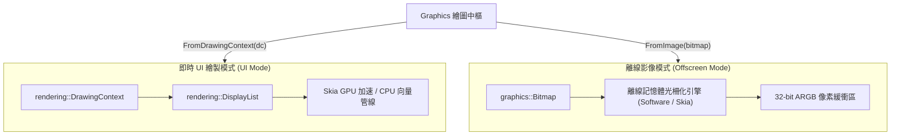

# Graphics 類別 (cppui::graphics::Graphics)

`Graphics` 類別借鏡經典 GDI+ (`System.Drawing.Graphics`) 與現代高效能 2D 向量繪圖庫設計，扮演 CPPUI 2D 向量圖形繪製與狀態管理的中樞排程器。它將畫筆（[`Pen`](graphics_pen.md)）、畫刷（[`Brush`](graphics_brush.md)）、幾何路徑（[`GraphicsPath`](graphics_path.md)）與點陣影像（[`Bitmap`](graphics_bitmap.md)）徹底解耦為獨立一級領域物件，由 `Graphics` 統一協調繪製命令。

---

## 1. 元資料與架構定位 (Metadata & Architecture)

* **命名空間**：[`cppui::graphics`](../namespaces/cppui_graphics.md)
* **標頭檔**：`#include "ui/graphics/Graphics.hpp"`
* **實作檔**：`src/graphics/Graphics.cpp`
* **相容性規範**：遵循 C++14 / C++17 / C++20，無平台相依型別（全固定寬度整數與 `float`）。

### 雙模式架構 (Dual-Mode Execution Architecture)

`Graphics` 提供一致的物件導向 API，並可在兩種截然不同的渲染後端模式下運作：



1. **即時 UI 繪製模式 (`FromDrawingContext`)**：
   - 用於控制項生命週期中（如 `Control::OnRender(DrawingContext& dc)`）。
   - 將所有繪圖呼叫無鎖轉換為 `DrawOp` 節點錄製至 `DisplayList` 記憶體池中，後續直通 Skia GPU 向量加速管線或純 CPU 備援管線進行即時畫面重繪。
2. **離線影像渲染模式 (`FromImage`)**：
   - 用於背景工作執行緒中對 `std::shared_ptr<Bitmap>` 進行純記憶體光柵繪製。
   - 所有繪圖操作皆在記憶體點陣緩衝區中光柵化，於呼叫 `Flush()` 或物件解構時自動提交寫入像素緩衝區。

---

## 2. 語法與建構子 (Constructors & Factory Methods)

### 工廠方法與建構子語法

```cpp
namespace cppui {
namespace graphics {

class Graphics {
public:
    // 工廠方法
    COMPAT_NODISCARD static Graphics FromDrawingContext(rendering::DrawingContext& dc);
    COMPAT_NODISCARD static Graphics FromImage(std::shared_ptr<Bitmap> image);

    // 顯式建構子
    explicit Graphics(rendering::DrawingContext& dc);
    explicit Graphics(std::shared_ptr<Bitmap> image);

    // 移動語意 (支援)
    Graphics(Graphics&& other) noexcept;
    Graphics& operator=(Graphics&& other) noexcept;

    // 拷貝語意 (禁用：持有專屬繪圖畫布狀態與指標)
    Graphics(const Graphics&) = delete;
    Graphics& operator=(const Graphics&) = delete;

    // 解構子
    ~Graphics();
};

} // namespace graphics
} // namespace cppui
```

### 建構與解構說明

| 方法 / 建構子 | 參數 | 說明 | 異常處理 / 前置條件 |
| :--- | :--- | :--- | :--- |
| `FromDrawingContext(dc)` | `rendering::DrawingContext& dc` | 靜態工廠：從 UI 繪製上下文建構即時繪製實例。 | 保證無例外。 |
| `FromImage(image)` | `std::shared_ptr<Bitmap> image` | 靜態工廠：從點陣影像建構離線光柵渲染實例。 | 若 `image == nullptr` 立即擲出 `std::invalid_argument`。 |
| `explicit Graphics(dc)` | `rendering::DrawingContext& dc` | 直接以 UI 上下文建構。 | 保證無例外。 |
| `explicit Graphics(image)`| `std::shared_ptr<Bitmap> image` | 直接以點陣影像建構。 | 若 `image == nullptr` 立即擲出 `std::invalid_argument`。 |
| `~Graphics()` | 無 | 解構子。在離線影像模式下會自動隱式呼叫 `Flush()` 提交未寫入命令。 | 保證無例外。 |

---

## 3. 畫布狀態與幾何變換 API (Canvas State & Transforms)

`Graphics` 維護一個內部繪圖狀態堆疊，包含當前仿射變換矩陣（平移、縮放、旋轉）、剪裁矩形、平滑化模式與插值模式。

### API 簽名

```cpp
uint32_t Save();
void Restore(uint32_t stateId);

void TranslateTransform(float dx, float dy);
void ScaleTransform(float sx, float sy);
void RotateTransform(float angleDegrees);
void ResetTransform();

void SetClip(const core::Rect& rect);
void SetClip(const GraphicsPath& path);
void ResetClip();
COMPAT_NODISCARD core::Rect GetClipBounds() const;

void SetSmoothingMode(SmoothingMode mode);
COMPAT_NODISCARD SmoothingMode GetSmoothingMode() const;

void SetInterpolationMode(InterpolationMode mode);
COMPAT_NODISCARD InterpolationMode GetInterpolationMode() const;

void Clear(core::Color color);
void Flush();
```

### 詳細功能說明

| 方法 | 參數 | 回傳值 | 說明 |
| :--- | :--- | :--- | :--- |
| `Save()` | 無 | `uint32_t` (狀態 Token) | 儲存目前畫布完整狀態（變換矩陣、剪裁區、平滑度、插值模式）至狀態堆疊，並傳回非零狀態識別碼。 |
| `Restore(stateId)` | `uint32_t stateId` | `void` | 回復至先前由 `Save()` 回傳的指定狀態 Token。若 Token 無效則靜默忽略。 |
| `TranslateTransform(dx, dy)` | `float dx, float dy` | `void` | 將當前坐標系沿 X 軸平移 `dx` 像素、沿 Y 軸平移 `dy` 像素。 |
| `ScaleTransform(sx, sy)` | `float sx, float sy` | `void` | 將當前坐標系沿 X 軸縮放 `sx` 倍、沿 Y 軸縮放 `sy` 倍。 |
| `RotateTransform(angleDegrees)` | `float angleDegrees` | `void` | 繞當前坐標原點順時針旋轉指定角度（單位：度）。 |
| `ResetTransform()` | 無 | `void` | 重設幾何變換為單位矩陣（無平移、無縮放、無旋轉）。 |
| `SetClip(rect)` | `const core::Rect& rect` | `void` | 設定軸對齊矩形剪裁邊界。後續繪圖僅在此矩形內部呈現。 |
| `SetClip(path)` | `const GraphicsPath& path` | `void` | 設定由幾何路徑包圍之任意形狀剪裁區域。 |
| `ResetClip()` | 無 | `void` | 清除剪裁區域約束，恢復為無邊界畫布。 |
| `GetClipBounds()` | 無 | `core::Rect` | 取得目前有效剪裁區域之外接矩形。 |
| `SetSmoothingMode(mode)` | [`SmoothingMode`](graphics_enums.md#5-平滑化反鋸齒模式-smoothingmode) | `void` | 設定向量線條與邊緣平滑化模式（如 `AntiAlias` 反鋸齒或 `HighSpeed` 高速光柵化）。 |
| `GetSmoothingMode()` | 無 | `SmoothingMode` | 取得目前平滑化反鋸齒模式。 |
| `SetInterpolationMode(mode)` | [`InterpolationMode`](graphics_enums.md#6-影像縮放插值模式-interpolationmode) | `void` | 設定點陣影像縮放採樣濾鏡（如 `Bilinear`, `Bicubic`, `NearestNeighbor`）。 |
| `GetInterpolationMode()` | 無 | `InterpolationMode` | 取得目前影像縮放插值模式。 |
| `Clear(color)` | `core::Color color` | `void` | 以指定色彩填滿清除整幅畫布背景。 |
| `Flush()` | 無 | `void` | 強制提交並執行所有待光柵化的渲染指令。 |

---

## 4. 幾何圖元描邊與填滿 API (Stroking & Filling Primitives)

`Graphics` 對標 GDI+，將**輪廓描邊 (`Draw*`)** 與**區域填滿 (`Fill*`)** 區分：
- 描邊操作必須傳入 [`Pen`](graphics_pen.md) 物件（指定線寬、色彩、虛線、端點）。
- 填滿操作必須傳入 [`Brush`](graphics_brush.md) 物件（支援純色、線性漸層、紋理貼圖）。

### 直線與多段折線 (Lines)

```cpp
void DrawLine(const Pen& pen, core::Point pt1, core::Point pt2);
void DrawLine(const Pen& pen, float x1, float y1, float x2, float y2);
void DrawLines(const Pen& pen, compat::span<const core::Point> points);
```
* **`DrawLine`**：繪製連接兩點的線段。
* **`DrawLines`**：繪製連續相連的折線。傳入點陣列長度小於 2 時靜默不作任何操作。

### 矩形與多重矩形 (Rectangles)

```cpp
void DrawRectangle(const Pen& pen, const core::Rect& rect);
void DrawRectangle(const Pen& pen, float x, float y, float width, float height);
void DrawRectangles(const Pen& pen, compat::span<const core::Rect> rects);

void FillRectangle(const Brush& brush, const core::Rect& rect);
void FillRectangle(const Brush& brush, float x, float y, float width, float height);
void FillRectangles(const Brush& brush, compat::span<const core::Rect> rects);
```
* **描邊**：`DrawRectangle` 沿矩形外框描繪。
* **填滿**：`FillRectangle` 填滿矩形內部實心區域。

### 圓角矩形 (Rounded Rectangles)

```cpp
void DrawRoundedRectangle(const Pen& pen, const core::Rect& rect, float radius);
void FillRoundedRectangle(const Brush& brush, const core::Rect& rect, float radius);
```
* **參數**：
  * `rect`：外接矩形邊界。
  * `radius`：四個角落之圓角半徑像素值（若大於寬高的一半則自動適應夾止）。

### 橢圓與圓弧 (Ellipses & Arcs)

```cpp
void DrawEllipse(const Pen& pen, const core::Rect& rect);
void DrawEllipse(const Pen& pen, float x, float y, float width, float height);
void FillEllipse(const Brush& brush, const core::Rect& rect);
void FillEllipse(const Brush& brush, float x, float y, float width, float height);

void DrawArc(const Pen& pen, const core::Rect& rect, float startAngle, float sweepAngle);
```
* **`DrawEllipse` / `FillEllipse`**：在給定邊界矩形內繪製內切橢圓（或圓形）。
* **`DrawArc`**：沿內切橢圓輪廓繪製圓弧，`startAngle` 為起始角度（度，0 為 3 點鐘方向），`sweepAngle` 為順時針掃掠角度。

### 扇形 (Pies)

```cpp
void DrawPie(const Pen& pen, const core::Rect& rect, float startAngle, float sweepAngle);
void FillPie(const Brush& brush, const core::Rect& rect, float startAngle, float sweepAngle);
```
* 繪製包含圓弧與由圓心連至弧兩端半徑之封閉扇形區域。

### 多邊形 (Polygons)

```cpp
void DrawPolygon(const Pen& pen, compat::span<const core::Point> points);
void FillPolygon(const Brush& brush, compat::span<const core::Point> points, FillMode fillMode = FillMode::Alternate);
```
* 自動在最後一點與第一點之間閉合連線。
* `fillMode` 支援 [`FillMode::Alternate`](graphics_enums.md#4-幾何路徑填色規則-fillmode)（奇偶交替射線法）或 [`FillMode::Winding`](graphics_enums.md#4-幾何路徑填色規則-fillmode)（非零卷繞數規則）。

### 貝茲曲線與平滑曲線 (Curves & Splines)

```cpp
void DrawBezier(const Pen& pen, core::Point pt1, core::Point pt2, core::Point pt3, core::Point pt4);
void DrawBeziers(const Pen& pen, compat::span<const core::Point> points);
void DrawCurve(const Pen& pen, compat::span<const core::Point> points);
```
* **`DrawBezier`**：繪製單條三次貝茲曲線（起點 `pt1`、控制點 `pt2`、控制點 `pt3`、終點 `pt4`）。
* **`DrawBeziers`**：繪製連續三次貝茲曲線序列（點數必須為 $3n + 1$）。
* **`DrawCurve`**：通過傳入點集合的平滑 Catmull-Rom 樣條曲線。

### 幾何路徑 (GraphicsPath)

```cpp
void DrawPath(const Pen& pen, const GraphicsPath& path);
void FillPath(const Brush& brush, const GraphicsPath& path);
```
* 繪製由 [`GraphicsPath`](graphics_path.md) 封裝的任意複雜向量圖形（包含多條子路徑、空心輪廓與複合圖形）。

---

## 5. 點陣影像繪製 API (Bitmap Image Rendering)

```cpp
void DrawImage(std::shared_ptr<Bitmap> image, const core::Rect& destRect);
void DrawImage(std::shared_ptr<Bitmap> image, const core::Rect& destRect, const core::Rect& srcRect);
void DrawImage(std::shared_ptr<Bitmap> image, float x, float y);
void DrawImage(std::shared_ptr<Bitmap> image, float x, float y, float width, float height);
void DrawImageUnscaled(std::shared_ptr<Bitmap> image, core::Point origin);
```

### 影像繪製多載詳解

| 多載簽名 | 說明 |
| :--- | :--- |
| `DrawImage(image, destRect)` | 將整幅 `Bitmap` 拉伸或壓縮繪製至目標矩形 `destRect`。 |
| `DrawImage(image, destRect, srcRect)` | 裁切來源影像中的 `srcRect` 區域，並映射縮放至目標 `destRect` 範圍。 |
| `DrawImage(image, x, y)` | 於指定座標 `(x, y)` 以影像原始像素尺寸進行繪製。 |
| `DrawImage(image, x, y, width, height)`| 於指定位置 `(x, y)` 並依 `width` 與 `height` 進行縮放繪製。 |
| `DrawImageUnscaled(image, origin)` | 於 `origin` 座標以 1:1 像素無縮放繪製。 |

> [!NOTE]
> 若傳入 `image == nullptr`，所有 `DrawImage` 方法皆進行安全防護，靜默略過而不引發記憶體存取違規。

---

## 6. 文字排版與度量 API (Text Typography)

```cpp
void DrawString(compat::string_view text, const text::FontDescriptor& font, const Brush& brush, core::Point origin);
void DrawString(compat::string_view text, const text::FontDescriptor& font, const Brush& brush, const core::Rect& layoutRect);
COMPAT_NODISCARD core::Size MeasureString(compat::string_view text, const text::FontDescriptor& font);
```

* **`DrawString(origin)`**：從指定基準點 `origin` 開始繪製單行文字。
* **`DrawString(layoutRect)`**：在指定的矩形排版邊界內進行繪製（支援多行文字換行與剪裁）。
* **`MeasureString(text, font)`**：依據字型屬性計算文字在畫布上渲染所需的最小寬高尺寸（`core::Size`），不產生任何繪圖命令。

---

## 7. RAII 狀態守衛 (`Graphics::StateScope`)

為了避免手動配對 `Save()` 與 `Restore()` 可能因分支或異常導致的畫布狀態洩漏，`Graphics` 提供巢狀 RAII 守衛輔助類別：

```cpp
class StateScope {
public:
    explicit StateScope(Graphics& g);
    ~StateScope();
};
```

### 使用範式

```cpp
void RenderCard(graphics::Graphics& g) {
    // 進入範圍：自動 g.Save()
    graphics::Graphics::StateScope scope(g);

    g.TranslateTransform(50.0f, 50.0f);
    g.RotateTransform(45.0f);
    g.FillRectangle(graphics::Brushes::SteelBlue(), core::Rect(0, 0, 100, 100));

    // 離開範圍：自動 g.Restore(savedToken)，保證矩陣與狀態完全復原
}
```

---

## 8. 完整使用範例 (Comprehensive Examples)

### 範例 1：在自訂控制項中繪製圖形 (UI Mode)

```cpp
#include "ui/controls/Control.hpp"
#include "ui/graphics/Graphics.hpp"
#include "ui/graphics/Brushes.hpp"
#include "ui/graphics/Pens.hpp"
#include "ui/graphics/Colors.hpp"

class ModernCardControl : public cppui::controls::Control {
public:
    void OnRender(cppui::rendering::DrawingContext& dc) override {
        Control::OnRender(dc);

        // 1. 建立 UI 模式 Graphics
        cppui::graphics::Graphics g(dc);

        // 2. 使用 RAII 守衛隔離坐標系
        {
            cppui::graphics::Graphics::StateScope scope(g);
            g.SetSmoothingMode(cppui::graphics::SmoothingMode::AntiAlias);

            // 繪製背景圓角卡片
            core::Rect cardBounds(10.0f, 10.0f, 260.0f, 140.0f);
            g.FillRoundedRectangle(cppui::graphics::Brushes::White(), cardBounds, 12.0f);
            g.DrawRoundedRectangle(cppui::graphics::Pens::LightGray(), cardBounds, 12.0f);

            // 繪製卡片裝飾圓形
            g.FillEllipse(cppui::graphics::Brushes::SteelBlue(), core::Rect(25.0f, 25.0f, 40.0f, 40.0f));

            // 繪製標題文字
            cppui::text::FontDescriptor titleFont("Segoe UI", 16.0f);
            g.DrawString("CPPUI Graphics", titleFont, cppui::graphics::Brushes::DarkSlateGray(), core::Point(75.0f, 35.0f));
        }
    }
};
```

### 範例 2：背景執行緒離線影像生成 (Offscreen Mode)

```cpp
#include <thread>
#include "ui/graphics/Bitmap.hpp"
#include "ui/graphics/Graphics.hpp"
#include "ui/graphics/Colors.hpp"
#include "ui/graphics/Brushes.hpp"
#include "ui/graphics/Pens.hpp"

std::shared_ptr<cppui::graphics::Bitmap> GenerateOffscreenChart() {
    auto bmp = std::make_shared<cppui::graphics::Bitmap>(800, 600);
    
    // 背景執行緒非同步渲染
    std::thread worker([bmp]() {
        // 從 Bitmap 建立離線 Graphics
        cppui::graphics::Graphics g = cppui::graphics::Graphics::FromImage(bmp);
        
        // 填滿背景
        g.Clear(cppui::graphics::Colors::WhiteSmoke);

        // 繪製網格線
        for (float y = 50.0f; y < 550.0f; y += 50.0f) {
            g.DrawLine(cppui::graphics::Pens::LightGray(), 50.0f, y, 750.0f, y);
        }

        // 繪製資料柱狀圖
        float data[] = { 120.0f, 250.0f, 380.0f, 190.0f, 430.0f };
        for (size_t i = 0; i < 5; ++i) {
            core::Rect barRect(100.0f + i * 120.0f, 550.0f - data[i], 60.0f, data[i]);
            g.FillRectangle(cppui::graphics::Brushes::SteelBlue(), barRect);
            g.DrawRectangle(cppui::graphics::Pens::Navy(), barRect);
        }

        // 解構時或顯式呼叫 Flush 確保光柵化提交
        g.Flush();
    });

    worker.join();
    return bmp;
}
```

---

## 9. 請參閱 (See Also)

* [`Color` 結構詳解](graphics_color.md)
* [`Brush` 畫刷家族詳解](graphics_brush.md)
* [`Bitmap` 點陣影像詳解](graphics_bitmap.md)
* [`Colors` 預定義調色盤常數](graphics_colors.md)
* [`Brushes` 常用標準純色畫刷集合](graphics_brushes.md)
* [`GraphicsTypes` 列舉型別字典](graphics_enums.md)
* [`Pen` 畫筆類別詳解](graphics_pen.md)
* [`GraphicsPath` 複合幾何路徑](graphics_path.md)
* [GDI+ 圖形與 PictureBox 開發指南](../guides/gdi_plus_graphics_guide.md)
