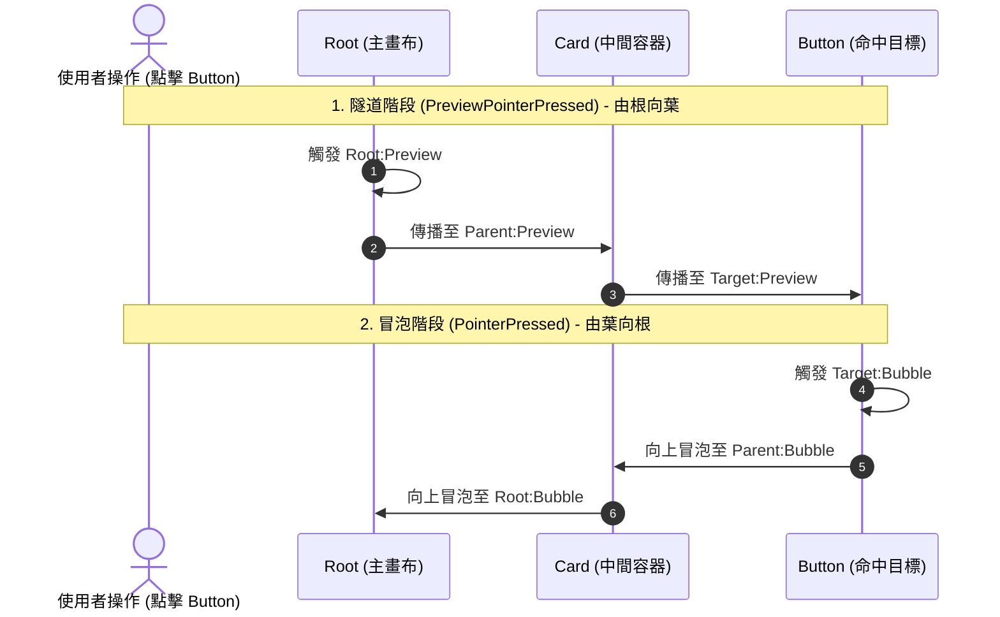

# EventRoute 類別 (cppui::input::EventRoute)

負責構建從視覺樹根節點至目標節點的傳播路徑，並依序執行「先隧道 (Tunneling)、後冒泡 (Bubbling)」雙向派發的路由管線執行器。

---

## 元資料 (Metadata)

* **命名空間**：[`cppui::input`](../namespaces/cppui_input.md)
* **標頭檔**：`#include <ui/input/EventRoute.hpp>`
* **模組**：`CPPUI Input`
* **相容性**：`C++14`, `C++17`, `C++20`, `C++23`

---

## 語法 (Syntax)

```cpp
namespace cppui {
namespace input {

class EventRoute {
public:
    explicit EventRoute(core::UIElement* target);

    // 沿視覺樹建構路由路徑
    void BuildRoute(core::UIElement* target);

    // 依序執行隧道與冒泡雙向派發
    void Dispatch(const RoutedEvent& previewEvent,
                  const RoutedEvent& bubbleEvent,
                  RoutedEventArgs&   args);

    // 執行單一事件派發 (適用於 Direct 策略或獨立階段)
    void DispatchSingle(const RoutedEvent& event, RoutedEventArgs& args);

    COMPAT_NODISCARD size_t GetNodeCount() const noexcept;
    COMPAT_NODISCARD const std::vector<core::UIElement*>& GetPath() const noexcept;

private:
    std::vector<core::UIElement*> m_routePath; // 順序為：[Target, Parent, ..., Root]
};

} // namespace input
} // namespace cppui
```

---

## 簡介 (Description)

當使用者在視窗介面上進行點擊或按鍵操作時，命中測試（Hit Testing）會確定一個目標葉節點（Target）。
`EventRoute` 的職責是：
1. **構建路徑 (`BuildRoute`)**：
   - 自目標節點 `target` 向上遞迴尋找父節點 `GetParent()`，收集整個視覺樹父子鏈，形成節點陣列：`[Target, Parent1, Parent2, ..., Root]`。
2. **隧道階段派發 (Tunnel Phase)**：
   - 逆向走訪陣列：由 `Root` $\rightarrow$ `Parent` $\rightarrow$ `Target` 依序調用節點上註冊的 `previewEvent` 處理器。
   - 若在過程中任何節點呼叫了 `args.SetHandled(true)`，後續隧道處理器將跳過（除非註冊了 `handledEventsToo`）。
3. **冒泡階段派發 (Bubble Phase)**：
   - 正向走訪陣列：由 `Target` $\rightarrow$ `Parent` $\rightarrow$ `Root` 依序調用節點上註冊的 `bubbleEvent` 處理器。
   - 同樣受 `args.IsHandled()` 狀態控制。

---

## 傳播順序圖 (Sequence Diagram)



---

## 範例程式碼 (Example)

```cpp
#include "compat/Compat.hpp"
#include "ui/input/EventRoute.hpp"
#include "ui/input/PointerEventArgs.hpp"
#include "ui/core/UIElement.hpp"

void ManuallyDispatchInput(cppui::core::UIElement* leafElement, cppui::core::Point clickPos) {
    using namespace cppui::input;

    // 建立事件參數
    PointerEventArgs args(StandardEvents::PointerPressed, leafElement, clickPos);

    // 構建並派發路由
    EventRoute route(leafElement);
    route.Dispatch(StandardEvents::PreviewPointerPressed, 
                   StandardEvents::PointerPressed, 
                   args);

    if (args.IsHandled()) {
        compat::println("事件已被成功處理！");
    }
}
```

---

## 請參閱 (See Also)
* [`RoutedEvent` 類別參考](input_routedevent.md)
* [`RoutedEventArgs` 類別參考](input_routedeventargs.md)
* [`InputManager` 類別參考](input_inputmanager.md)
