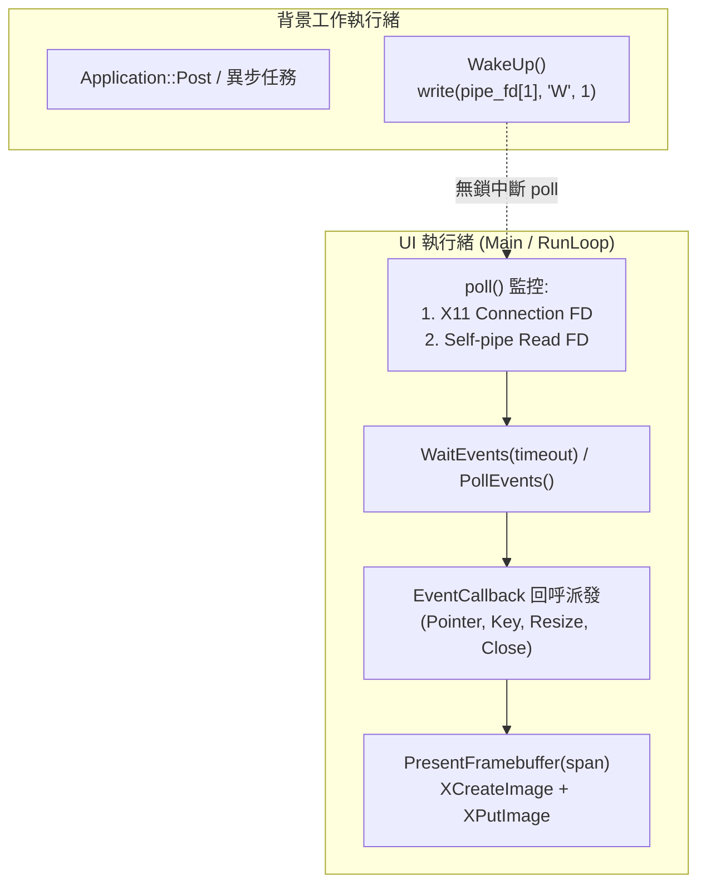

# PlatformWindowX11 類別 (cppui::pal::x11::PlatformWindowX11)

`PlatformWindowX11` 是 CPPUI 專為 Linux 桌面與 WSLg (Windows Subsystem for Linux GUI) 環境設計的原生實體視窗後端實作，繼承自 [`IPlatformWindow`](pal_iplatformwindow.md)。

---

## 1. 元資料 (Metadata)

* **命名空間**：`cppui::pal::x11`
* **標頭檔**：`src/pal/x11/PlatformWindowX11.hpp`（內部實作，由 [`PlatformWindowFactory`](pal_platformwindowfactory.md) 建立）
* **相依函式庫**：Xlib (`libX11`), POSIX (`poll`, `pipe2`)
* **相容標準**：`C++14`, `C++17`, `C++20`, `C++23`

---

## 2. 語法宣告 (Syntax)

```cpp
namespace cppui {
namespace pal {
namespace x11 {

class PlatformWindowX11 : public IPlatformWindow {
public:
    explicit PlatformWindowX11(const WindowDesc& desc);
    ~PlatformWindowX11() override;

    PlatformWindowX11(const PlatformWindowX11&) = delete;
    PlatformWindowX11& operator=(const PlatformWindowX11&) = delete;

    void Show() override;
    void Hide() override;
    void Close() override;
    COMPAT_NODISCARD bool IsVisible() const noexcept override;
    COMPAT_NODISCARD bool IsClosed() const noexcept override;

    COMPAT_NODISCARD compat::string_view GetTitle() const noexcept override;
    void SetTitle(compat::string_view title) override;

    COMPAT_NODISCARD core::Size GetClientSize() const noexcept override;
    void SetClientSize(int32_t width, int32_t height) override;

    COMPAT_NODISCARD core::Point GetPosition() const noexcept override;
    void SetPosition(int32_t x, int32_t y) override;

    void PresentFramebuffer(compat::span<const uint8_t> pixels, int32_t width, int32_t height) override;
    void RequestRedraw() override;

    bool WaitEvents(int32_t timeoutMs = -1) override;
    bool PollEvents() override;
    void WakeUp() override;

    COMPAT_NODISCARD float GetDpiScale() const noexcept override;
};

} // namespace x11
} // namespace pal
} // namespace cppui
```

---

## 3. 架構設計與核心機制 (Architecture & Mechanics)



### 3.1 雙緩衝畫面呈現 (`PresentFramebuffer`)
- 使用 `XCreateImage` 封裝連續 RGBA 記憶體視圖 (`compat::span<const uint8_t>`)。
- 透過 `XPutImage` 將像素直接繪製至 X11 視窗之預設 Graphics Context (`GC`)，零中間記憶體拷貝。
- 支援任意動態調整尺寸，視窗大小變更時即時重整影像尺寸。

### 3.2 異步執行緒安全喚醒 (Self-Pipe Mechanism)
- 為避免背景執行緒呼叫 `Application::Post` 或 `WakeUp()` 時因主執行緒正阻塞於 `WaitEvents` 而延遲，內部初始化了 POSIX `pipe2(m_pipeFds, O_CLOEXEC | O_NONBLOCK)`。
- `WaitEvents` 透過 `poll` 同時監聽 **X11 連線檔案描述符** (`XConnectionNumber`) 與 **Self-pipe 讀取端**：
  - 當 X Server 有輸入事件時，`poll` 立即喚醒並派發 XEvent。
  - 當背景執行緒呼叫 `WakeUp()` 時，單一 Byte (`'W'`) 寫入 Pipe，立即使 `poll` 解除阻塞，達成毫秒級異步喚醒。

### 3.3 高分屏 DPI 縮放偵測 (`GetDpiScale`)
- 優先使用 `XResourceManagerString(display)` 與 Xrm 資源資料庫查詢 `Xft.dpi` 設定。
- 若系統未配置 `Xft.dpi`，自動利用 `XDisplayWidth` 與 `XDisplayWidthMM` 計算水平物理每吋像素 (DPI)。
- 基於 96.0 DPI 標準基準換算回縮放比例（如 192 DPI 換算為 2.0f）。

### 3.4 視窗關閉協議 (`WM_DELETE_WINDOW`)
- 向 X Server 註冊 `WM_PROTOCOLS` 與 `WM_DELETE_WINDOW` Atom。
- 當使用者點擊視窗關閉按鈕時，攔截 `ClientMessage` 並派發 `RawEventType::WindowClose` 事件，交由框架 `Form` 執行確認或安全關閉，避免 X11 原生程序直接強制消滅視窗導致資源洩漏。

---

## 4. 建立與使用方式 (Usage)

應用程式不需直接實例化 `PlatformWindowX11`，建議透過 [`PlatformWindowFactory`](pal_platformwindowfactory.md) 自動偵測或明確指定：

```cpp
#include "ui/pal/PlatformWindowFactory.hpp"
#include "compat/compat.hpp"

void LaunchWindow() {
    using namespace cppui::pal;

    WindowDesc desc;
    desc.title = "Linux X11 Native Window";
    desc.width = 1024;
    desc.height = 768;

    // 方式 A：由工廠自動依環境建立 (Linux 偵測 DISPLAY 自動啟用 X11)
    std::shared_ptr<IPlatformWindow> window = PlatformWindowFactory::Create(desc);

    // 方式 B：明確指定建立 X11 實體視窗
    // std::shared_ptr<IPlatformWindow> window = PlatformWindowFactory::CreateX11(desc);

    window->Show();
    compat::println("X11 視窗已成功開啟，當前 DPI Scale: {:.2f}", window->GetDpiScale());
}
```

---

## 5. 請參閱 (See Also)

* [`IPlatformWindow` 核心抽象介面](pal_iplatformwindow.md)
* [`PlatformWindowFactory` 原生視窗工廠](pal_platformwindowfactory.md)
* [`PlatformWindowGeneric` 通用虛擬視窗實作](pal_platformwindowgeneric.md)
* [跨平台視窗架構指南](../guides/cross_platform_architecture.md)
