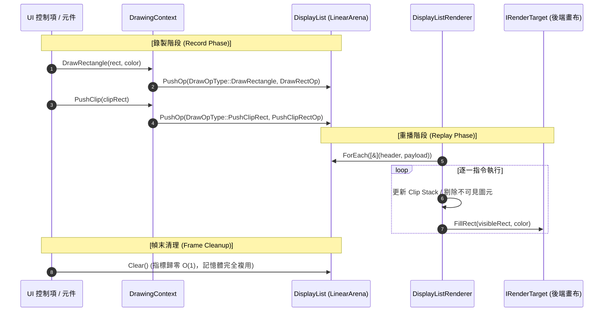

# DisplayList 二進位錄製深度解析 (DisplayList Recording & Replay Architecture)

深入探討 CPPUI 的 **命令緩衝區架構 (Command Buffer)**、連續平坦記憶體池、二進位協議與微架構最佳化。

---

## 1. 為什麼需要 DisplayList？

在傳統 UI 框架中，常見兩種繪圖模型：
1. **即時模式 (Immediate Mode)**：如 Dear ImGui。控制項直接呼叫 GPU 繪圖，但缺乏佈局快取、難以支援異步合成與視圖剪裁。
2. **重度物件保留模式 (Heavy Object Retained Mode)**：如舊版 WPF。每個繪圖圖元均為獨立的 C++ 類別實例（包含虛擬函式表、多個智慧指標），每幀產生數萬個小物件，導致沉重的 GC 停頓與記憶體碎片。

### CPPUI 的折衷架構：命令緩衝區模式
CPPUI 採用與 Chromium CC (Chrome Compositor) 及 Skia `SkPicture` 相同的設計：
* **錄製階段 (Record)**：控制項只將緊湊的二進位命令連續追加至平坦緩衝區中。分配時間為常數 $O(1)$，無任何虛擬函式呼叫。
* **重播階段 (Replay)**：光柵化器對平坦記憶體進行一次連續線性快取讀取（Cache-Friendly Linear Traversal），執行剪裁剔除並繪製。



---

## 2. LinearArena 平坦記憶體池設計

[`LinearArena`](../classes/rendering_lineararena.md) 內部使用一塊連續的記憶體區塊。

### 8 字節記憶體對齊演算
為確保 64 位元處理器能夠以單一指令載入純量資料並避免 Unaligned Access 效能懲罰，每次分配均執行位元遮罩對齊：

$$\text{alignedOffset} = (\text{offset} + (\text{alignment} - 1)) \ \& \ \sim(\text{alignment} - 1)$$

```cpp
void* LinearArena::Allocate(size_t bytes, size_t alignment) {
    size_t alignedOffset = (m_offset + (alignment - 1)) & ~(alignment - 1);
    size_t newOffset = alignedOffset + bytes;

    if (COMPAT_UNLIKELY(newOffset > m_capacity)) {
        // 觸發倍增擴展並保留記憶體供下一幀重用
        size_t newCapacity = std::max(m_capacity * 2, newOffset + DEFAULT_CAPACITY);
        m_buffer.resize(newCapacity);
        m_capacity = newCapacity;
    }

    uint8_t* ptr = m_buffer.data() + alignedOffset;
    m_offset = newOffset;
    return ptr;
}
```

---

## 3. Clip Stack 與可視區域剔除 (Occlusion Culling)

在 UI 渲染中，子控制項經常會繪製在父控制項的可視區域之外（例如滾動清單中的隱藏項目）。

`DisplayListRenderer` 在遍歷命令串流時，內部維護一個由 [`core::Rect`](../classes/core_rect.md) 組成的 `std::vector<Rect> clipStack`：
* **PushClip**：`newClip = currentClip.Intersect(op->rect)`，並將 `newClip` 壓棧。
* **圖元繪製**：`visibleRect = op->rect.Intersect(currentClip)`。
  * 若 `visibleRect.IsEmpty()`：**直接跳過光柵化！** 不執行任何耗時的迴圈或像素寫入。
* **PopClip**：將棧頂彈出，恢復前一級剪裁範圍。

---

## 4. 效能基準 (Benchmark Results)

在現代 PC 硬體與不同編譯器下進行的 50,000 個指令高壓錄製測試：

| 編譯器與標準 | 錄製 50,000 Ops 耗時 | 目標時間 | 記憶體使用量 |
| :--- | :---: | :---: | :---: |
| **Clang++ (C++14 / O2)** | **1.167 ms** | < 1.5 ms | 1,562 KB |
| **G++ (C++14 / O2)** | **1.109 ms** | < 1.5 ms | 1,562 KB |
| **MSVC (C++14 / O2)** | **1.163 ms** | < 1.5 ms | 1,562 KB |

> [!TIP]
> 相當於每秒可錄製超過 **4,300 萬個圖元指令**，足以從容因應任何複雜的現代桌面應用介面。

---

## 請參閱 (See Also)
* [`DrawingContext` 參考](../classes/rendering_drawingcontext.md)
* [`DisplayList` 參考](../classes/rendering_displaylist.md)
* [`DisplayListRenderer` 參考](../classes/rendering_displaylistrenderer.md)
