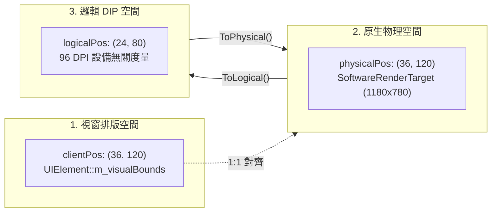

# 高分屏 DPI 與座標轉換指南 (DPI Scaling & Coordinate Systems)

說明 CPPUI 中 **裝置獨立像素 (Device Independent Pixels, DIP)**、**實體像素 (Physical Pixels)**、**客戶區排版空間 (Client Layout Space)** 與專屬 [`CoordinateTransform`](../classes/core_coordinatetransform.md) 類別的設計原理與最佳實踐。

---

## 1. 概念背景 (Concepts)

在現代顯示器（4K、Retina 螢幕、Surface 高分屏）盛行的環境下，作業系統通常會設定 125%、150% 或 200% 的顯示縮放比例。
若直接使用物理像素進行 UI 排版，元件將會因為螢幕 PPI 過高而變得極其細小無法閱讀。
若過早或重複進行縮放換算，則容易導致**點擊命中測試脫節**或**文字雙重放大溢出**。

### 核心定義
* **DIP (裝置獨立像素 / 邏輯座標)**：
  標準以 96 DPI（100% 縮放）為基準的虛擬單位。1 DIP 在 100% 縮放時等於 1 個物理像素，在 200% 縮放時等於 2 個物理像素。
  $$\text{Physical Pixels} = \text{DIP} \times \text{DpiScale}$$
* **物理像素 (Physical Pixels)**：
  顯示器硬體真實發光像素網格與 Framebuffer 緩衝區的長寬數值。
* **客戶區排版空間 (Client Layout Space)**：
  視窗客戶區內部視覺樹 [`Visual`](../classes/core_visual.md) 的版面排列幾何空間。

---

## 2. 三重座標空間模型 (Three Coordinate Spaces)

為了根除高分屏下點擊位置與按鈕不一致的問題，CPPUI 採用嚴格的「三重空間」模型，交由 [`CoordinateTransform`](../classes/core_coordinatetransform.md) 統一換算：



### 職責劃分
1. **視窗尺寸**：
   * `window->GetSize()`：透過 `m_coordTransform.ToLogical` 回傳**邏輯尺寸 (DIP)**。
   * `window->GetFramebufferSize()`：回傳**物理尺寸**，供光柵化畫布配置記憶體使用。
2. **滑鼠輸入事件 ([`RawMouseEventData`](../classes/pal_rawinputevent.md))**：
   * `event.mouse.position`：始終為**視窗客戶區排版座標**，與視覺樹排版邊界 1:1 對齊，確保 `HitTest` 0 像素偏差！
   * `event.mouse.physicalPosition`：原生未經縮放的**物理像素座標**。
   * `event.mouse.logicalPosition`：由 `CoordinateTransform::ToLogical` 換算之**邏輯 DIP 座標**。

---

## 3. Windows Per-Monitor V2 自動感知與動態 DPI

在 Win32 實作 [`PlatformWindowWin32`](../../../src/pal/win32/PlatformWindowWin32.cpp) 中，視窗建立前即啟用 Per-Monitor V2 模式：

```cpp
SetProcessDpiAwarenessContext(DPI_AWARENESS_CONTEXT_PER_MONITOR_AWARE_V2);
```

### 處理動態跨螢幕拖曳 (`WM_DPICHANGED`)
當使用者將視窗從 100% 螢幕拖拉至 150% 螢幕時：
1. 視窗接收到 DPI 改變通知與建議外框 RECT。
2. 內部更新 `m_dpiScale = newDpi / 96.0f`（例如 1.5f）。
3. 同步更新 `m_coordTransform.SetDpiScale(m_dpiScale)`。
4. 派發 [`RawEventType::DpiChanged`](../classes/pal_rawinputevent.md) 事件給應用程式更新 Framebuffer 尺寸並重繪。

---

## 4. 座標換算實戰範例 (Example)

```cpp
#include "compat/Compat.hpp"
#include "ui/core/CoordinateTransform.hpp"
#include "ui/pal/IPlatformWindow.hpp"
#include "ui/pal/RawInputEvent.hpp"

void ProcessDpiAwareInput(cppui::pal::IPlatformWindow* window, 
                          const cppui::pal::RawInputEvent& e) {
    using namespace cppui::core;

    float dpi = window->GetDpiScale();
    CoordinateTransform transform(dpi);

    // 1. 排版坐標（直接用於視覺樹命中測試）
    Point layoutPos = e.mouse.position;

    // 2. 邏輯 DIP 坐標（設備無關數值）
    Point logicalPos = e.mouse.logicalPosition;

    // 3. 物理像素坐標（光柵化畫布定位）
    Point physicalPos = e.mouse.physicalPosition;

    compat::println("DPI: {}% | 排版: ({}, {}) | 邏輯 DIP: ({}, {}) | 物理: ({}, {})",
        static_cast<int>(dpi * 100),
        layoutPos.x, layoutPos.y,
        logicalPos.x, logicalPos.y,
        physicalPos.x, physicalPos.y);

    // 往返轉換保證
    Point roundTrip = transform.ToPhysical(logicalPos);
    // roundTrip 與 physicalPos 誤差 < 0.001
}
```

---

## 請參閱 (See Also)
* [`CoordinateTransform` 類別參考](../classes/core_coordinatetransform.md)
* [`RawInputEvent` 結構參考](../classes/pal_rawinputevent.md)
* [`IPlatformWindow` 介面參考](../classes/pal_iplatformwindow.md)
* [輸入管線與路由事件指南](input_and_routed_events.md)
