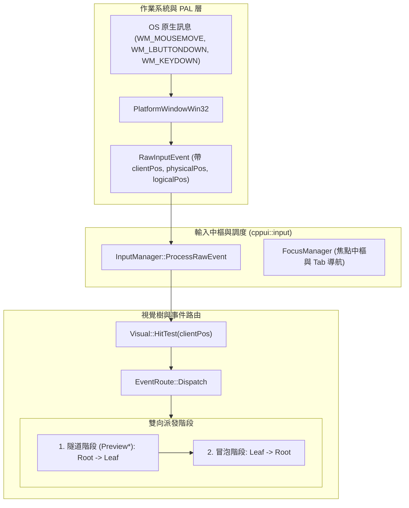

# 輸入管線、路由事件與焦點管理實戰指南 (Input Pipeline & Routed Events Guide)

深入解析 CPPUI 中的輸入架構、微軟 WPF / Avalonia 風格之雙向路由事件體系（隧道 Tunneling + 冒泡 Bubbling）、指標捕獲（Pointer Capture）與焦點鍵盤導航演算法。

---

## 1. 架構全景 (Architecture Overview)

CPPUI 的輸入系統採分層解耦設計，由下而上包含 OS 訊息層、PAL 原生事件層、輸入中樞層與視覺樹路由層：



---

## 2. 路由事件雙向傳播機制 (Tunneling & Bubbling)

### 2.1 傳播策略對比

| 策略 (Strategy) | 傳播方向 | 命名規範 | 核心目的 |
| :--- | :--- | :--- | :--- |
| **Tunnel (隧道)** | 根節點 $\rightarrow$ 目標節點 | `Preview*` 前綴 | 父節點預先校驗、日誌或條件攔截。 |
| **Bubble (冒泡)** | 目標節點 $\rightarrow$ 根節點 | 常規名稱 | 複合元件子項目點擊向外傳播與聚合處理。 |
| **Direct (直接)** | 僅目標節點自身 | 如 `PointerEntered` | 局部狀態變更，無需跨層級傳播。 |

### 2.2 事件短路機制 (`Handled` Short-Circuiting)

任何事件處理常式均可透過 `args.SetHandled(true)` 將事件標記為已處理：
* 一旦標記為 `Handled = true`，後續所有常規監聽器將被短路跳過。
* **`handledEventsToo` 機制**：若某些高級監聽器（如日誌記錄器、無障礙輔助）必須在事件已被處理的情況下依然接收通知，可在註冊時宣告 `handledEventsToo = true`：

```cpp
// 常規監聽器：被短路時不觸發
element.AddHandler(StandardEvents::PointerPressed, [](RoutedEventArgs& e) {
    // ...
}, /*handledEventsToo=*/false);

// 強制監聽器：即使 e.IsHandled() == true 依然被調用
element.AddHandler(StandardEvents::PointerPressed, [](RoutedEventArgs& e) {
    compat::println("強制接收到已處理事件！");
}, /*handledEventsToo=*/true);
```

---

## 3. 指標懸停與捕獲 (Hover Tracking & Pointer Capture)

### 3.1 游標懸停追蹤 (Hover Tracking)
`InputManager` 在每次 `MouseMove` 時維護內部懸停節點 `m_hoveredElement`：
* 當游標移出舊元件時，向舊元件派發 [`PointerExited`](../classes/input_routedevent.md)。
* 當游標移入新元件時，向新元件派發 [`PointerEntered`](../classes/input_routedevent.md)。
* 確保 Enter / Exit 成對觸發，適用於按鈕懸停色彩漸層變更。

### 3.2 指標捕獲語意 (Pointer Capture)
當使用者點擊並拖曳滑桿（Slider）或自訂按鈕時，即便游標移出視窗，仍需要持續接收 `PointerMoved` 與 `PointerReleased` 事件：
```cpp
// 1. 按下時捕獲
button.OnPointerPressed([&](PointerEventArgs& e) {
    if (e.IsLeftButton()) {
        InputManager::Get().CapturePointer(&button);
    }
});

// 2. 移動時持續接收（即便在邊界外）
button.OnPointerMoved([&](PointerEventArgs& e) {
    // 依據 e.GetPosition(&button) 實作拖曳更新
});

// 3. 釋放時解除捕獲
button.OnPointerReleased([&](PointerEventArgs& e) {
    InputManager::Get().ReleasePointerCapture(&button);
});
```

---

## 4. 焦點管理與 Tab 鍵鍵盤導航 (Focus Management)

### 4.1 焦點模型與屬性
* `SetFocusable(true)`：聲明該元件可接受鍵盤焦點。
* `SetTabStop(true)`：聲明該元件參與 Tab 鍵輪詢導航。
* `SetTabIndex(int32_t)`：指定 Tab 導航權重（小者優先）。

### 4.2 Tab / Shift+Tab 尋路演算法
`FocusManager::Get().MoveFocus(root, forward)` 自動執行：
1. 收集 `root` 下所有滿足 `IsFocusable() && IsTabStop() && IsVisible()` 的元件。
2. 依照 `TabIndex` 升冪排序；若 `TabIndex` 相同則依照視覺樹前序周遊順序排序。
3. 若 `forward == true`，轉移至下一個元件；若 `forward == false`（Shift+Tab），轉移至前一個元件。
4. 到達末端時自動首尾相接循環（Wrap-around）。
5. 舊元件觸發 `LostFocus`，新元件觸發 `GotFocus`。

---

## 5. 完整實戰範例 (Complete Example)

以下展示如何在一個複合互動卡片中運用隧道攔截、按鈕冒泡、文字輸入與 Tab 導航：

```cpp
#include "compat/compat.hpp"
#include "ui/core/UIElement.hpp"
#include "ui/layout/StackPanel.hpp"
#include "ui/layout/Border.hpp"
#include "ui/controls/TextBlock.hpp"
#include "ui/input/InputManager.hpp"
#include "ui/input/FocusManager.hpp"

using namespace cppui;
using namespace cppui::core;
using namespace cppui::layout;
using namespace cppui::input;

void CreateInteractiveCard() {
    auto card = std::make_shared<Border>();
    auto stack = std::make_shared<StackPanel>();
    card->SetChild(stack);

    auto btnLike = std::make_shared<Border>();
    btnLike->SetFocusable(true);
    btnLike->SetTabIndex(1);

    auto btnText = std::make_shared<controls::TextBlock>("👍 點讚 (0)");
    btnLike->SetChild(btnText);
    stack->AddChild(btnLike);

    int likeCount = 0;

    // 1. 懸停變色
    btnLike->OnPointerEntered([=](PointerEventArgs&) {
        btnLike->SetBackground(Color(45, 60, 85, 255));
    });
    btnLike->OnPointerExited([=](PointerEventArgs&) {
        btnLike->SetBackground(Color(30, 40, 55, 255));
    });

    // 2. 冒泡點擊處理
    btnLike->OnPointerPressed([&, btnText](PointerEventArgs& e) {
        if (e.IsLeftButton()) {
            likeCount++;
            btnText->SetText("👍 點讚 (" + std::to_string(likeCount) + ")");
            compat::println("按鈕獲點擊，當前點讚數: {}", likeCount);
            e.SetHandled(true);
        }
    });

    // 3. 父卡片預先攔截示例 (條件開啟時阻斷事件)
    bool blockInput = false;
    card->AddHandler(StandardEvents::PreviewPointerPressed, [&](RoutedEventArgs& e) {
        if (blockInput) {
            compat::println("卡片已鎖定，Preview 階段阻斷輸入！");
            e.SetHandled(true); // 下層 btnLike 將收不到 PointerPressed
        }
    });

    // 4. 焦點視覺反饋
    btnLike->OnGotFocus([=](FocusEventArgs&) {
        btnLike->SetBorderBrush(Color(0, 180, 255, 255)); // 藍色霓虹光暈
    });
    btnLike->OnLostFocus([=](FocusEventArgs&) {
        btnLike->SetBorderBrush(Color(60, 70, 80, 255));
    });
}
```

---

## 6. 請參閱 (See Also)
* [`RoutedEvent` 類別參考](../classes/input_routedevent.md)
* [`InputManager` 類別參考](../classes/input_inputmanager.md)
* [`FocusManager` 類別參考](../classes/input_focusmanager.md)
* [`UIElement` 類別參考](../classes/core_uielement.md)
* [高分屏 DPI 與座標轉換指南](dpi_and_coordinates.md)
