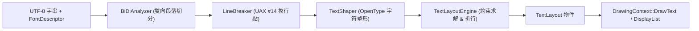

# 工業級文字排版與雙向命中測試指南 (Text Shaping, Typography & Hit-Testing)

本指南介紹如何在 CPPUI 中使用 `cppui::text` 模組進行文字排版、多行折行 (Wrapping)、省略號修剪 (Trimming)、雙向文字 (BiDi) 以及文字輸入框所需的命中測試 (Hit-Testing)。

---

## 1. 文字排版管線架構概觀

CPPUI 採用與現代瀏覽器和作業系統一致的三層文字管線：



---

## 2. 快速入門：量測與多行折行

在自訂控制項的 `Measure` 或 `Render` 階段中，文字度量是最頻繁的操作：

```cpp
#include "ui/text/FontManager.hpp"
#include "ui/text/TextLayoutEngine.hpp"
#include "compat/Compat.hpp"

using namespace cppui::text;
using namespace cppui::core;

void LayoutSample() {
    // 取得系統繁中字型並設為 16pt 粗體
    FontDescriptor font = FontManager::Get().GetDefaultChineseFont(16.0f).WithWeight(FontWeight::Bold);

    // 依指定寬度 (如 300px) 求解自動折行排版
    compat::string_view text = "CPPUI 文字管線具備每秒百萬次的極速查詢效能，能自適應螢幕縮放與動態排版約束。";
    TextLayout layout = TextLayoutEngine::Get().CreateLayout(
        text,
        font,
        300.0f,               // maxWidth
        1000.0f,              // maxHeight
        TextAlignment::Left,  // 水平靠左
        TextWrapping::WordWrap// 單詞優先自動折行
    );

    // 取得多行資訊
    compat::println("總行數: {}", layout.GetLineCount());
    for (const auto& line : layout.GetLines()) {
        compat::println("  行範圍 [{} ~ {}], 高度={:.1f}, 基線={:.1f}",
                        line.startIndex, line.startIndex + line.length,
                        line.bounds.height, line.baseline);
    }
}
```

---

## 3. 雙向命中測試 (Hit-Testing) 實戰

開發文字編輯器或標籤選取功能時，需要雙向轉換：
1. **滑鼠座標 $\rightarrow$ 字元索引**：決定使用者在字串的哪一個位置點擊或反白。
2. **字元索引 $\rightarrow$ 游標矩形**：在畫面特定字元旁繪製閃爍垂直插入線（Caret / Cursor）。

```cpp
void HitTestingSample(const TextLayout& layout, Point clickPoint) {
    // 1. 以局部滑鼠點擊座標查詢命中結果
    TextHitTestResult hit = layout.HitTestPoint(clickPoint);

    if (hit.isInside) {
        compat::println("點擊在文字內！字元索引: {}", hit.textPosition);
        compat::println("是否點擊後半部: {}", hit.isTrailingHit ? "YES" : "NO");

        // 繪製插入游標的幾何位置
        Rect caret = hit.cursorRect;
        compat::println("游標繪製位置: X={:.1f}, Y={:.1f}, 寬={:.1f}, 高={:.1f}",
                        caret.x, caret.y, caret.width, caret.height);
    }

    // 2. 以已知字元索引 (例如索引 5) 取得游標邊界
    Rect fixedCaret = layout.HitTestTextPosition(5);
    compat::println("字元 5 游標矩形: ({:.1f}, {:.1f})", fixedCaret.x, fixedCaret.y);
}
```

---

## 4. 繪圖管線集成：透過 DrawingContext 繪製文字

產出的 `TextLayout` 或純字串可以直接序列化寫入 `DisplayList`，實現零 GPU 耦合：

```cpp
#include "ui/rendering/DrawingContext.hpp"

void Paint(DrawingContext& dc, const TextLayout& layout, const FontDescriptor& font) {
    // 1. 直接繪製純字串
    dc.DrawText("Hello CPPUI", Point(20.0f, 20.0f), font, Colors::White);

    // 2. 繪製預先計算之多行 TextLayout
    dc.DrawTextLayout(layout, Point(20.0f, 60.0f), Colors::Yellow);
}
```

---

## 5. 動態載入自訂字型與記憶體字型 (Dynamic Font Loading)

在現代應用程式中，為確保品牌視覺一致性或在無特權環境下執行，CPPUI 提供執行期字型註冊管線。支援自實體檔案或記憶體二進位緩衝區（如內嵌資源、壓縮包解壓）動態註冊字型，並無縫整合至排版與繪圖管線。

### 5.1 註冊本機字型檔案

透過 `FontManager::Get().RegisterFontFile` 註冊 `.ttf` 或 `.otf` 字型：

```cpp
#include "ui/text/FontManager.hpp"
#include "ui/text/TextLayoutEngine.hpp"
#include "compat/Compat.hpp"

using namespace cppui::text;

void LoadCustomFontExample() {
    auto& fm = FontManager::Get();

    // 1. 註冊本機字型檔案，並指定自訂別名（可選）
    bool ok = fm.RegisterFontFile("assets/fonts/Inter-VariableFont.ttf", "Inter");
    if (!ok) {
        compat::println("字型載入失敗！");
        return;
    }

    // 2. 設定為全域預設字型家族
    fm.SetDefaultFontFamily("Inter");

    // 3. 後續建立字型或排版即可自動套用
    FontDescriptor font = fm.GetDefaultFont(16.0f);
    compat::println("預設字型家族已更新為: {}", font.familyName);
}
```

### 5.2 自記憶體二進位緩衝區載入字型

當字型已編譯為二進位資源（例如 C++ 陣列）或由網路下載至記憶體時，使用 `RegisterFontFromMemory`：

```cpp
#include "ui/text/FontManager.hpp"
#include "compat/Compat.hpp"

using namespace cppui::text;

// 假想之內嵌字型二進位資料
extern const uint8_t g_EmbeddedFontData[];
extern const size_t g_EmbeddedFontSize;

void LoadMemoryFontExample() {
    auto& fm = FontManager::Get();

    // 封裝為現代唯讀 span
    compat::span<const uint8_t> data(g_EmbeddedFontData, g_EmbeddedFontSize);

    // 註冊為自訂家族名稱
    bool ok = fm.RegisterFontFromMemory(data, "AppBrandFont");
    if (ok) {
        // 驗證字型是否存在
        if (fm.HasFontFamily("AppBrandFont")) {
            // 建構字型描述符
            FontDescriptor brandFont("AppBrandFont", 18.0f);
            compat::println("成功使用記憶體字型建立 FontDescriptor！");
        }
    }
}
```

### 5.3 預設字族管理與復原

可個別自訂通用、繁體中文與等寬字型的預設字族，並在需要時重設回作業系統預設值：

```cpp
auto& fm = FontManager::Get();

// 設定各語系與用途之預設家族
fm.SetDefaultFontFamily("Inter");
fm.SetDefaultChineseFontFamily("Noto Sans TC");
fm.SetDefaultMonospaceFontFamily("JetBrains Mono");

// 查詢所有已動態註冊之字型家族清單
std::vector<std::string> families = fm.GetRegisteredFontFamilies();
for (const auto& fam : families) {
    compat::println("已註冊家族: {}", fam);
}

// 重設回作業系統預設值 (Windows: Segoe UI / 微軟正黑體; Linux: DejaVu Sans / Noto Sans CJK TC)
fm.ResetDefaultFonts();
```

