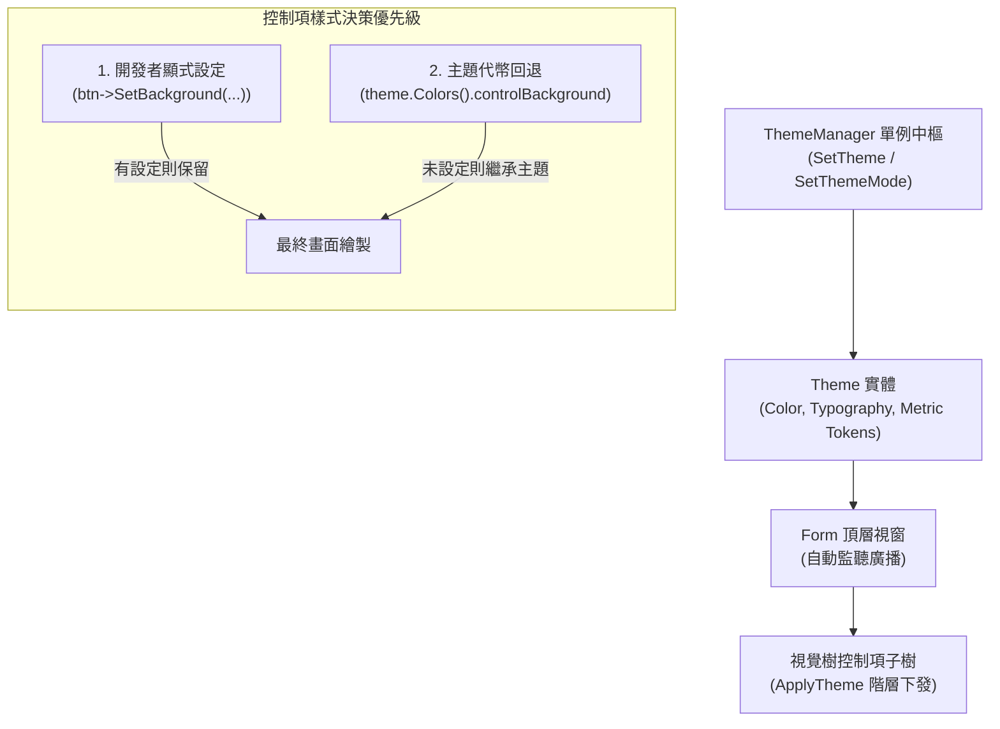

# CPPUI 集中式主題與樣式系統指南 (Theme and Styling System Guide)

本指南說明 CPPUI 現代設計規格代幣 (Design Tokens)、原廠多模式主題、執行期即時動態換膚機制，以及控制項屬性覆寫與繼承規則。

---

## 1. 架構核心理念 (Architecture Principles)

傳統桌面 GUI 程式常常將色彩、字型大小與內距硬編碼在控制項建構式中，導致難以切換暗色模式與無障礙高對比。CPPUI 遵循以下三大核心原則：



1. **關注點分離 (SoC)**：幾何間距 ([`MetricTokens`](../classes/theme_tokens.md#3-幾何與間距代幣-metrictokens))、字型排版 ([`TypographyTokens`](../classes/theme_tokens.md#2-排版代幣-typographytokens)) 與語意色彩 ([`ColorTokens`](../classes/theme_tokens.md#1-色彩代幣-colortokens)) 獨立分層，邏輯與展示解耦。
2. **顯式指定優先，未指定繼承主題**：開發者手動呼叫的樣式設定（例如 `btn->SetBackground(...)`）具有最高優先權，執行期主題切換時會受到保留；未明確設定的樣式則自動響應最新主題代幣。
3. **無縫全域廣播與局部重繪**：透過 [`ThemeManager`](../classes/theme_thememanager.md) 訂閱機制，視窗與控制項在主題切換時自動重新計算邊界與樣式，並發起 `Invalidate()` 局部重繪。

---

## 2. 原廠預設主題 (Built-in Themes)

CPPUI 原廠提供三種針對現代螢幕調優的主題：

| 主題模式 | 靜態工廠 | 特點說明 |
| :--- | :--- | :--- |
| **Dark (暗色模式)** | `Theme::Dark()` | 預設模式。深灰低眩光底色 (`#181A20`)，搭配清晰文字與明亮天藍強調色 (`#007AFF`)。 |
| **Light (亮色模式)** | `Theme::Light()` | 清新素雅白色表面 (`#F5F6F8` / `#FFFFFF`)，搭配高對比深黑灰文字 (`#141821`)。 |
| **HighContrast (高對比)** | `Theme::HighContrast()` | 純黑底色 (`#000000`)、純白邊框 (`#FFFFFF`) 與純青強調色 (`#00FFFF`)，專為低視力無障礙需求設計。 |

### 切換範例
```cpp
#include "ui/theme/ThemeManager.hpp"

// 快速切換為亮色模式
cppui::theme::ThemeManager::Get().SetThemeMode(cppui::theme::ThemeMode::Light);

// 快速切換為高對比模式
cppui::theme::ThemeManager::Get().SetThemeMode(cppui::theme::ThemeMode::HighContrast);
```

---

## 3. 客製化主題與鏈式語法 (Custom Themes)

開發者可基於現有主題派生，透過流暢鏈式方法快速客製品牌規格：

```cpp
#include "ui/theme/ThemeManager.hpp"

void ApplyCustomCompanyTheme() {
    using namespace cppui::theme;
    using namespace cppui::core;

    Theme companyTheme = Theme::Dark()
        // 1. 更換主要強調色彩
        .WithAccent(
            Color(16, 185, 129, 255), // Emerald Green 主色
            Color(52, 211, 153, 255), // Hover
            Color(5, 150, 105, 255)   // Pressed
        )
        // 2. 更換全域預設字型家族
        .WithFontFamily("Segoe UI")
        // 3. 調整全域圓角規格 (基準半徑 8px)
        .WithCornerRadius(8.0f);

    // 套用至全域管理器
    ThemeManager::Get().SetTheme(companyTheme);
}
```

---

## 4. 控制項屬性優先級機制 (Override & Fallback)

所有繼承自 [`Control`](../classes/controls_control.md) 的元件（如 `Button`, `TextBox`, `CheckBox`, `TextBlock`）內部維護有顯式屬性覆寫標記：
- `m_hasExplicitBackground`
- `m_hasExplicitForeground`
- `m_hasExplicitBorderBrush`
- `m_hasExplicitBorderThickness`
- `m_hasExplicitCornerRadius`
- `m_hasExplicitFontFamily`
- `m_hasExplicitFontSize`

### 行為範例
```cpp
auto btn1 = std::make_shared<Button>("預設按鈕");
auto btn2 = std::make_shared<Button>("危險操作");

// 開發者顯式指定了紅色背景
btn2->SetBackground(Color(220, 53, 69, 255));

// 當使用者切換全域主題至 Light 時：
ThemeManager::Get().SetThemeMode(ThemeMode::Light);
// -> btn1 自動切換為亮色按鈕底色
// -> btn2 依然維持紅色背景，不受主題更換影響！
```

---

## 5. 自訂元件實作 `ApplyTheme`

若您開發自訂控制項，可覆寫 `Control::ApplyTheme` 以響應動態主題切換：

```cpp
#include "ui/controls/Control.hpp"
#include "ui/theme/Theme.hpp"

class CustomCard : public cppui::controls::Control {
public:
    void ApplyTheme(const cppui::theme::Theme& theme) override {
        // 先調用基底類別處理通用背景與字型
        Control::ApplyTheme(theme);

        // 未顯式設定邊框時，自動拉取主題卡片邊界色
        if (!m_hasExplicitBorderBrush) {
            SetBorderBrush(theme.Colors().surfaceBorder);
        }

        // 未顯式設定背景時，自動拉取主題卡片背景色
        if (!m_hasExplicitBackground) {
            SetBackground(theme.Colors().cardBackground);
        }
    }
};
```

---

## 6. 請參閱 (See Also)

* [`Theme` 實體類別參考](../classes/theme_theme.md)
* [`ThemeManager` 單例中樞參考](../classes/theme_thememanager.md)
* [`ThemeTokens` 設計規格代幣矩陣](../classes/theme_tokens.md)
* [`Control` 控制項基底類別](../classes/controls_control.md)
* [`Form` 視窗元件](../classes/app_form.md)
