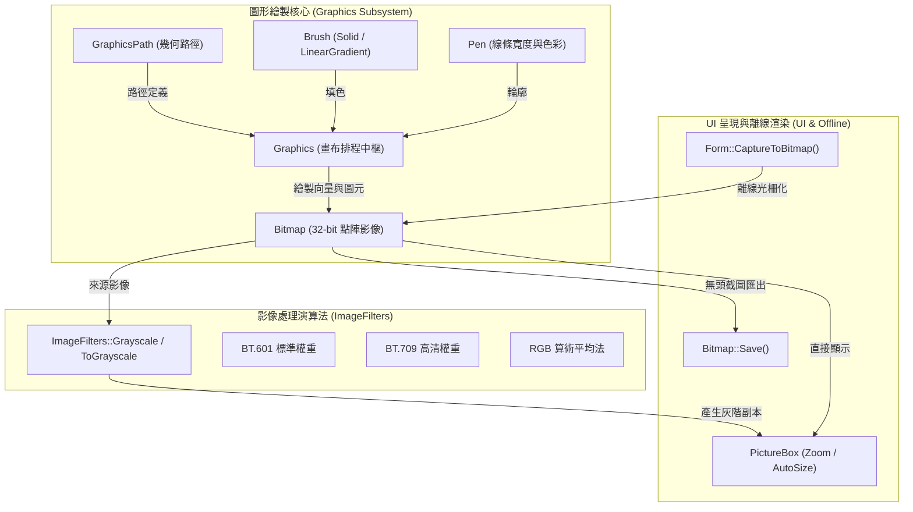

# 2D 圖形繪圖與影像濾鏡教學 (Tutorial: 2D Graphics Drawing & Image Filters)

CPPUI 提供了一套與 GDI+ 語意相容、底層支援 CPU/GPU 混合硬體加速的現代 2D 向量繪圖與影像處理引擎。本教學將帶領您透過實作 `graphics_drawing_demo` 範例，掌握幾何圖元繪製、漸層填色、幾何路徑構建、動態圖片生成與載入，以及運用高效能演算法套用 **Grayscale 灰階影像濾鏡**。

---

## 1. 成果預覽 (Preview)

本範例展示了在同一幅高解析度畫布上整合幾何圖元、自訂路徑、圖片繪製，以及即時套用灰階濾鏡的強大能力：

### 彩色原圖模式 (32-bit ARGB Canvas with Vector & Bitmap Graphics)


### 灰階濾鏡模式 (ITU-R BT.601 Grayscale Image Filter Applied)


---

## 2. 核心繪圖架構 (Architecture Overview)

CPPUI 繪圖子系統由以下核心模組構成：



- **[`Graphics`](../classes/graphics_graphics.md)**：統一 2D 向量繪圖排程器，支援直線、貝茲曲線、矩形、圓弧、橢圓、路徑以及點陣圖縮放繪製。
- **[`Bitmap`](../classes/graphics_bitmap.md)**：32-bit ARGB/BGRA 記憶體點陣圖，支援讀寫鎖並發安全、連續跨度 (`compat::span`) 存取與檔案匯出。
- **[`GraphicsPath`](../classes/graphics_path.md)**：封裝任意複合幾何輪廓與平滑曲線路徑。
- **[`ImageFilters`](../classes/graphics_imagefilters.md)**：高效能影像演算法庫，支援多執行緒並發與定點數極速灰階/模糊/二值化轉換。
- **[`PictureBox`](../classes/controls_picturebox.md)**：現代 UI 控制項，支援 `Zoom`、`CenterImage`、`StretchImage` 等縮放適配模式。

---

## 3. 專案檔案規劃

本教學對應之實作專案位於 `examples/graphics_drawing_demo/`：

```text
examples/graphics_drawing_demo/
├── DrawingDemoForm.hpp   # 視窗表單宣告、幾何路徑純函數數學輔助類別
├── DrawingDemoForm.cpp   # 向量繪圖、DrawImage 影像合成與灰階濾鏡操作
└── main.cpp              # 應用程式進入點與離線無頭截圖參數支援
```

---

## 4. 幾何路徑與動態徽章生成 (SoC 純函數隔離)

遵循純函數與職責分離原則，我們將幾何路徑計算與測試影像生成實作為靜態輔助函式：

### 正五角星幾何路徑 (CreateStarPath)

使用三角函數採樣內外半徑交錯頂點，並封閉為完整路徑：

```cpp
cppui::graphics::GraphicsPath DrawingDemoMath::CreateStarPath(
    cppui::core::Point center,
    float outerRadius,
    float innerRadius,
    uint32_t points) {
    if (points < 3) points = 3;

    cppui::graphics::GraphicsPath path;
    const float pi = 3.14159265358979323846f;
    const float step = pi / static_cast<float>(points);
    float angle = -pi / 2.0f; // 從頂端垂直向上開始

    std::vector<cppui::core::Point> pts;
    pts.reserve(static_cast<size_t>(points) * 2);

    for (uint32_t i = 0; i < points * 2; ++i) {
        const float r = (i % 2 == 0) ? outerRadius : innerRadius;
        const float x = center.x + r * std::cos(angle);
        const float y = center.y + r * std::sin(angle);
        pts.push_back(cppui::core::Point(x, y));
        angle += step;
    }

    path.AddLines(compat::span<const cppui::core::Point>(pts.data(), pts.size()));
    path.CloseFigure();
    return path;
}
```

### 動態點陣徽章生成 (CreateSampleBadge)

展示如何建立記憶體點陣圖，並透過 `Graphics::FromImage` 在其上進行繪圖：

```cpp
std::shared_ptr<cppui::graphics::Bitmap> DrawingDemoMath::CreateSampleBadge(uint32_t size) {
    auto bmp = std::make_shared<cppui::graphics::Bitmap>(size, size);
    cppui::graphics::Graphics g(bmp);
    g.Clear(cppui::core::Color(0, 0, 0, 0)); // 全透明底色

    const float s = static_cast<float>(size);

    // 外環雙色線性漸層
    cppui::graphics::LinearGradientBrush ringBrush(
        cppui::core::Point(0.0f, 0.0f), cppui::core::Point(s, s),
        cppui::core::Color(255, 60, 100, 255), cppui::core::Color(255, 180, 0, 255));
    g.FillEllipse(ringBrush, cppui::core::Rect(2.0f, 2.0f, s - 4.0f, s - 4.0f));

    // 內圈深色核心與白邊
    cppui::graphics::SolidBrush innerBrush(cppui::core::Color(35, 42, 58, 255));
    g.FillEllipse(innerBrush, cppui::core::Rect(s * 0.18f, s * 0.18f, s * 0.64f, s * 0.64f));
    g.DrawEllipse(cppui::graphics::Pen(cppui::core::Color(255, 255, 255, 220), 2.0f),
                  cppui::core::Rect(s * 0.18f, s * 0.18f, s * 0.64f, s * 0.64f));

    // 中央金色菱形多邊形
    cppui::graphics::SolidBrush diamondBrush(cppui::core::Color(255, 215, 0, 255));
    const float mid = s * 0.5f;
    const float d = s * 0.18f;
    std::vector<cppui::core::Point> diamond = {
        cppui::core::Point(mid, mid - d),
        cppui::core::Point(mid + d, mid),
        cppui::core::Point(mid, mid + d),
        cppui::core::Point(mid - d, mid)
    };
    g.FillPolygon(diamondBrush, compat::span<const cppui::core::Point>(diamond.data(), diamond.size()));

    g.Flush();
    return bmp;
}
```

---

## 5. 繪製彩色主畫布 (RenderMasterScene)

在主表單中，我們以 `530 x 330` 像素規格建立主點陣圖，並綜合示範各類圖形 API：

```cpp
void DrawingDemoForm::RenderMasterScene() {
    constexpr uint32_t canvasW = 530;
    constexpr uint32_t canvasH = 330;

    m_originalBitmap = std::make_shared<cppui::graphics::Bitmap>(canvasW, canvasH);
    cppui::graphics::Graphics g(m_originalBitmap);

    // 1. 深色畫布底色
    g.Clear(cppui::core::Color(26, 30, 40, 255));

    // 2. 漸層標題橫幅 (LinearGradientBrush + FillRectangle + DrawRectangle)
    cppui::graphics::LinearGradientBrush headerBrush(
        cppui::core::Point(15.0f, 12.0f), cppui::core::Point(515.0f, 58.0f),
        cppui::core::Color(30, 80, 180, 255), cppui::core::Color(140, 40, 160, 255));
    g.FillRectangle(headerBrush, 15.0f, 12.0f, 500.0f, 46.0f);
    g.DrawRectangle(cppui::graphics::Pen(cppui::core::Color(100, 180, 255, 200), 1.5f), 
                    15.0f, 12.0f, 500.0f, 46.0f);

    // 3. 第一排幾何圖元
    // 矩形輪廓 (DrawRectangle)
    g.DrawRectangle(cppui::graphics::Pen(cppui::core::Color(0, 200, 255, 255), 2.0f), 
                    20.0f, 74.0f, 85.0f, 60.0f);

    // 圓角矩形 (FillRoundedRectangle & DrawRoundedRectangle)
    cppui::graphics::SolidBrush orangeBrush(cppui::core::Color(255, 120, 50, 255));
    g.FillRoundedRectangle(orangeBrush, cppui::core::Rect(125.0f, 74.0f, 90.0f, 60.0f), 8.0f);
    g.DrawRoundedRectangle(cppui::graphics::Pen(cppui::core::Colors::White, 1.5f), 
                           cppui::core::Rect(125.0f, 74.0f, 90.0f, 60.0f), 8.0f);

    // 漸層橢圓 (FillEllipse)
    cppui::graphics::LinearGradientBrush ellipseBrush(
        cppui::core::Point(235.0f, 74.0f), cppui::core::Point(335.0f, 134.0f),
        cppui::core::Color(255, 220, 50, 255), cppui::core::Color(220, 60, 80, 255));
    g.FillEllipse(ellipseBrush, 235.0f, 74.0f, 95.0f, 60.0f);

    // 扇形 (FillPie) 與圓弧 (DrawArc)
    cppui::graphics::SolidBrush pieBrush(cppui::core::Color(160, 90, 240, 255));
    g.FillPie(pieBrush, cppui::core::Rect(350.0f, 74.0f, 75.0f, 60.0f), 30.0f, 260.0f);
    g.DrawArc(cppui::graphics::Pen(cppui::core::Color(80, 230, 160, 255), 2.5f), 
              cppui::core::Rect(445.0f, 74.0f, 65.0f, 60.0f), 45.0f, 270.0f);

    // 分隔線 (DrawLine)
    g.DrawLine(cppui::graphics::Pen(cppui::core::Color(60, 70, 90, 255), 1.0f), 
               15.0f, 150.0f, 515.0f, 150.0f);

    // 4. 第二排進階幾何與影像繪製
    // 三次貝茲曲線 (DrawBezier)
    cppui::graphics::Pen bezierPen(cppui::core::Color(255, 90, 160, 255), 3.0f);
    g.DrawBezier(bezierPen,
        cppui::core::Point(20.0f, 240.0f), cppui::core::Point(65.0f, 165.0f),
        cppui::core::Point(115.0f, 305.0f), cppui::core::Point(165.0f, 225.0f));

    // 五角星 GraphicsPath (FillPath & DrawPath)
    auto starPath = DrawingDemoMath::CreateStarPath(cppui::core::Point(245.0f, 235.0f), 46.0f, 20.0f, 5);
    cppui::graphics::SolidBrush starBrush(cppui::core::Color(255, 215, 0, 255));
    g.FillPath(starBrush, starPath);
    g.DrawPath(cppui::graphics::Pen(cppui::core::Color(255, 140, 0, 255), 2.0f), starPath);

    // 繪製點陣影像 (DrawImage)
    auto badge = DrawingDemoMath::CreateSampleBadge(80);
    g.DrawImage(badge, cppui::core::Rect(330.0f, 195.0f, 80.0f, 80.0f));

    // 縮小比例繪製影像 (DrawImage 多尺度適配)
    g.DrawImage(badge, cppui::core::Rect(435.0f, 210.0f, 54.0f, 54.0f));

    // 提交繪圖
    g.Flush();
    m_currentBitmap = m_originalBitmap->Clone();
}
```

---

## 6. 套用 Grayscale 灰階濾鏡 (ImageFilters)

CPPUI 的 [`ImageFilters`](../classes/graphics_imagefilters.md) 提供定點數無浮點懲罰的極速灰階轉換演算法。

### 支援的三種標準演算法

1. **`GrayscaleMethod::BT601` (標準 NTSC/PAL 權重)**：
   $$\text{Gray} = \frac{77 \cdot R + 150 \cdot G + 29 \cdot B}{256}$$
2. **`GrayscaleMethod::BT709` (現代 HDTV/sRGB 權重)**：
   $$\text{Gray} = \frac{54 \cdot R + 183 \cdot G + 19 \cdot B}{256}$$
3. **`GrayscaleMethod::Average` (簡單算術平均)**：
   $$\text{Gray} = \frac{R + G + B}{3}$$

### 呼叫方式與純函數轉換

在表單中，我們透過純函數版本 `ToGrayscale` 取得轉換後的全新點陣圖實例，並將其指派給 `PictureBox`：

```cpp
void DrawingDemoForm::ApplyGrayscale(cppui::graphics::GrayscaleMethod method, compat::string_view description) {
    if (!m_originalBitmap) return;

    // 呼叫純函數濾鏡，產生全新灰階 Bitmap 副本
    m_currentBitmap = cppui::graphics::ImageFilters::ToGrayscale(*m_originalBitmap, method);
    
    // 更新 PictureBox 控制項呈現
    m_pictureBox->SetImage(m_currentBitmap);
    
    // 更新狀態文字
    m_statusLabel->SetText(compat::format("當前狀態：已套用 {}", description));
    m_statusLabel->SetForeground(cppui::core::Color(255, 200, 80, 255));
}

void DrawingDemoForm::ResetOriginal() {
    if (!m_originalBitmap) return;

    // 還原為原始彩色點陣圖深拷貝副本
    m_currentBitmap = m_originalBitmap->Clone();
    m_pictureBox->SetImage(m_currentBitmap);
    m_statusLabel->SetText("當前狀態：原始 32-bit ARGB 彩色畫布");
    m_statusLabel->SetForeground(cppui::core::Color(80, 200, 255, 255));
}
```

---

## 7. 離線截圖與無頭驗證支援 (CaptureToBitmap)

CPPUI 內建 [`Form::CaptureToBitmap()`](../classes/app_form.md) 與 [`Bitmap::Save()`](../classes/graphics_bitmap.md)，允許應用程式在**無螢幕、鎖定螢幕或 CI/CD 自動化測試**環境下，百分之百精確光柵化表單當前佈局並匯出高品質圖片：

```cpp
int main(int argc, char* argv[]) {
    bool startGrayscale = false;
    compat::string_view capturePath = "";

    for (int i = 1; i < argc; ++i) {
        if (compat::string_view(argv[i]) == "--grayscale") {
            startGrayscale = true;
        } else if (compat::string_view(argv[i]) == "--capture" && i + 1 < argc) {
            capturePath = argv[i + 1];
            ++i;
        }
    }

    // 若指定了 --capture 引數，在背景離線渲染並儲存影像後立即退出
    if (!capturePath.empty()) {
        graphics_drawing_demo::DrawingDemoForm form(startGrayscale);
        auto bmp = form.CaptureToBitmap();
        bmp->Save(capturePath);
        return 0;
    }

    // 正常桌面互動視窗模式
    return cppui::app::Application::Run<graphics_drawing_demo::DrawingDemoForm>(startGrayscale);
}
```

---

## 8. 編譯與執行 (Build & Run)

在專案根目錄下執行以下指令完成編譯與運行：

```powershell
# 1. 透過 CMake 編譯 graphics_drawing_demo 目標
cmake --build build --config Debug --target graphics_drawing_demo

# 2. 啟動展示應用程式
.\build\bin\Debug\graphics_drawing_demo.exe

# 3. 以灰階模式啟動展示
.\build\bin\Debug\graphics_drawing_demo.exe --grayscale

# 4. 離線產生點陣截圖
.\build\bin\Debug\graphics_drawing_demo.exe --capture preview.bmp
```

---

## 9. 總結 (Summary)

透過本教學，您已掌握了：
1. **2D 向量圖形函數**：直線、矩形、圓角矩形、橢圓、扇形、貝茲曲線與路徑。
2. **漸層填色與筆刷**：`LinearGradientBrush`、`SolidBrush` 與 `Pen`。
3. **圖片載入與繪製**：透過 `Graphics::FromImage` 在記憶體中合成點陣影像，並使用 `Graphics::DrawImage` 繪製至任意位置與比例。
4. **影像濾鏡管線**：調用 `ImageFilters::ToGrayscale` 配合 BT.601、BT.709 權重進行色彩空間轉換。
5. **UI 整合與離線渲染**：使用 `PictureBox` 控制項與 `Form::CaptureToBitmap` 實現全自動化視覺輸出。
