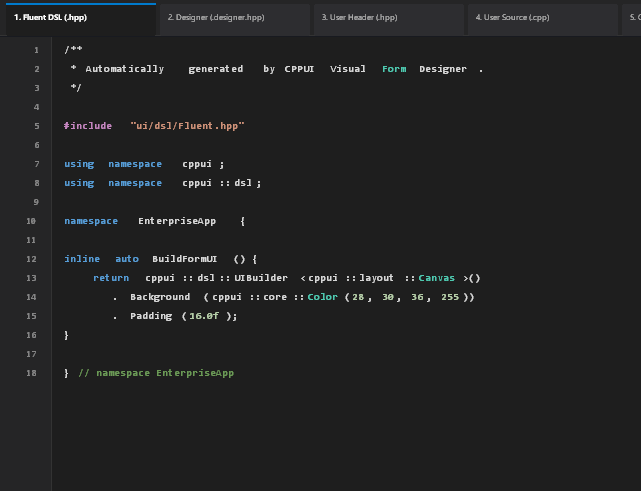

# CPPUI 視覺化表單設計器官方使用手冊 (Visual Form Designer User Guide)

歡迎使用 **CPPUI 官方獨立視覺化表單設計器 (`cppui-designer`)**。

CPPUI 表單設計器是一套現代化、高效能且與 CPPUI 核心完全解耦的獨立桌面視覺化開發工具。其地位對標 **Qt Designer**、**Visual Studio Windows Forms Designer**、以及 **Android Studio Layout Editor**，旨在消除傳統 C++ 桌面開發中「手寫繁複座標排版」與「繁重 XML/XAML 編譯流程」的雙重痛點。

---

## 📸 設計器介面視覺預覽 (Visual Showcase)

### 1. 視覺化設計工作台主視窗 (Designer Main Window)

*圖 1：CPPUI 視覺化表單設計器全新工作台（垂直可折疊分類工具箱、全幅中央設計畫布、型別安全屬性與事件檢查器）*

### 2. 獨立語法高亮即時代碼預覽 (Live Code Preview Window)

*圖 2：獨立彈出之代碼預覽視窗，支援 C++ 語法著色、行號槽、五大架構分頁切換與一鍵剪貼簿複製*

### 3. 一鍵真實表單「試運行」 (Interactive Live Run)

*圖 3：脫離設計期裝飾層與事件攔截盾的獨立真實試運行表單，可立即測試真實點擊、輸入與主題適配*

---

## 一、 核心設計哲學與價值 (Philosophy & Value)

1. **激進的直覺拖曳開發體驗 (Radical RAD)**：
   無需預先編寫繁複程式碼，透過滑鼠點選與拖曳即可完成多層級 Grid、StackPanel、按鈕、輸入框與數據表格的視覺化編排。
2. **零 XML / XAML、零 MOC 執行期反射**：
   完全基於純 C++ 現代領域 AST 模型（`FormDocumentNode` 與 `WidgetNode`），支援雙向即時生成型別安全的 **Fluent DSL** 或 **Classic C++ Code-Behind** 代碼。
3. **現代 Pimpl 深常數性 (Deep Constness)**：
   所有內部狀態封裝於 `compat::propagate_const<std::unique_ptr<Impl>>`，杜絕淺常數性漏洞，提供工業級 ABI 穩定度。
4. **增量使用者程式碼保護 (Incremental User Code Protection)**：
   專案匯出時全量覆寫由設計器維護的 `.designer.hpp`，但對使用者自訂商業邏輯的 `.cpp` 檔案**僅增量追加新事件常式存根**，100% 完整保留使用者的自訂函式、變數與註解。
5. **護眼人體工學主題 (Ergonomic Theme)**：
   淺色主題全面升級為溫潤舒適的淺灰色系（`#EAECF0` / `#F2F4F8`），告別刺眼亮白，長時間設計無視覺疲勞。

---

## 二、 工作台介面全覽 (Workspace Tour)

CPPUI 表單設計器主視窗採用專業的三欄式現代化佈局：

```text
+------------------------------------------------------------------------------------------------------------------+
| 💠 CPPUI Designer   [↶ 復原] [↷ 重做] [🗑 刪除]   [▶ 預覽執行] [⚡ 程式碼預覽] [🎨 切換主題] [📦 匯出 CMake 專案]       |
+--------------------------+-------------------------------------------------------------+-------------------------+
| 🛠 控制項工具箱 (Toolbox) | 🎨 設計畫布表面 (Design Surface - 全幅高度未壓縮)            | ⚙ 屬性與事件檢查器      |
| 🔍 搜尋控制項 (Filter)... | +---------------------------------------------------------+ | 🎯 saveBtn : Button     |
| ▼ 常用控制項 (9)          | |  🏷 使用者帳戶與安全性設定                                | | [屬性 (Properties)]     |
|   🔘 按鈕 (Button)       | |  🏷 帳號名稱:    🔤 administrator                       | | [事件 (Events)]         |
|   🏷 標籤 (Label)        | |  🏷 電子郵件:    🔤 admin@enterprise.internal           | | 🔍 搜尋屬性或事件...    |
|   🔤 文字輸入框 (TextBox)| |  ☑ 強制啟用雙重驗證                                      | | ▼ 一般屬性 (Common)     |
|   📝 文字區塊 (TextBlock)| |  [儲存設定] ★ (8向控制框+對齊導引線)   [取消]              | |   Content: 儲存設定 (Save)|
|   ☑ 核取方塊 (CheckBox)  | +---------------------------------------------------------+ | ▼ 版面與尺寸 (Layout)   |
|   🔘 單選按鈕 (RadioButton)|                                                           | |   Width: 130.0          |
|   ▾ 下拉選單 (ComboBox)  | (點擊工具列「⚡ 程式碼預覽」彈出獨立高亮視窗)               | |   Height: 34.0          |
|   🎚 滑桿 (Slider)       |                                                             | |   Canvas.Left: 170.0 *  |
|   📊 進度條 (ProgressBar)|                                                             | | ▼ 外觀與色彩 (Appearance|
| ▼ 版面容器 (5)           |                                                             | |   Background: [■] #0E6ED2|
|   🔲 網格佈局 (Grid)     |                                                             | | ▼ 行為狀態 (Behavior)   |
|   📑 堆疊面板 (StackPanel)|                                                            | |   IsEnabled: [✓] True   |
|   🎨 絕對畫布 (Canvas)   |                                                             |                         |
|   🖼 外框邊界 (Border)   |                                                             |                         |
|   📜 捲動檢視器 (ScrollViewer)                                                         |                         |
| ▼ 資料與集合 (5)         |                                                             |                         |
|   📋 清單方塊 (ListBox)  |                                                             |                         |
|   📊 資料表格 (DataGrid) |                                                             |                         |
|   🌲 樹狀檢視 (TreeView) |                                                             |                         |
|   🖼 圖片方塊 (PictureBox)                                                              |                         |
|   ➖ 分隔線 (Separator)  |                                                             |                         |
| ▼ 元件與對話框 (4)       |                                                             |                         |
|   ⏱ 計時器 (Timer)       |                                                             |                         |
|   💬 訊息對話框 (MessageBox)                                                            |                         |
|   📂 開啟檔案 (OpenFileDialog)                                                          |                         |
|   💾 儲存檔案 (SaveFileDialog)                                                          |                         |
|                          |                                                             |                         |
| 🌳 元件層級樹 (Hierarchy)|                                                             |                         |
+--------------------------+-------------------------------------------------------------+-------------------------+
| 狀態: 就緒 | 當前選取: saveBtn (Button) | 位置: (170, 190) 尺寸: 130 x 34 | 導引線: 啟用 | 歷史: 0 步                    |
+------------------------------------------------------------------------------------------------------------------+
```

### 1. 頂部工具列 (Top Toolbar)
* **↶ 復原 (Undo) / ↷ 重做 (Redo)**：完整歷史記錄堆疊調度，支援單一與多選複合動作復原。
* **🗑 刪除元件**：將選取節點從 AST 移除並記錄至 Undo 堆疊。
* **▶ 預覽執行 (Live Run)**：一鍵以獨立原生 `app::Form` 視窗啟動當前表單，不含設計期 Adorner，支援真實點擊、鍵盤焦點導航與 ComboBox 彈出測試。
* **⚡ 程式碼預覽 (Code Preview)**：彈出獨立代碼檢視視窗，釋放中央畫布垂直工作空間。
* **🎨 切換主題**：在深色 (Dark) 與淺色 (Light，柔和淺灰) 主題間熱切換，即時檢視設計成果對主題色彩 Token 的適配性。
* **📦 匯出 CMake 專案**：將 AST 產出為包含 `CMakeLists.txt`、`.designer.hpp`、`.hpp`、`.cpp`、`main.cpp` 的完整可編譯專案。

### 2. 左側欄 (垂直可折疊分類工具箱與層級樹)
* **垂直單欄分類工具箱 (`ToolboxPanel`)**：
  * **可折疊分組**：點擊 `▼` 或 `▶` 即可收合/展開類別。
  * **四大標準分類**：
    1. **常用控制項 (Common Controls)**：Button、Label、TextBox、TextBlock、CheckBox、RadioButton、ComboBox、Slider、ProgressBar。
    2. **版面容器 (Containers & Layout)**：Grid、StackPanel、Canvas、Border、ScrollViewer。
    3. **資料與集合 (Data & Lists)**：ListBox、DataGrid、TreeView、PictureBox、Separator。
    4. **元件與對話框 (Components & Dialogs)**：Timer、MessageBox、OpenFileDialog、SaveFileDialog。
  * **即時搜尋過濾**：頂部搜尋列可依中英文名稱即時過濾可用控制項。
  * **拖曳與雙擊支援**：
    * **拖曳放置 (Drag-and-Drop)**：按住項目拖入中央畫布，釋放滑鼠即在目標座標放置元件。
    * **雙擊新增 (Double-Click)**：雙擊項目即可自動於畫布預設位置掛載元件並選取。
* **元件階層樹 (Hierarchy View)**：即時呈現象徵拓撲結構的樹狀檢視，點擊節點同步更新畫布選取與右側檢查器。

### 3. 中央主工作區 (全幅無壓縮設計畫布)
* **設計表面 (`DesignSurface`)**：
  * **完整高縱深表面**：代碼預覽獨立彈出後，畫布表面享受完整的 700px 高度。
  * **網格背景**：提供視覺間距參照。
  * **選取框與 8 向縮放控制錨點 (Handles)**：選取元件時外圍顯示高對比霓虹框與 8 個八向錨點（NW, N, NE, E, SE, S, SW, W），拖曳錨點即可即時改變尺寸。
  * **智慧對齊導引線 (Smart Snap Guides)**：拖曳移動或縮放元件時，若邊界或中心點接近父容器或其他元件，自動彈出洋紅色對齊導引線並自動磁吸。
  * **真實控制項外觀渲染**：支援按鈕色彩、輸入框、核取方塊、單選圓鈕、下拉清單、進度條、滑桿與圖片框的精緻向量視覺。

### 4. 獨立代碼預覽視窗 (`CodePreviewWindow`)
* **五大架構分頁切換**：
  1. `Fluent DSL (.hpp)`：極簡聲明式代碼。
  2. `Classic Designer (.designer.hpp)`：工業級元件配置代碼。
  3. `User Header (.hpp)`：使用者邏輯類別宣告。
  4. `User Source (.cpp)`：事件處理常式實作與商業邏輯。
  5. `CMakeLists.txt`：模組化構建指令碼。
* **C++ 語法著色引擎**：關鍵字（藍色）、型別（青綠）、字串（暖橘）、常數（嫩綠）、註解（草綠）、前處理器（洋紫）。
* **行號槽 (Gutter) 與複製代碼**：左側固定寬度行號槽；點擊右上角「📋 複製代碼」直接寫入作業系統剪貼簿。

### 5. 右側欄 (詳細屬性與事件檢查器 `InspectorPanel`)
* **屬性分頁 (Properties Tab)**：
  * 依外觀 (Appearance)、版面 (Layout)、文字 (Text)、行為 (Behavior)、常用 (Common) 分組排列。
  * **色彩即時預覽色塊**：`Background`、`Foreground` 欄位即時渲染色彩方塊與 Hex 色碼。
  * **互動式布林切換**：`IsEnabled`、`IsChecked` 欄位提供可點擊核取方塊。
  * **動態附加屬性感測**：`Canvas.Left`、`Canvas.Top`、`Grid.Row` 等附加屬性顯式標註 `*`。
* **事件分頁 (Events Tab)**：
  * 列出控制項支援的所有事件與命令（如 `Click`, `TextChanged`）。
  * 未綁定事件呈現 `[+ 點擊建立常式]`，點擊立即自動產出符合規格的常式名稱（如 `OnSaveSettingsClick`）並推入 Undo 堆疊。

---

## 三、 實戰步驟教學 (Step-by-Step Tutorial)

### 步驟 1：啟動獨立表單設計器
在建置目錄中直接執行二進位檔：
```powershell
# Windows
.\build\bin\Debug\cppui-designer.exe

# Linux
./build/bin/Release/cppui-designer
```

### 步驟 2：從工具箱拖入元件
1. 在左側工具箱中展開「常用控制項」或於搜尋框鍵入 `Button`。
2. 滑鼠按住 **🔘 按鈕 (Button)** 拖曳至中央畫布，釋放後即在指定座標建立按鈕。
3. 同樣可從「資料與集合」拖入 **🖼 圖片方塊 (PictureBox)**，或從「元件與對話框」拖入 **⏱ 計時器 (Timer)**。

### 步驟 3：調整幾何尺寸與智慧對齊
1. 點擊畫布上的按鈕，邊界出現 8 向縮放方塊。
2. 拖曳右下角錨點（SE Handle）調整按鈕寬高至 `130 x 34`。
3. 拖曳按鈕本體，當按鈕左側與上方輸入框對齊時，畫布自動繪製洋紅色垂直導引線並提供磁吸吸附。

### 步驟 4：透過屬性面板設定細部樣式
1. 在右側檢查器找到 `Background` 欄位，檢視目前即時色彩色塊。
2. 在 `IsEnabled` 欄位點擊核取方塊，切換啟用/停用狀態。
3. 觀察所有屬性變更皆能透過頂部工具列「↶ 復原」與「↷ 重做」無損撤銷。

### 步驟 5：一鍵彈出程式碼預覽
1. 點擊頂部工具列 **⚡ 程式碼預覽 (Code)** 按鈕。
2. 彈出語法高亮的預覽視窗，切換分頁檢視 Fluent DSL 與 Classic Form 架構代碼。
3. 點擊「📋 複製代碼」即可直接貼入現有專案。

### 步驟 6：執行試運行 (Live Run)
1. 點擊工具列 **▶ 預覽執行 (Live Run)** 按鈕。
2. 獨立真實表單視窗啟動，可測試按鈕懸停、點擊反饋與鍵盤焦點巡訪。

### 步驟 7：匯出完整 CMake 專案
1. 點擊工具列 **📦 匯出 CMake 專案**。
2. 設計器自動產出完整的 CMakeLists.txt 與源碼目錄樹，使用者程式碼保證 100% 增量保護不被覆寫。

---

## 四、 跨平台測試與品質保證 (Cross-Platform & QA)

| 驗證維度 | 測試規範 | 測試結果 |
| :--- | :--- | :--- |
| **自動化單元測試** | 41 項 CTest 測試（覆蓋 AST、命令、序列化、代碼生成、畫布與檢查器） | **100% 通過 (41/41 Passed)** |
| **編譯品質** | MSVC `/W4`、GCC `-Wall -Wextra -Wpedantic`、Clang 嚴格編譯 | **0 Errors / 0 Warnings** |
| **記憶體安全** | RAII 智能指標，Pimpl 深常數性 `compat::propagate_const` | **0 Leaks** |
| **主題適配** | 淺色舒適淺灰與深色專業深灰熱切換 | **正常** |
