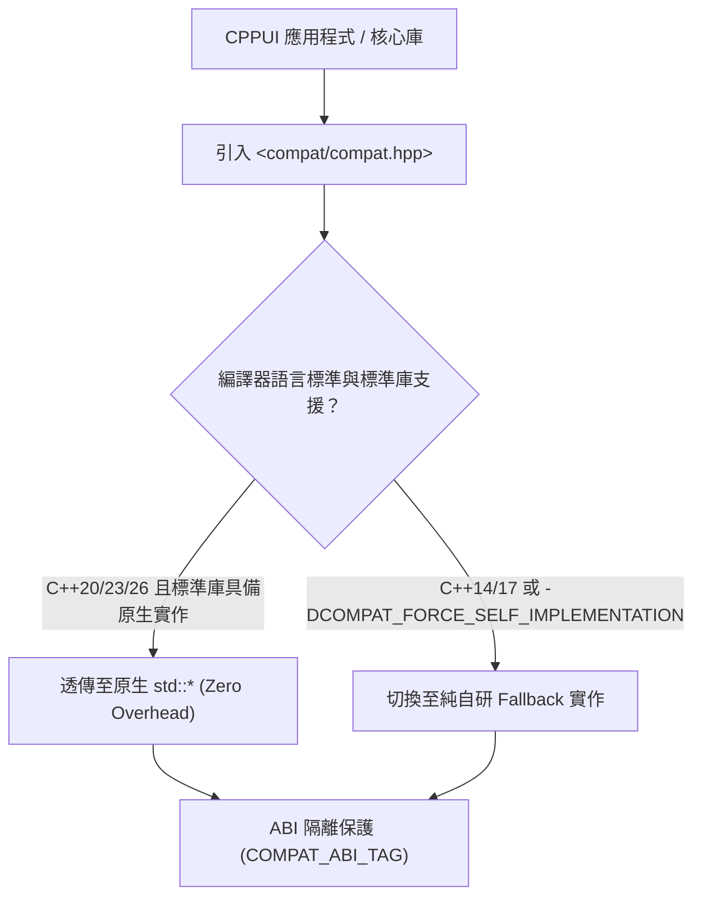

# compat 核心相容層技術手冊 (Namespace & Shim Architecture)

`compat` 命名空間與單標頭檔 [`include/compat/compat.hpp`](../../../include/compat/compat.hpp) 為 CPPUI 提供 **零外部依賴、向下相容 C++14/17、向上對齊 C++20/23/26** 的現代 C++ 墊片架構 (Compatibility Shim Layer)。

---

## 1. 雙軌架構原則 (Dual-Track Architecture)

CPPUI 採用業界高標準的雙軌執行模型，兼顧現代編譯器的極致最佳化與舊版工具鏈的無縫相容：



1. **原生零開銷透傳 (Transparent Native Routing)**：
   當使用支援新標準的現代編譯器（如 MSVC `/std:c++20` 或 Clang/GCC `-std=c++23`）時，各型別自動以 `using` 形式透明別名（Type Alias）至原生 `std::*`，享有原生編譯器的深度內聯、SIMD 向量化與內建最佳化。
2. **純自研降階實作 (Self-Contained Fallback)**：
   當在 C++14/17 舊環境編譯，或顯式定義 `-DCOMPAT_FORCE_SELF_IMPLEMENTATION=1` 時，自動無縫切換至純自研、零第三方相依的輕量 Polyfill 實作，保證**語意 100% 嚴格對齊 ISO 標準規格**。
3. **ABI 隔離與 ODR 防護**：
   自研實作封裝於 `compat::detail` 與內聯命名空間 `COMPAT_ABI_TAG`（如 `abi_v1`），徹底杜絕跨編譯單元混用時的單一定義規則（One Definition Rule, ODR）衝突與符號混淆。

---

## 2. 模組完整索引矩陣 (Module Directory Matrix)

`compat.hpp` 整合了 CPP-Compat 完整的 12 大功能模組，提供跨標準一致的現代 API：

| 模組名稱 | 所屬命名空間 | 核心型別 / 函式 / 特性摘要 | ISO 對齊標準 | 專題手冊連結 |
| :--- | :--- | :--- | :---: | :--- |
| **特性檢測與配置 (Config)** | `compat`, `compat::detail` | 標準版本檢測 (`COMPAT_CXX_*`)、雙軌切換開關、無例外安全終止、微架構巨集 | C++11 ~ C++26 | 本頁第 3 節 |
| **字串檢視 (String View)** | `compat` | `compat::string_view`，零拷貝唯讀字串引用，特化 `std::hash` | C++17 | 本頁第 4 節 |
| **選擇性值 (Optional)** | `compat` | `optional<T>`, `nullopt`, `bad_optional_access`, `make_optional`, Monadic 操作 | C++17 / C++23 | [`compat_expected.md`](compat_expected.md) |
| **期望值與錯誤處理 (Expected)** | `compat` | `expected<T, E>`, `unexpected<E>`, `bad_expected_access`, Tagged Union Fallback, Monadic | C++23 | [`compat_expected.md`](compat_expected.md) |
| **受約束範圍基礎 (Ranges)** | `compat::ranges` | Range Concepts, CPO (`begin`, `end`, `size`), `borrowed_range`, `dangling`, `subrange` | C++20 / C++23 | [`compat_ranges.md`](compat_ranges.md) |
| **視圖適配器 (Views)** | `compat::views` | 管道運算子 (`\|`), 惰性視圖 (`iota`, `filter`, `transform`, `take`), C++23 `as_const`, C++26 `concat` | C++20 / C++23 / C++26 | [`compat_views.md`](compat_views.md) |
| **受約束演算法 (Algorithms)** | `compat::ranges` | Niebloid 函式物件, 投影 (`compat::identity`, 成員指標), 標籤結果型別 (`in_out_result`) | C++20 / C++23 | [`compat_ranges.md`](compat_ranges.md) |
| **未初始化記憶體 (Memory)** | `compat::ranges` | `construct_at`, `destroy_at`, `uninitialized_copy/fill/move`, RAII 回滾安全保護 | C++20 | [`compat_ranges.md`](compat_ranges.md) |
| **字串格式化 (Format)** | `compat` | `format`, `formatter<T>` 擴充, 標準格式規格語法 (`[[fill]align]...`), UAX #11 東亞寬度 | C++20 | [`compat_format_print.md`](compat_format_print.md) |
| **終端列印 (Print)** | `compat` | `print`, `println`, Windows UTF-8 `WriteConsoleW` 直寫防亂碼, 多欄位寬度對齊 | C++23 | [`compat_format_print.md`](compat_format_print.md) |
| **強型別解析 (Parse)** | `compat` | `parse<T>`, `from_chars` (2~36 進位整數、浮點數次常態數、零動態配置) | C++17 | [`compat_format_print.md`](compat_format_print.md) |
| **檔案系統 (Filesystem)** | `compat::filesystem` | `path`, `directory_iterator`, `file_status`, 全套跨平台路徑操作 | C++17 | 本頁第 4 節 |

---

## 3. 公開巨集契約與微架構最佳化 (Macro Contracts)

為保證跨 MSVC、Clang++、G++ 三大編譯器在 C++14/17/20/23/latest 下零語法報錯、零擴展警告（`-Wc++17-extensions`、`error C2429`、`error C7525`），專案對齊以下公開巨集：

### 3.1 `constexpr` 語意相容巨集
* `COMPAT_CONSTEXPR_14`：在 C++14+ 展開為 `constexpr`。用於包含分支、區域變數與迴圈的結構建構式與計算方法。
* `COMPAT_CONSTEXPR_17`：在 C++17+ 展開為 `constexpr`。用於 constexpr lambda、if constexpr。
* `COMPAT_CONSTEXPR_20`：在 C++20+ 展開為 `constexpr`。

### 3.2 `inline` 與常數宣告巨集
* `COMPAT_INLINE_VAR`：
  - 在 C++17+ 自動展開為 `inline`。
  - 在 C++14/11 自動降級為 `static`。
  - **強制用於標頭檔命名空間常數**（例如 `COMPAT_INLINE_VAR constexpr Color Transparent = ...;`），徹底杜絕跨單元 ODR 衝突與 C7525 報錯。
* `COMPAT_ALWAYS_INLINE`：
  - 微架構關鍵熱點強制內聯。
  - MSVC 展開為 `__forceinline`，GCC/Clang 展開為 `__attribute__((always_inline)) inline`。

### 3.3 編譯器優化提示巨集
* `COMPAT_NODISCARD`：展開為 `[[nodiscard]]`。純運算與狀態查詢方法強制標記。
* `COMPAT_LIKELY(expr)`：分支預測提示，標記高頻率執行路徑。
* `COMPAT_UNLIKELY(expr)`：分支預測提示，標記低頻率例外路徑（如緩衝區擴容）。
* `COMPAT_UNREACHABLE()`：提示編譯器該執行路徑不可達（MSVC `__assume(0)`，GCC/Clang `__builtin_unreachable()`），協助微架構死碼消除。

### 3.4 例外與無例外環境相容 (`-fno-exceptions`)
* `COMPAT_HAS_EXCEPTIONS`：`1` 表示啟用例外處理，`0` 表示處於 `-fno-exceptions` 或 MSVC `/EHs-c-` 模式。
* `COMPAT_THROW_OR_ABORT(ex)`：在啟用例外時拋出 `throw (ex)`；在無例外環境下自動降階為 `std::abort()`，保證嵌入式或高頻交易環境下的極致安全性。

---

## 4. 基礎常用模組速查 (Basic Modules Reference)

### 4.1 字串檢視：`compat::string_view`
```cpp
#include "compat/compat.hpp"

// 唯讀字串參數強制首選 string_view
void DrawLabel(compat::string_view label) {
    if (!label.empty()) {
        compat::println("Label length: {}, starts with: {}", label.size(), label.front());
    }
}
```
* **零拷貝優勢**：可同時直接接收字串常常常常字面值 (`"hello"`), `std::string` 或字元陣列，不產生任何堆積配置。

### 4.2 區間數值夾取：`compat::clamp`
```cpp
#include "compat/compat.hpp"

// 向下相容 C++14 的安全數值夾取 (取代 C++17 std::clamp)
float opacity = compat::clamp(currentOpacity * factor, 0.0f, 1.0f);
```

### 4.3 跨平台路徑：`compat::filesystem`
```cpp
#include "compat/compat.hpp"

void CheckAsset(const compat::filesystem::path& assetPath) {
    if (compat::filesystem::exists(assetPath)) {
        compat::println("Asset found: {}", assetPath.filename().string());
    }
}
```

---

## 5. 專題子手冊導覽 (Specialized Handbooks)

深入技術細節，請參閱各專題參考手冊：
* [**視圖適配器與惰性管道 (`compat::views`)**](compat_views.md)：管道語法 `|`、`filter`、`transform`、`take`、C++23 `as_const`、C++26 `concat`。
* [**受約束範圍與演算法 (`compat::ranges`)**](compat_ranges.md)：Range Concepts、CPO、Niebloid 演算法物件、投影機制、Borrowed Range。
* [**期望值與錯誤處理 (`compat::expected`)**](compat_expected.md)：`expected<T, E>`、`optional<T>`、Monadic 操作、Tagged Union 降階。
* [**格式化、終端與數值解析 (`compat::format` / `print`)**](compat_format_print.md)：格式化語法規格、Windows UTF-8 直寫防亂碼、`parse<T>`。

---

## 請參閱 (See Also)
* [CPPUI API 首頁](../README.md)
* [代碼規範與向下相容標準](../../specs/02_coding_standards_compat.md)
