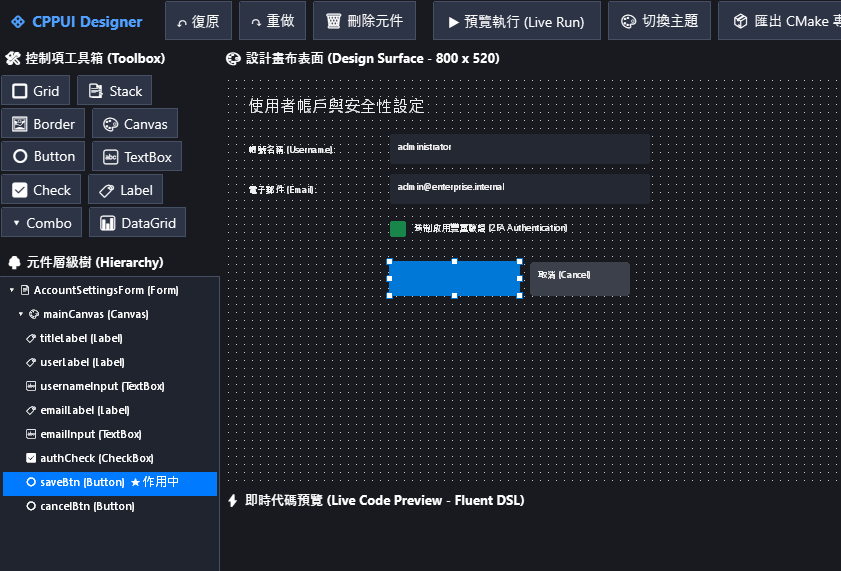
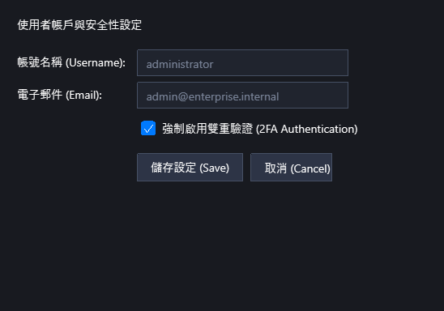
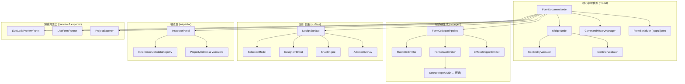

# `cppui::designer` 命名空間 (Visual Form Designer Architecture)

歡迎查閱 **`cppui::designer`** 視覺化表單設計器核心體系的官方 API 規格與架構文件。

---

## 1. 命名空間總覽 (Overview)

`cppui::designer` 為 CPPUI 提供完整且現代化的視覺化表單設計核心，涵蓋：
1. **核心領域 AST 模型 (`cppui::designer::model`)**：高內聚、鬆耦合、具備深常數性 (Deep Constness) 的節點抽象樹，內建 C++ 識別字檢驗、容器基數驗證、反應式異動信號與完整的 Undo/Redo 命令狀態機。
2. **多目標代碼發射管線 (`cppui::designer::codegen`)**：支援同時輸出宣告式 Fluent DSL、Classic Code-Behind (.designer.hpp/.hpp/.cpp) 與 CMakeLists.txt，並具備雙向 SourceMap 行號追蹤。
3. **視覺化畫布設計表面 (`cppui::designer::surface`)**：提供真實 UIElement 裝飾層 (Adorner)、8 向選取控制框、智慧對齊導引線 (Smart Snap Guides) 與拖曳排版互動。
4. **型別安全屬性與事件檢查器 (`cppui::designer::inspector`)**：支援繼承鏈自動聚合、多選交集編輯 (`<Multiple Values>`)、動態附加屬性感測與主題語意代幣 (Theme Tokens) 整合。
5. **即時代碼預覽與試運行 (`cppui::designer::preview`)**：多分頁即時代碼展示、SourceMap 行號聚焦高亮、以及一鍵無裝飾器「真實執行」獨立 Form 視窗。
6. **標準專案匯出引擎 (`cppui::designer::exporter`)**：自動產出完整 CMake 專案目錄樹，並具備使用者業務邏輯檔（`.cpp`）增量保護機制（保留使用者代碼，僅追加新事件 Stubs）。

> [!TIP]
> **官方獨立工具與完整使用手冊**：
> CPPUI 提供預先構建之獨立官方工具 **`tools/designer/`** (`cppui-designer.exe`)。
> 欲了解完整的介面導覽、拖曳操作、智慧導引線、屬性/事件檢查器與專案匯出流程，請參閱 [📖 **視覺化表單設計器官方使用手冊 (User Guide)**](../guides/visual_form_designer_user_guide.md)。

### 視覺成果展示 (Visual Showcase)

| 官方視覺化表單設計器 (`cppui-designer`) | 真實試運行模式 (Live Run) |
| :---: | :---: |
|  |  |
| *獨立官方工具、八向控制點、智慧導引線與屬性檢查器* | *零設計干擾之獨立視窗試運行、控制項互動與主題即時測試* |



---

## 2. 子命名空間與核心型別索引 (Sub-namespaces & Types)

### 2.1 領域模型層：`cppui::designer::model`

| 類別 / 結構 | 職責與特性 |
| :--- | :--- |
| [`WidgetNode`](#widgetnode-類別) | 代表畫布上單一控制項或排版容器的 AST 節點。採用現代 Pimpl 深常數性（`compat::propagate_const`），封裝型別、名稱、UUID、幾何邊界、屬性表、附加屬性表與子節點擁有權清單。 |
| [`FormDocumentNode`](#formdocumentnode-類別) | 表單設計文件的最頂層根節點。持有根 `WidgetNode`、表單全域名稱、命名空間、視窗尺寸，並提供 `SignalModified` 反應式異動廣播。 |
| `CardinalityValidator` | 容器子節點基數與循環引用純函數驗證器（如驗證 `ContentControl` 最多僅容納 1 個子元件，避免非法拓撲）。 |
| `IdentifierValidator` | C++ 變數名合法性驗證器（檢查 C++ 關鍵字衝突、首字元規範，並提供重複命名消歧義序號自動補齊）。 |
| `PropertyValue` | 型別安全之屬性變體封裝（支援 `bool`, `int32_t`, `float`, `string`, `Color`, `Thickness` 等）。 |
| `PropertyMetadataRegistry` | 靜態屬性註冊表中樞，記錄各控制項屬性的預設值，支援輸出代碼與 JSON 時剔除無效預設值以達成檔案精簡。 |
| `FormSerializer` | 提供完全確定性、無損且跨平台相容之 `.cppui.json` 序列化與反序列化引擎。 |
| `CommandHistoryManager` | 具備容量限制之 Undo/Redo 歷史命令管理中樞，支援單一操作回退與多選批次 `MacroCommand` 復原。 |

### 2.2 程式碼生成層：`cppui::designer::codegen`

| 類別 / 結構 | 職責與特性 |
| :--- | :--- |
| `FormCodegenPipeline` | 程式碼生成編排中樞，協調各 Emitter 生成專案代碼並維護全域 `SourceMap`。 |
| `FluentDslEmitter` | 將 AST 樹轉換為簡潔、現代的 CPPUI 宣告式 `UIBuilder<T>` (VStack/HStack/Grid/Button) 鏈式建構程式碼。 |
| `FormClassEmitter` | 生成微軟標準 partial class / code-behind 風格代碼（包含 `.designer.hpp` 元件宣告與初始化、`.hpp` 類別定義與 `.cpp` 事件處理常式存根）。 |
| `CMakeSnippetEmitter` | 生成完整相容現代 CMake 3.20+ 的 `CMakeLists.txt` 建置設定檔。 |
| `SourceMap` / `SourceSpan` | 記錄 AST 節點 UUID 與生成檔案各行號區間之雙向映射，支援點選畫布跳轉程式碼、以及點選程式碼高亮控制項。 |

### 2.3 視覺化設計表面：`cppui::designer::surface`

| 類別 / 結構 | 職責與特性 |
| :--- | :--- |
| `DesignSurface` | 繼承自 `cppui::controls::Control` 的主設計畫布，內嵌深常數性 Pimpl，負責繪製背景格線、掛載 AdornerOverlay、攔截設計期滑鼠輸入並指派命令。 |
| `SelectionModel` | 管理設計期選取狀態，支援單選（Single Selection）、多選（Multi-selection）、反選與主選取節點（Primary Selected UUID）追蹤。 |
| `DesignerHitTest` | 精確度量 8 向縮放控制點（NW, N, NE, E, SE, S, SW, W）與階層式內部控制項的命中測試。 |
| `SnapEngine` | 幾何對齊與智慧導引線求解器，支援磁吸至父容器邊緣/中心、相鄰兄弟元件外框，並可自訂吸附閾值與網格吸附。 |
| `AdornerOverlay` | 專屬設計期飾條渲染器，直接將八向錨點框、霓虹選取外框與洋紅色對齊導引線發射至 `DisplayList` 命令流。 |

### 2.4 屬性與事件檢查器：`cppui::designer::inspector`

| 類別 / 結構 | 職責與特性 |
| :--- | :--- |
| `InspectorPanel` | 右側屬性檢查器面板，繼承 `Control`，支援「屬性 (Properties)」與「事件/MVVM (Events)」雙分頁切換與即時篩選。 |
| `InheritanceMetadataRegistry` | 靜態解析 Visual $\to$ UIElement $\to$ Control $\to$ 衍生控制項繼承鏈，支援多選狀態下的共同屬性交集計算。 |
| `PropertyValidators` | 防禦性純函數驗證器，針對數值、浮點、NaN/Inf、負數尺寸、Hex 色碼與合法 C++ 識別字進行即時攔截保護。 |
| `PropertyEditorModel` | 型別安全專屬編輯器模型，支援單值、`<Multiple Values>` 多重數值顯示與 `theme::ColorTokens` 主題語意代幣建議。 |

### 2.5 預覽與匯出層：`cppui::designer::preview` & `exporter`

| 類別 / 結構 | 職責與特性 |
| :--- | :--- |
| `LiveCodePreviewPanel` | 即時代碼預覽面板，提供 5 種檢視模式（Fluent DSL、Classic Designer HPP、Classic Header、Classic Source、CMakeLists），訂閱 AST 信號即時重繪並自動高亮選取行號。 |
| `LiveFormRunner` | 將 AST 動態轉換為真實獨立之 `app::Form` 實例，不含任何裝飾器，讓使用者直接體驗按鈕點擊、Tab 鍵焦點切換與深淺色主題熱切換。 |
| `ProjectExporter` | 標準 CMake 專案結構匯出引擎，生成完整目錄樹並落實**增量使用者程式碼保護**（全量覆寫 `.designer.hpp`，增量附加新事件 Stubs 至 `.cpp`，不破壞使用者既有代碼）。 |

---

## 3. 核心 API 程式碼範例 (Code Examples)

### 3.1 程式化組裝表單 AST 並觸發檢查器與序列化

```cpp
#include <ui/Designer.hpp>
#include <compat/Compat.hpp>

using namespace cppui::designer::model;
using namespace cppui::designer::inspector;
using namespace cppui::designer::serialization;

void CreateAdminFormExample() {
    // 1. 建立表單文件根節點
    FormDocumentNode doc("AdminDashboardForm", "AdminApp");
    doc.SetFormSize(800.0f, 600.0f);

    // 2. 建立主 Grid 佈局面板
    auto grid = std::make_unique<WidgetNode>("mainGrid", "Grid");
    grid->SetBounds(cppui::core::Rect(0.0f, 0.0f, 800.0f, 600.0f));

    // 3. 建立並加入 Button 控制項
    auto submitBtn = std::make_unique<WidgetNode>("submitBtn", "Button");
    submitBtn->SetBounds(cppui::core::Rect(20.0f, 20.0f, 120.0f, 36.0f));
    submitBtn->SetProperty("Content", PropertyValue(std::string("送出訂單")));
    submitBtn->SetProperty("Margin", PropertyValue(cppui::core::Thickness(8.0f)));
    submitBtn->AddEventBinding(EventBindingDescriptor{ "Click", "OnSubmitBtnClick" });

    // 4. 掛載至 AST (自動觸發基數與識別字檢驗)
    grid->AddChild(std::move(submitBtn));
    doc.SetRoot(std::move(grid));

    // 5. 序列化為 .cppui.json
    auto jsonResult = FormSerializer::Serialize(doc);
    if (jsonResult.has_value()) {
        compat::println("表單序列化成功，JSON 大小: {} 位元組", jsonResult.value().size());
    }
}
```

### 3.2 匯出完整 CMake 專案並保留使用者邏輯

```cpp
#include <ui/Designer.hpp>

using namespace cppui::designer::model;
using namespace cppui::designer::exporter;

void ExportAdminProject(const FormDocumentNode& doc) {
    ProjectExportOptions options;
    options.outputDirectory = "./output/AdminSystem";
    options.projectName = "AdminSystem";
    options.formClassName = "AdminDashboardForm";
    options.targetNamespace = "AdminApp";
    options.incrementalUserCode = true; // 啟用使用者程式碼增量保護

    auto result = ProjectExporter::ExportProject(doc, options);
    if (result.success) {
        compat::println("專案已成功匯出至: {}", options.outputDirectory);
        for (const auto& file : result.generatedFiles) {
            compat::println("  - 生成檔案: {}", file);
        }
    }
}
```

---

## 4. 執行緒安全與微架構保證 (Threading & Safety)

1. **深常數性 (Deep Constness)**：
   所有公開介面類別（如 `WidgetNode`、`FormDocumentNode`、`DesignSurface`、`InspectorPanel`、`LiveCodePreviewPanel`）內部 Pimpl 成員一律採用 `compat::propagate_const<std::unique_ptr<Impl>>` 封裝，防止 `const` 方法內部意外篡改狀態。
2. **零堆積分派與無例外驗證 (Fail-Fast & Zero-Allocation)**：
   驗證器與解析輔助函數一律回傳 `compat::expected<T, DesignerError>` 或 `ValidationResult`，禁止透過丟出例外處理預期內業務失敗。
3. **無損確定性 JSON**：
   `FormSerializer` 嚴格依屬性字母順序排序，生成的 JSON 字串在多次往返 (Round-trip) 中保持 100% 確定性一致。
