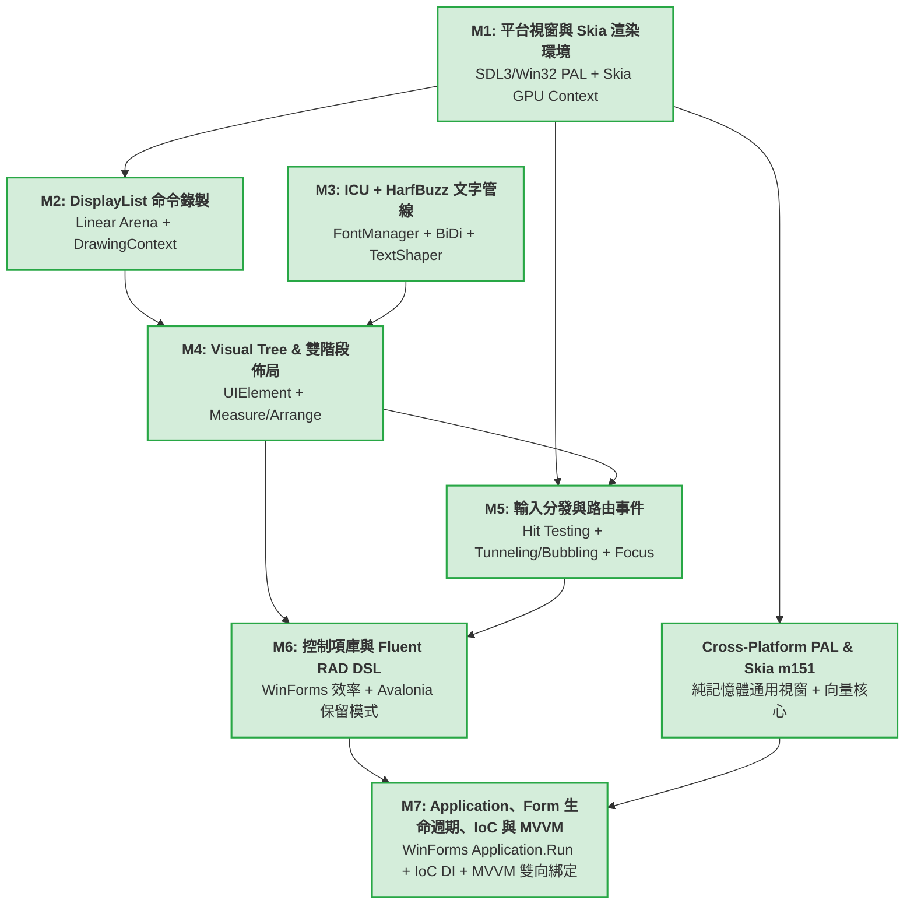

# CPPUI 目標地圖 (Target Roadmap: M1 ~ M7)

本文件將 CPPUI 跨平台現代 UI 框架之核心演進路線劃分為七大里程碑（M1 ~ M7）。每個階段皆有明確的職責界定、輸入依賴、核心交付物與客觀驗收標準。

---

## 1. 里程碑相依拓撲圖 (Milestone Dependency Graph)

---

## 2. 六大核心階段詳解

### 里程碑 1 (M1)：平台窗口抽象與 Skia 渲染環境搭建 (PAL & Render Backend)
* **核心目標**：建立解耦的平台視窗管理介面與 Skia GPU 硬體加速管線，提供穩定的畫面更新與原始事件派發能力。
* **技術選型**：
  * PAL：SDL3 或 原生 Win32 / Cocoa。
  * 渲染器：Skia (`GrDirectContext` / `SkSurface` / `SkCanvas`)。
* **核心交付物**：
  * `IPlatformWindow` 跨平台介面（視窗控制、尺寸變更、標題、DPI 取得）。
  * `PlatformWindowSDL3` 與/或 `PlatformWindowWin32`。
  * `SkiaRenderContext`：綁定視窗 Handle，管理 GPU 後端 Context 與 SwapBuffers。
  * `RunLoop`：主執行緒訊息泵與 VSync 計時器喚醒迴圈。
  * `RawInputEvent`：滑鼠座標、按鍵、滾輪、DPI 變更的原生事件結構。
* **驗收標準 (Acceptance Criteria)**：
  1. 能在 Windows (以及跨平台目標) 彈出原生視窗，主迴圈低 CPU 佔用執行。
  2. 視窗縮放時能夠自適應調整 Skia Framebuffer。
  3. Skia 成功執行 GPU 清屏（Clear）與繪製測試圖元（如旋轉彩色矩形），流暢達到 60/120 FPS。
  4. 滑鼠移動與點擊時能穩定輸出 `RawInputEvent`。

---

### 里程碑 2 (M2)：自研 DisplayList 與 Canvas 命令錄製系統 (Command Buffer)
* **核心目標**：徹底分離 UI 邏輯與 GPU 繪製，UI 元件僅產生輕量繪製指令流，由記憶體池高效承載。
* **技術選型**：連續平坦記憶體池（Linear Arena Allocator）+ 自研命令序列化。
* **核心交付物**：
  * `LinearArena`：具備字節對齊、零鎖定、$O(1)$ 分配與每幀重設（Reset）的記憶體池。
  * `DrawOpHeader` 與指令結構體（`DrawRectOp`, `DrawRoundedRectOp`, `DrawTextOp`, `PushClipOp`, `PopClipOp` 等）。
  * `DrawingContext`：提供高階直覺的公開繪製 API（如 `DrawRectangle`, `DrawText`），將操作序列化寫入 Arena。
  * `DisplayList`：命令容器，封裝指令遍歷迭代器。
  * `DisplayListRenderer`：解析指令流，依序轉換並呼叫 `SkCanvas` 對應 API。
* **驗收標準 (Acceptance Criteria)**：
  1. 單一幀錄製 50,000 個矩形命令，耗時低於 1.5ms 且堆積分配（Heap Allocation）次數為 0。
  2. 錄製並重播各種幾何圖元、剪裁（Clip）、透明度與變換矩陣，輸出結果與直接呼叫 SkCanvas 像素完全一致。
  3. 支援幀末 O(1) 記憶體重設。

---

### 里程碑 3 (M3)：文字整形與多行排版管線 (Text Pipeline) [已完成]
* **核心目標**：實現支援多語言、複合字形、Emoji、雙向文字（BiDi）與多行折行的工業級排版管線。
* **技術選型**：DirectWrite 原生工業級引擎（Windows 零額外依賴）+ ICU/HarfBuzz 跨平台雙軌插槽。
* **核心交付物**：
  * `FontManager`：快取管理 `hb_face_t`、`hb_font_t`，跨平台匹配系統字型家族。
  * `TextShaper`：封裝 `hb_buffer_t` 與 `hb_shape()`，轉換 UTF-8 字串為 Shaped Runs（包含 Glyph ID、X/Y Advance 與 Offset）。
  * `BiDiAnalyzer`：使用 ICU UBiDi 分析 RTL（如阿拉伯文、希伯來文）與 LTR（中英拉丁）混排段落。
  * `LineBreaker`：使用 ICU UBreakIterator 進行 Unicode UAX #14 斷行計算。
  * `TextLayoutEngine`：多行折行、對齊（Left/Center/Right/Justify）、省略號處理與字元點擊命中測試（Index to Point, Point to Index）。
* **驗收標準 (Acceptance Criteria)**：
  1. 成功載入系統預設字型並精準塑形拉丁與中文字元。
  2. 中英文混排且包含 Emoji 時，折行計算正確，無文字溢出或截斷亂碼。
  3. RTL 與 LTR 混排能正確判定顯示順序。
  4. 提供快速的 `MeasureText(string, maxWidth)`，供佈局系統查詢。

---

### 里程碑 4 (M4)：Visual Tree、Dirty Tracking 與雙階段佈局系統 (Layout Engine) [已完成]
* **核心目標**：構建 Avalonia 風格的階層式視覺樹，將排版幾何約束求解與繪圖呈現徹底分離。
* **技術選型**：Avalonia Two-Pass Layout (`Measure` / `Arrange`) 模型。
* **核心交付物**：
  * `Visual` 基底類別：維護座標系（Transform）、邊界（Bounds）、裁剪（ClipBounds）、反向 Z-Order 命中測試與 `Render(DrawingContext&)`。
  * `UIElement` 基底類別：維護 `Margin`、`Width`、`Height`、`MinWidth`、`MaxWidth`、`HorizontalAlignment`、`VerticalAlignment`。
  * 雙階段排版管線：
    * `Measure(availableSize)` $\rightarrow$ 計算並快取 `DesiredSize`。
    * `Arrange(finalRect)` $\rightarrow$ 配置子元件之實際位置 `RenderBounds`。
  * 髒標記（Dirty Tracking）系統：分離 `InvalidateMeasure`、`InvalidateArrange`、`InvalidateVisual`。
  * 核心佈局容器與控制項：`Panel`、`StackPanel`、`Border`、`Canvas`、`LayoutManager`、`TextBlock`。
* **驗收標準 (Acceptance Criteria)**：
  1. 建立至少三層嵌套的視覺樹，排版約束（如 Margin、居中對齊、拉伸對齊）計算精確無誤。
  2. 變更顏色等外觀屬性時，觸發 `InvalidateVisual`，監控確認**完全不重跑 Measure 與 Arrange**。
  3. 變更字串長度時，向上精確標記父節點尺寸髒區，正確觸發局部重排。
  4. 通過全編譯器多標準 60/60 矩陣測試與 10,000 元件排版壓測。

---

### 里程碑 5 (M5)：輸入分發、焦點管理與路由事件 (Input & Events) [已完成]
* **核心目標**：將作業系統原生訊息轉化為樹狀結構的事件路由，實現直覺且精準的互動反饋。
* **技術選型**：Avalonia/WPF Routed Events (Tunneling + Bubbling) 與 Z-Order 命中測試。
* **核心交付物**：
  * `Visual::HitTest`：自根節點向下反向 Z-Order 深度搜尋點擊命中節點。
  * `RoutedEvent` 與 `EventRoute` 派發器：實作 `Preview*` 隧道階段與冒泡階段。
  * `RoutedEventArgs`：支援 `e.Handled = true` 中斷後續傳播，以及 `handledEventsToo` 強制接收。
  * `FocusManager`：全域焦點切換、Tab 鍵尋路演算法、`GotFocus` / `LostFocus` 事件。
  * `InputManager`：懸停追蹤（Hover Tracking）與指標捕獲（Pointer Capture）。
* **驗收標準 (Acceptance Criteria)**：
  1. 在深層嵌套控制項（如按鈕內部的文字）上點擊，按鈕能以冒泡方式收到 `PointerPressed` 事件。[✔ 已通過]
  2. 父容器攔截 `PreviewPointerPressed` 並設為 Handled 時，子元件確實收不到事件。[✔ 已通過]
  3. 按下鍵盤 Tab 鍵可在多個輸入框與按鈕間流暢轉移焦點，並呈現焦點外框光暈。[✔ 已通過]
  4. 通過全編譯器多標準 84/84 矩陣測試與 `m5_input_demo` 互動展示。[✔ 已通過]

---

### 里程碑 6 (M6)：控制項庫與 Fluent RAD API 封裝 (Modern C++ DSL) [已完成]
* **核心目標**：結合 Avalonia 架構實力與 WinForms 的極速代碼直覺，提供零 XML 的宣告式 Fluent Builder 開發體驗。
* **技術選型**：現代 C++ 移動語意、鏈式呼叫 Builder、Lambda 事件回呼、輕量信號綁定。
* **核心交付物**：
  * 基礎控制項庫：`Control`, `ContentControl`, `Label`, `Button`, `TextBox`, `CheckBox`, `StackPanel` (`VStack`, `HStack`), `Grid`。
  * 宣告式 Fluent Builder 語法糖：支援單行鏈式建構與大括號巢狀樹。
  * Lambda 事件連結器：如 `.OnClick( { ... })`。
  * 屬性信號（Signals / Reactive Binding）：支援動態值變更自動觸發 UI 更新。
* **驗收標準 (Acceptance Criteria)**：
  1. 能夠在 15 行 C++ 代碼內宣告一個包含標題、文字輸入框、按鈕與點擊計數器的完整視窗應用程式。[✔ 已通過]
  2. 代碼完全型別安全，具備編譯期型別檢查，無字串弱型別解析。[✔ 已通過]
  3. 開發手感流暢直覺，重現 WinForms 的神速生產力。[✔ 已通過]
  4. 通過全編譯器多標準 108/108 矩陣測試與 `m6_fluent_rad_demo` 互動展示。[✔ 已通過]

---

### 里程碑 7 (M7)：Application 中樞、Form 生命週期、IoC 與 MVVM 架構 [已完成]
* **核心目標**：封裝視窗與訊息泵細節，支援單行 `Application::Run(new Form1())` 啟動，並原生提供依賴反轉 (IoC) 與現代 MVVM 雙向綁定與命令架構。
* **技術選型**：.NET WinForms Application/Form 模型 + Microsoft.Extensions.DependencyInjection + CommunityToolkit.Mvvm。
* **核心交付物**：
  * `Application`：密封靜態類別，提供 `Run(new Form1())`、`Exit()`、`DoEvents()`、`OpenForms`、`ActiveForm`、`ShutdownMode`。
  * `Form`：視窗基底類別，繼承自 `ContentControl`，具備 `OnLoad`、`OnShown`、`OnFormClosing`（支援取消 `e.Cancel = true`）、`OnFormClosed` 以及模態對話框 `ShowDialog`。
  * `ServiceCollection` & `IServiceProvider`：支援 Transient 與 Singleton 生命週期之依賴反轉容器。
  * `ViewModelBase`、`ICommand`、`RelayCommand`：命令模式與屬性變更通知。
  * `UIElement::GetDataContext()`：沿視覺樹向上繼承。
  * `Button::SetCommand()`：自動與 `CanExecute` 啟用/禁用狀態連動。
* **驗收標準 (Acceptance Criteria)**：
  1. 能夠在 7 行 C++ 代碼內透過 `Application::CreateBuilder()` 註冊服務並以 `Application::Run` 啟動主表單。[✔ 已通過]
  2. 視窗關閉時支援使用者取消關閉操作（`FormClosingEventArgs::Cancel`）。[✔ 已通過]
  3. 按鈕綁定 `RelayCommand` 時，自動依據 `CanExecute` 連動 `IsEnabled` 外觀。[✔ 已通過]
  4. 通過全編譯器多標準 168/168 矩陣測試與 `m7_mvvm_app_demo` 互動展示。[✔ 已通過]

---

## 3. 各階段責任矩陣速查

| 模組名稱 | 階段 | 主要包含頭文件目錄 | 核心對標概念 |
| :--- | :--- | :--- | :--- |
| **PAL & Render Backend** | M1 | `include/ui/pal/` | WinForms `Form` / Avalonia `WindowImpl` |
| **Command Buffer** | M2 | `include/ui/rendering/` | Avalonia `DrawingContext` / Skia `SkPicture` |
| **Text Pipeline** | M3 | `include/ui/text/` | DirectWrite / CoreText / Pango |
| **Layout Tree** | M4 | `include/ui/core/`, `include/ui/layout/` | Avalonia / WPF Two-Pass Layout Engine |
| **Input & Focus** | M5 | `include/ui/input/` | WPF Routed Event System |
| **RAD Fluent Controls** | M6 | `include/ui/controls/` | WinForms Code-Behind / Avalonia C# Markup |
| **Application & MVVM** | M7 | `include/ui/app/`, `include/ui/ioc/`, `include/ui/mvvm/` | WinForms `Application.Run` / WPF `DataContext` / .NET Generic Host |
