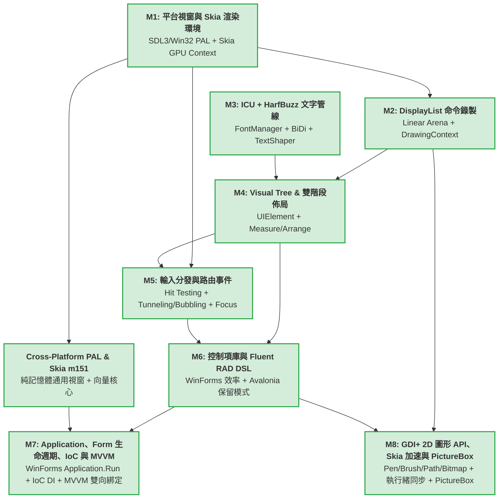

# CPPUI 目標地圖 (Target Roadmap: M1 ~ M8)

本文件將 CPPUI 跨平台現代 UI 框架之核心演進路線劃分為八大里程碑（M1 ~ M8）。每個階段皆有明確的職責界定、輸入依賴、核心交付物、所有即將實作的 API 清單與客觀驗收標準。

---

## 1. 里程碑相依拓撲圖 (Milestone Dependency Graph)

---

## 2. 六大核心階段詳解

### 里程碑 1 (M1)：平台窗口抽象與 Skia 渲染環境搭建 (PAL & Render Backend)
* **核心目標**：建立解耦的平台視窗管理介面與 Skia GPU 硬體加速管線，提供穩定的畫面更新與原始事件派發能力。
* **技術選型**：
  * PAL：SDL3 或 原生 Win32 / Cocoa。
  * 渲染器：Skia (`GrDirectContext` / `SkSurface` / `SkCanvas`)。
* **核心交付物**：
  * `IPlatformWindow` 跨平台介面（視窗控制、尺寸變更、標題、DPI 取得）。
  * `PlatformWindowSDL3` 與/或 `PlatformWindowWin32`。
  * `SkiaRenderContext`：綁定視窗 Handle，管理 GPU 後端 Context 與 SwapBuffers。
  * `RunLoop`：主執行緒訊息泵與 VSync 計時器喚醒迴圈。
  * `RawInputEvent`：滑鼠座標、按鍵、滾輪、DPI 變更的原生事件結構。
* **驗收標準 (Acceptance Criteria)**：
  1. 能在 Windows (以及跨平台目標) 彈出原生視窗，主迴圈低 CPU 佔用執行。
  2. 視窗縮放時能夠自適應調整 Skia Framebuffer。
  3. Skia 成功執行 GPU 清屏（Clear）與繪製測試圖元（如旋轉彩色矩形），流暢達到 60/120 FPS。
  4. 滑鼠移動與點擊時能穩定輸出 `RawInputEvent`。

---

### 里程碑 2 (M2)：自研 DisplayList 與 Canvas 命令錄製系統 (Command Buffer)
* **核心目標**：徹底分離 UI 邏輯與 GPU 繪製，UI 元件僅產生輕量繪製指令流，由記憶體池高效承載。
* **技術選型**：連續平坦記憶體池（Linear Arena Allocator）+ 自研命令序列化。
* **核心交付物**：
  * `LinearArena`：具備字節對齊、零鎖定、$O(1)$ 分配與每幀重設（Reset）的記憶體池。
  * `DrawOpHeader` 與指令結構體（`DrawRectOp`, `DrawRoundedRectOp`, `DrawTextOp`, `PushClipOp`, `PopClipOp` 等）。
  * `DrawingContext`：提供高階直覺的公開繪製 API（如 `DrawRectangle`, `DrawText`），將操作序列化寫入 Arena。
  * `DisplayList`：命令容器，封裝指令遍歷迭代器。
  * `DisplayListRenderer`：解析指令流，依序轉換並呼叫 `SkCanvas` 對應 API。
* **驗收標準 (Acceptance Criteria)**：
  1. 單一幀錄製 50,000 個矩形命令，耗時低於 1.5ms 且堆積分配（Heap Allocation）次數為 0。
  2. 錄製並重播各種幾何圖元、剪裁（Clip）、透明度與變換矩陣，輸出結果與直接呼叫 SkCanvas 像素完全一致。
  3. 支援幀末 O(1) 記憶體重設。

---

### 里程碑 3 (M3)：文字整形與多行排版管線 (Text Pipeline) [已完成]
* **核心目標**：實現支援多語言、複合字形、Emoji、雙向文字（BiDi）與多行折行的工業級排版管線。
* **技術選型**：DirectWrite 原生工業級引擎（Windows 零額外依賴）+ ICU/HarfBuzz 跨平台雙軌插槽。
* **核心交付物**：
  * `FontManager`：快取管理 `hb_face_t`、`hb_font_t`，跨平台匹配系統字型家族。
  * `TextShaper`：封裝 `hb_buffer_t` 與 `hb_shape()`，轉換 UTF-8 字串為 Shaped Runs（包含 Glyph ID、X/Y Advance 與 Offset）。
  * `BiDiAnalyzer`：使用 ICU UBiDi 分析 RTL（如阿拉伯文、希伯來文）與 LTR（中英拉丁）混排段落。
  * `LineBreaker`：使用 ICU UBreakIterator 進行 Unicode UAX #14 斷行計算。
  * `TextLayoutEngine`：多行折行、對齊（Left/Center/Right/Justify）、省略號處理與字元點擊命中測試（Index to Point, Point to Index）。
* **驗收標準 (Acceptance Criteria)**：
  1. 成功載入系統預設字型並精準塑形拉丁與中文字元。
  2. 中英文混排且包含 Emoji 時，折行計算正確，無文字溢出或截斷亂碼。
  3. RTL 與 LTR 混排能正確判定顯示順序。
  4. 提供快速的 `MeasureText(string, maxWidth)`，供佈局系統查詢。

---

### 里程碑 4 (M4)：Visual Tree、Dirty Tracking 與雙階段佈局系統 (Layout Engine) [已完成]
* **核心目標**：構建 Avalonia 風格的階層式視覺樹，將排版幾何約束求解與繪圖呈現徹底分離。
* **技術選型**：Avalonia Two-Pass Layout (`Measure` / `Arrange`) 模型。
* **核心交付物**：
  * `Visual` 基底類別：維護座標系（Transform）、邊界（Bounds）、裁剪（ClipBounds）、反向 Z-Order 命中測試與 `Render(DrawingContext&)`。
  * `UIElement` 基底類別：維護 `Margin`、`Width`、`Height`、`MinWidth`、`MaxWidth`、`HorizontalAlignment`、`VerticalAlignment`。
  * 雙階段排版管線：
    * `Measure(availableSize)` $\rightarrow$ 計算並快取 `DesiredSize`。
    * `Arrange(finalRect)` $\rightarrow$ 配置子元件之實際位置 `RenderBounds`。
  * 髒標記（Dirty Tracking）系統：分離 `InvalidateMeasure`、`InvalidateArrange`、`InvalidateVisual`。
  * 核心佈局容器與控制項：`Panel`、`StackPanel`、`Border`、`Canvas`、`LayoutManager`、`TextBlock`。
* **驗收標準 (Acceptance Criteria)**：
  1. 建立至少三層嵌套的視覺樹，排版約束（如 Margin、居中對齊、拉伸對齊）計算精確無誤。
  2. 變更顏色等外觀屬性時，觸發 `InvalidateVisual`，監控確認**完全不重跑 Measure 與 Arrange**。
  3. 變更字串長度時，向上精確標記父節點尺寸髒區，正確觸發局部重排。
  4. 通過全編譯器多標準 60/60 矩陣測試與 10,000 元件排版壓測。

---

### 里程碑 5 (M5)：輸入分發、焦點管理與路由事件 (Input & Events) [已完成]
* **核心目標**：將作業系統原生訊息轉化為樹狀結構的事件路由，實現直覺且精準的互動反饋。
* **技術選型**：Avalonia/WPF Routed Events (Tunneling + Bubbling) 與 Z-Order 命中測試。
* **核心交付物**：
  * `Visual::HitTest`：自根節點向下反向 Z-Order 深度搜尋點擊命中節點。
  * `RoutedEvent` 與 `EventRoute` 派發器：實作 `Preview*` 隧道階段與冒泡階段。
  * `RoutedEventArgs`：支援 `e.Handled = true` 中斷後續傳播，以及 `handledEventsToo` 強制接收。
  * `FocusManager`：全域焦點切換、Tab 鍵尋路演算法、`GotFocus` / `LostFocus` 事件。
  * `InputManager`：懸停追蹤（Hover Tracking）與指標捕獲（Pointer Capture）。
* **驗收標準 (Acceptance Criteria)**：
  1. 在深層嵌套控制項（如按鈕內部的文字）上點擊，按鈕能以冒泡方式收到 `PointerPressed` 事件。[✔ 已通過]
  2. 父容器攔截 `PreviewPointerPressed` 並設為 Handled 時，子元件確實收不到事件。[✔ 已通過]
  3. 按下鍵盤 Tab 鍵可在多個輸入框與按鈕間流暢轉移焦點，並呈現焦點外框光暈。[✔ 已通過]
  4. 通過全編譯器多標準 84/84 矩陣測試與 `m5_input_demo` 互動展示。[✔ 已通過]

---

### 里程碑 6 (M6)：控制項庫與 Fluent RAD API 封裝 (Modern C++ DSL) [已完成]
* **核心目標**：結合 Avalonia 架構實力與 WinForms 的極速代碼直覺，提供零 XML 的宣告式 Fluent Builder 開發體驗。
* **技術選型**：現代 C++ 移動語意、鏈式呼叫 Builder、Lambda 事件回呼、輕量信號綁定。
* **核心交付物**：
  * 基礎控制項庫：`Control`, `ContentControl`, `Label`, `Button`, `TextBox`, `CheckBox`, `StackPanel` (`VStack`, `HStack`), `Grid`。
  * 宣告式 Fluent Builder 語法糖：支援單行鏈式建構與大括號巢狀樹。
  * Lambda 事件連結器：如 `.OnClick( { ... })`。
  * 屬性信號（Signals / Reactive Binding）：支援動態值變更自動觸發 UI 更新。
* **驗收標準 (Acceptance Criteria)**：
  1. 能夠在 15 行 C++ 代碼內宣告一個包含標題、文字輸入框、按鈕與點擊計數器的完整視窗應用程式。[✔ 已通過]
  2. 代碼完全型別安全，具備編譯期型別檢查，無字串弱型別解析。[✔ 已通過]
  3. 開發手感流暢直覺，重現 WinForms 的神速生產力。[✔ 已通過]
  4. 通過全編譯器多標準 108/108 矩陣測試與 `m6_fluent_rad_demo` 互動展示。[✔ 已通過]

---

### 里程碑 7 (M7)：Application 中樞、Form 生命週期、IoC 與 MVVM 架構 [已完成]
* **核心目標**：封裝視窗與訊息泵細節，支援單行 `Application::Run(new Form1())` 啟動，並原生提供依賴反轉 (IoC) 與現代 MVVM 雙向綁定與命令架構。
* **技術選型**：.NET WinForms Application/Form 模型 + Microsoft.Extensions.DependencyInjection + CommunityToolkit.Mvvm。
* **核心交付物**：
  * `Application`：密封靜態類別，提供 `Run(new Form1())`、`Exit()`、`DoEvents()`、`OpenForms`、`ActiveForm`、`ShutdownMode`。
  * `Form`：視窗基底類別，繼承自 `ContentControl`，具備 `OnLoad`、`OnShown`、`OnFormClosing`（支援取消 `e.Cancel = true`）、`OnFormClosed` 以及模態對話框 `ShowDialog`。
  * `ServiceCollection` & `IServiceProvider`：支援 Transient 與 Singleton 生命週期之依賴反轉容器。
  * `ViewModelBase`、`ICommand`、`RelayCommand`：命令模式與屬性變更通知。
  * `UIElement::GetDataContext()`：沿視覺樹向上繼承。
  * `Button::SetCommand()`：自動與 `CanExecute` 啟用/禁用狀態連動。
* **驗收標準 (Acceptance Criteria)**：
  1. 能夠在 7 行 C++ 代碼內透過 `Application::CreateBuilder()` 註冊服務並以 `Application::Run` 啟動主表單。[✔ 已通過]
  2. 視窗關閉時支援使用者取消關閉操作（`FormClosingEventArgs::Cancel`）。[✔ 已通過]
  3. 按鈕綁定 `RelayCommand` 時，自動依據 `CanExecute` 連動 `IsEnabled` 外觀。[✔ 已通過]
  4. 通過全編譯器多標準 168/168 矩陣測試與 `m7_mvvm_app_demo` 互動展示。[✔ 已通過]

---

### 里程碑 8 (M8)：GDI+ 風格圖形 API、Skia 向量加速、執行緒安全自動同步與 PictureBox 控制項 (Graphics & Imaging Subsystem) [規劃中]
* **核心目標**：建立解耦、高生產力且完全型別安全的 2D 繪圖物件模型，借鏡 GDI+ 將畫筆（`Pen`）、畫刷（`Brush`）、幾何路徑（`GraphicsPath`）與位圖（`Bitmap`）抽離為一級物件，由 `Graphics` 類別統一排程繪製，導入 Skia GPU 加速與純 CPU 軟體光柵雙引擎備援，物件內建讀寫鎖自動同步多執行緒存取，並新增 `PictureBox` 影像控制項。
* **技術選型**：
  * 物件導向圖形模型：對標 GDI+ (`System.Drawing`) API 規格。
  * 渲染引擎：Skia (`SkCanvas`, `SkPath`, `SkImage`, `SkPaint`) 向量硬體加速 + 純 C++ 軟體光柵備援 (Bilinear Interpolation / Edge Table Scanline)。
  * 並發架構：`std::shared_mutex` 多讀單寫零衝突自動同步。
  * 控制項：WinForms `PictureBox` 5 種尺寸佈局模式 + Fluent DSL。
* **即將實作之完整 API 地圖清單 (Exhaustive API Inventory)**：

#### 1. 列舉型別清單 (`include/ui/graphics/GraphicsTypes.hpp`)
* `enum class DashStyle : uint8_t { Solid, Dash, Dot, DashDot, DashDotDot, Custom }`
* `enum class LineCap : uint8_t { Flat, Square, Round, Triangle, NoAnchor, SquareAnchor, RoundAnchor, DiamondAnchor, ArrowAnchor }`
* `enum class LineJoin : uint8_t { Miter, Bevel, Round, MiterClipped }`
* `enum class FillMode : uint8_t { Alternate, Winding }`
* `enum class SmoothingMode : uint8_t { Default, HighSpeed, HighQuality, None, AntiAlias }`
* `enum class InterpolationMode : uint8_t { Default, Low, High, Bilinear, Bicubic, NearestNeighbor, HighQualityBilinear, HighQualityBicubic }`
* `enum class PixelFormat : uint8_t { Format32bppArgb, Format32bppRgb, Format24bppRgb, Format8bppIndexed }`
* `enum class PictureBoxSizeMode : uint8_t { Normal, StretchImage, AutoSize, CenterImage, Zoom }`
* `enum class BrushType : uint8_t { SolidColor, LinearGradient, Texture }`
* `enum class RotateFlipType : uint8_t { RotateNoneFlipNone, Rotate90FlipNone, Rotate180FlipNone, Rotate270FlipNone, RotateNoneFlipX, RotateNoneFlipY, RotateNoneFlipXY }`

#### 2. 色彩類別與預定義集合 (`include/ui/core/Geometry.hpp` & `include/ui/graphics/Colors.hpp`)
* `struct Color` 方法擴充：
  * `static Color FromArgb(uint8_t a, uint8_t r, uint8_t g, uint8_t b) noexcept`
  * `static Color FromArgb(uint8_t r, uint8_t g, uint8_t b) noexcept`
  * `static Color FromArgb(uint32_t argb) noexcept`
  * `static Color FromArgb(uint8_t a, const Color& baseColor) noexcept`
  * `uint32_t ToArgb() const noexcept`
  * `bool IsEmpty() const noexcept`
  * `float GetBrightness() const noexcept`
  * `float GetHue() const noexcept`
  * `float GetSaturation() const noexcept`
* `namespace Colors` 預定義常數擴充（涵蓋 GDI+ 完整色系）：
  * `Transparent`, `Black`, `White`, `Red`, `Green`, `Blue`, `Yellow`, `Cyan`, `Magenta`, `Gray`, `LightGray`, `DarkGray`, `Orange`, `Purple`, `Brown`, `SteelBlue`, `Navy`, `Gold`, `Lime`, `Pink`, `DarkRed`, `DarkBlue`, `DarkGreen`, `DarkSlateGray`, `Olive`, `Teal`, `Maroon`, `Coral`, `Silver`, `AliceBlue`, `AntiqueWhite`, `Aqua`, `Aquamarine`, `Azure`, `Beige`, `Bisque`, `BlanchedAlmond`, `BlueViolet`, `BurlyWood`, `CadetBlue`, `Chartreuse`, `Chocolate`, `CornflowerBlue`, `Cornsilk`, `Crimson`, `DarkCyan`, `DarkGoldenrod`, `DarkKhaki`, `DarkMagenta`, `DarkOliveGreen`, `DarkOrange`, `DarkOrchid`, `DarkSalmon`, `DarkSeaGreen`, `DarkSlateBlue`, `DarkTurquoise`, `DarkViolet`, `DeepPink`, `DeepSkyBlue`, `DimGray`, `DodgerBlue`, `Firebrick`, `FloralWhite`, `ForestGreen`, `Fuchsia`, `Gainsboro`, `GhostWhite`, `Goldenrod`, `GreenYellow`, `Honeydew`, `HotPink`, `IndianRed`, `Indigo`, `Ivory`, `Khaki`, `Lavender`, `LavenderBlush`, `LawnGreen`, `LemonChiffon`, `LightBlue`, `LightCoral`, `LightCyan`, `LightGoldenrodYellow`, `LightGreen`, `LightPink`, `LightSalmon`, `LightSeaGreen`, `LightSkyBlue`, `LightSlateGray`, `LightSteelBlue`, `LightYellow`, `LimeGreen`, `Linen`, `MediumAquamarine`, `MediumBlue`, `MediumOrchid`, `MediumPurple`, `MediumSeaGreen`, `MediumSlateBlue`, `MediumSpringGreen`, `MediumTurquoise`, `MediumVioletRed`, `MidnightBlue`, `MintCream`, `MistyRose`, `Moccasin`, `NavajoWhite`, `OldLace`, `OliveDrab`, `OrangeRed`, `Orchid`, `PaleGoldenrod`, `PaleGreen`, `PaleTurquoise`, `PaleVioletRed`, `PapayaWhip`, `PeachPuff`, `Peru`, `Plum`, `PowderBlue`, `RosyBrown`, `RoyalBlue`, `SaddleBrown`, `Salmon`, `SandyBrown`, `SeaGreen`, `SeaShell`, `Sienna`, `SkyBlue`, `SlateBlue`, `SlateGray`, `Snow`, `SpringGreen`, `Tan`, `Thistle`, `Tomato`, `Turquoise`, `Violet`, `Wheat`, `WhiteSmoke`, `YellowGreen`

#### 3. 畫筆類別與標準集合 (`include/ui/graphics/Pen.hpp` & `include/ui/graphics/Pens.hpp`)
* `class Pen`：
  * `Pen(core::Color color, float width = 1.0f)`
  * `Pen(const Brush& brush, float width = 1.0f)`
  * `Pen(const Pen& other)`（執行緒安全深拷貝）
  * `Pen& operator=(const Pen& other)`（雙重鎖定防死鎖拷貝賦值）
  * `core::Color GetColor() const`
  * `void SetColor(core::Color color)`
  * `float GetWidth() const`
  * `void SetWidth(float width)`
  * `DashStyle GetDashStyle() const`
  * `void SetDashStyle(DashStyle style)`
  * `LineCap GetLineCap() const`
  * `void SetLineCap(LineCap cap)`
  * `LineJoin GetLineJoin() const`
  * `void SetLineJoin(LineJoin join)`
  * `Pen Clone() const`
* `class Pens`（靜態標準畫筆，寬度為 1.0f）：
  * `static const Pen& Transparent()`, `static const Pen& Black()`, `static const Pen& White()`, `static const Pen& Red()`, `static const Pen& Green()`, `static const Pen& Blue()`, `static const Pen& Yellow()`, `static const Pen& Cyan()`, `static const Pen& Magenta()`, `static const Pen& Gray()`, `static const Pen& LightGray()`, `static const Pen& DarkGray()`, `static const Pen& Orange()`, `static const Pen& Purple()`, `static const Pen& Brown()`, `static const Pen& SteelBlue()`, `static const Pen& Navy()`, `static const Pen& Gold()`, `static const Pen& Lime()`, `static const Pen& Pink()`, `static const Pen& DarkRed()`, `static const Pen& DarkBlue()`, `static const Pen& DarkGreen()`, `static const Pen& Olive()`, `static const Pen& Teal()`, `static const Pen& Maroon()`, `static const Pen& Coral()`, `static const Pen& Silver()`

#### 4. 畫刷家族與標準集合 (`include/ui/graphics/Brush.hpp` & `include/ui/graphics/Brushes.hpp`)
* `class Brush`（抽象基底）：
  * `virtual ~Brush() = default`
  * `virtual BrushType GetType() const noexcept = 0`
  * `virtual std::unique_ptr<Brush> Clone() const = 0`
* `class SolidBrush : public Brush`：
  * `SolidBrush(core::Color color)`
  * `core::Color GetColor() const`
  * `void SetColor(core::Color color)`
  * `std::unique_ptr<Brush> Clone() const override`
* `class LinearGradientBrush : public Brush`：
  * `LinearGradientBrush(core::Point p1, core::Point p2, core::Color c1, core::Color c2)`
  * `LinearGradientBrush(const core::Rect& rect, core::Color c1, core::Color c2, float angleDegrees)`
  * `core::Point GetStartPoint() const`, `void SetStartPoint(core::Point p)`
  * `core::Point GetEndPoint() const`, `void SetEndPoint(core::Point p)`
  * `core::Color GetStartColor() const`, `void SetStartColor(core::Color c)`
  * `core::Color GetEndColor() const`, `void SetEndColor(core::Color c)`
  * `std::unique_ptr<Brush> Clone() const override`
* `class TextureBrush : public Brush`：
  * `TextureBrush(std::shared_ptr<Bitmap> image)`
  * `std::shared_ptr<Bitmap> GetImage() const`
  * `std::unique_ptr<Brush> Clone() const override`
* `class Brushes`（靜態標準純色畫刷）：
  * `static const SolidBrush& Transparent()`, `static const SolidBrush& Black()`, `static const SolidBrush& White()`, `static const SolidBrush& Red()`, `static const SolidBrush& Green()`, `static const SolidBrush& Blue()`, `static const SolidBrush& Yellow()`, `static const SolidBrush& Cyan()`, `static const SolidBrush& Magenta()`, `static const SolidBrush& Gray()`, `static const SolidBrush& LightGray()`, `static const SolidBrush& DarkGray()`, `static const SolidBrush& Orange()`, `static const SolidBrush& Purple()`, `static const SolidBrush& Brown()`, `static const SolidBrush& SteelBlue()`, `static const SolidBrush& Navy()`, `static const SolidBrush& Gold()`, `static const SolidBrush& Lime()`, `static const SolidBrush& Pink()`, `static const SolidBrush& DarkRed()`, `static const SolidBrush& DarkBlue()`, `static const SolidBrush& DarkGreen()`, `static const SolidBrush& Olive()`, `static const SolidBrush& Teal()`, `static const SolidBrush& Maroon()`, `static const SolidBrush& Coral()`, `static const SolidBrush& Silver()`

#### 5. 幾何路徑類別 (`include/ui/graphics/GraphicsPath.hpp`)
* `class GraphicsPath`：
  * `GraphicsPath()`
  * `explicit GraphicsPath(FillMode fillMode)`
  * `GraphicsPath(compat::span<const core::Point> points, FillMode fillMode = FillMode::Alternate)`
  * `GraphicsPath(const GraphicsPath& other)` / `GraphicsPath& operator=(const GraphicsPath& other)`
  * `void AddLine(core::Point p1, core::Point p2)`
  * `void AddLine(float x1, float y1, float x2, float y2)`
  * `void AddLines(compat::span<const core::Point> points)`
  * `void AddRectangle(const core::Rect& rect)`
  * `void AddRoundedRectangle(const core::Rect& rect, float radius)`
  * `void AddEllipse(const core::Rect& rect)`
  * `void AddEllipse(float x, float y, float width, float height)`
  * `void AddArc(const core::Rect& rect, float startAngle, float sweepAngle)`
  * `void AddBezier(core::Point p1, core::Point c1, core::Point c2, core::Point p2)`
  * `void AddCurve(compat::span<const core::Point> points)`
  * `void AddPolygon(compat::span<const core::Point> points)`
  * `void AddPath(const GraphicsPath& path, bool connect = false)`
  * `void CloseFigure()`
  * `void CloseAllFigures()`
  * `void StartFigure()`
  * `void Reset()`
  * `FillMode GetFillMode() const`
  * `void SetFillMode(FillMode mode)`
  * `core::Rect GetBounds() const`
  * `size_t GetPointCount() const`
  * `std::vector<core::Point> GetPathPoints() const`
  * `bool IsVisible(core::Point pt) const`
  * `bool IsVisible(float x, float y) const`
  * `bool IsOutlineVisible(core::Point pt, const Pen& pen) const`
  * `std::vector<core::Point> Flatten(float flatness = 0.25f) const`
  * `void Transform(float m11, float m12, float m21, float m22, float dx, float dy)`
  * `GraphicsPath Clone() const`

#### 6. 點陣位圖類別 (`include/ui/graphics/Bitmap.hpp`)
* `class Bitmap`：
  * `Bitmap(uint32_t width, uint32_t height, PixelFormat format = PixelFormat::Format32bppArgb)`
  * `Bitmap(uint32_t width, uint32_t height, compat::span<const uint32_t> pixels, PixelFormat format = PixelFormat::Format32bppArgb)`
  * `explicit Bitmap(compat::string_view filename)`
  * `Bitmap(const Bitmap& other)` / `Bitmap& operator=(const Bitmap& other)`
  * `uint32_t GetWidth() const noexcept`
  * `uint32_t GetHeight() const noexcept`
  * `PixelFormat GetPixelFormat() const noexcept`
  * `uint32_t GetStride() const noexcept`
  * `core::Color GetPixel(uint32_t x, uint32_t y) const`
  * `void SetPixel(uint32_t x, uint32_t y, core::Color color)`
  * `void Clear(core::Color color)`
  * `compat::span<const uint32_t> GetPixelSpan() const`
  * `compat::span<uint32_t> GetPixelSpanMut()`
  * `void* LockBits(const core::Rect& rect, uint32_t flags)`
  * `void UnlockBits()`
  * `std::shared_ptr<Bitmap> Clone(const core::Rect& rect, PixelFormat format) const`
  * `void RotateFlip(RotateFlipType rotateFlipType)`

#### 7. 圖形排程中樞 (`include/ui/graphics/Graphics.hpp`)
* `class Graphics`：
  * `static Graphics FromDrawingContext(rendering::DrawingContext& dc)`
  * `static Graphics FromImage(std::shared_ptr<Bitmap> image)`
  * `uint32_t Save()`
  * `void Restore(uint32_t stateId)`
  * `void TranslateTransform(float dx, float dy)`
  * `void ScaleTransform(float sx, float sy)`
  * `void RotateTransform(float angleDegrees)`
  * `void ResetTransform()`
  * `void SetClip(const core::Rect& rect)`
  * `void SetClip(const GraphicsPath& path)`
  * `void ResetClip()`
  * `core::Rect GetClipBounds() const`
  * `void SetSmoothingMode(SmoothingMode mode)`
  * `SmoothingMode GetSmoothingMode() const`
  * `void SetInterpolationMode(InterpolationMode mode)`
  * `InterpolationMode GetInterpolationMode() const`
  * `void Clear(core::Color color)`
  * `void DrawLine(const Pen& pen, core::Point pt1, core::Point pt2)`
  * `void DrawLine(const Pen& pen, float x1, float y1, float x2, float y2)`
  * `void DrawLines(const Pen& pen, compat::span<const core::Point> points)`
  * `void DrawRectangle(const Pen& pen, const core::Rect& rect)`
  * `void DrawRectangle(const Pen& pen, float x, float y, float width, float height)`
  * `void DrawRectangles(const Pen& pen, compat::span<const core::Rect> rects)`
  * `void FillRectangle(const Brush& brush, const core::Rect& rect)`
  * `void FillRectangle(const Brush& brush, float x, float y, float width, float height)`
  * `void FillRectangles(const Brush& brush, compat::span<const core::Rect> rects)`
  * `void DrawRoundedRectangle(const Pen& pen, const core::Rect& rect, float radius)`
  * `void FillRoundedRectangle(const Brush& brush, const core::Rect& rect, float radius)`
  * `void DrawEllipse(const Pen& pen, const core::Rect& rect)`
  * `void DrawEllipse(const Pen& pen, float x, float y, float width, float height)`
  * `void FillEllipse(const Brush& brush, const core::Rect& rect)`
  * `void FillEllipse(const Brush& brush, float x, float y, float width, float height)`
  * `void DrawArc(const Pen& pen, const core::Rect& rect, float startAngle, float sweepAngle)`
  * `void DrawPie(const Pen& pen, const core::Rect& rect, float startAngle, float sweepAngle)`
  * `void FillPie(const Brush& brush, const core::Rect& rect, float startAngle, float sweepAngle)`
  * `void DrawPolygon(const Pen& pen, compat::span<const core::Point> points)`
  * `void FillPolygon(const Brush& brush, compat::span<const core::Point> points, FillMode fillMode = FillMode::Alternate)`
  * `void DrawBezier(const Pen& pen, core::Point pt1, core::Point pt2, core::Point pt3, core::Point pt4)`
  * `void DrawBeziers(const Pen& pen, compat::span<const core::Point> points)`
  * `void DrawCurve(const Pen& pen, compat::span<const core::Point> points)`
  * `void DrawPath(const Pen& pen, const GraphicsPath& path)`
  * `void FillPath(const Brush& brush, const GraphicsPath& path)`
  * `void DrawImage(std::shared_ptr<Bitmap> image, const core::Rect& destRect)`
  * `void DrawImage(std::shared_ptr<Bitmap> image, const core::Rect& destRect, const core::Rect& srcRect)`
  * `void DrawImage(std::shared_ptr<Bitmap> image, float x, float y)`
  * `void DrawImage(std::shared_ptr<Bitmap> image, float x, float y, float width, float height)`
  * `void DrawImageUnscaled(std::shared_ptr<Bitmap> image, core::Point origin)`
  * `void DrawString(compat::string_view text, const text::FontDescriptor& font, const Brush& brush, core::Point origin)`
  * `void DrawString(compat::string_view text, const text::FontDescriptor& font, const Brush& brush, const core::Rect& layoutRect)`
  * `core::Size MeasureString(compat::string_view text, const text::FontDescriptor& font)`
  * `class Graphics::StateScope`（RAII 狀態守衛）

#### 8. PictureBox 控制項與 Fluent DSL (`include/ui/controls/PictureBox.hpp` & `include/ui/dsl/Fluent.hpp`)
* `class PictureBox : public Control`：
  * `PictureBox()`
  * `explicit PictureBox(std::shared_ptr<graphics::Bitmap> image)`
  * `std::shared_ptr<graphics::Bitmap> GetImage() const`
  * `void SetImage(std::shared_ptr<graphics::Bitmap> image)`
  * `graphics::PictureBoxSizeMode GetSizeMode() const`
  * `void SetSizeMode(graphics::PictureBoxSizeMode mode)`
  * `core::Size MeasureOverride(core::Size availableSize) override`
  * `core::Size ArrangeOverride(core::Size finalSize) override`
  * `void OnRender(rendering::DrawingContext& dc) override`
* `Fluent.hpp` 宣告式擴充：
  * `PictureBox(std::shared_ptr<Bitmap> bmp)`
  * `.Image(std::shared_ptr<Bitmap> bmp)`
  * `.SizeMode(PictureBoxSizeMode mode)`
  * `.BindImage(Signal<std::shared_ptr<Bitmap>>& sig)`

* **驗收標準 (Acceptance Criteria)**：
  1. 完整實作上述所有列舉、結構、類別與成員函數，API 簽章 100% 對齊設計。
  2. 單元測試 (`tests/graphics_gdi_test.cpp`) 涵蓋率達 100%，對每個 API 提供 Dedicated Test Case。
  3. 驗證多執行緒並發寫入與讀取時（包含 10 個執行緒密集隨機呼叫 `SetPixel`/`GetPixel` 與 `AddLine`/`GetBounds`），無 Data Race、無記憶體洩漏且執行緒安全同步。
  4. 驗證 `PictureBox` 於 5 種 `SizeMode` 下排版測量（`DesiredSize`）與渲染拉伸裁切數學無誤。
  5. 驗證 Skia 向量加速分支與 CPU 軟體光柵回退分支輸出正確。
  6. 測試所有公開 API 傳入 `nullptr`、負數維度、非法引數時正確擲出 `std::invalid_argument`。

---

## 3. 各階段責任矩陣速查

| 模組名稱 | 階段 | 主要包含頭文件目錄 | 核心對標概念 |
| :--- | :--- | :--- | :--- |
| **PAL & Render Backend** | M1 | `include/ui/pal/` | WinForms `Form` / Avalonia `WindowImpl` |
| **Command Buffer** | M2 | `include/ui/rendering/` | Avalonia `DrawingContext` / Skia `SkPicture` |
| **Text Pipeline** | M3 | `include/ui/text/` | DirectWrite / CoreText / Pango |
| **Layout Tree** | M4 | `include/ui/core/`, `include/ui/layout/` | Avalonia / WPF Two-Pass Layout Engine |
| **Input & Focus** | M5 | `include/ui/input/` | WPF Routed Event System |
| **RAD Fluent Controls** | M6 | `include/ui/controls/` | WinForms Code-Behind / Avalonia C# Markup |
| **Application & MVVM** | M7 | `include/ui/app/`, `include/ui/ioc/`, `include/ui/mvvm/` | WinForms `Application.Run` / WPF `DataContext` / .NET Generic Host |
| **Graphics & PictureBox** | M8 | `include/ui/graphics/`, `include/ui/controls/PictureBox.hpp` | GDI+ (`System.Drawing`) / Skia 2D / WinForms `PictureBox` |

