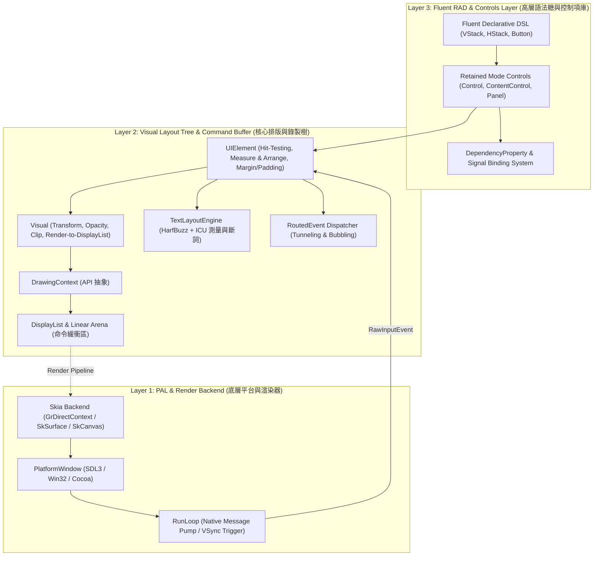

# CPPUI 設計規範 01：三層架構分離與依賴邊界 (Architecture Layers & Boundaries)

## 1. 核心設計願景

CPPUI 是一個現代 C++ 跨平台 UI 框架，旨在融合以下頂尖技術與哲學：
1. **Skia**：工業級 2D GPU 硬體加速渲染。
2. **ICU + HarfBuzz**：業界標準的多語言國際化與複雜字形塑形管線。
3. **Avalonia / WPF**：保留模式（Retained Mode）階層式視覺樹、雙階段約束排版（Measure/Arrange）與路由事件體系。
4. **Windows Forms**：極速直覺的代碼驅動開發體驗（Code-First）、免 XML 編譯、型別安全、基於 Lambda 的信號綁定。

為了維護極致的可維護性、測試性與跨平台擴充能力，框架核心確立**單向依賴的三層架構體系**。

---

## 2. 三層架構職責定義

### Layer 1: 平台抽象與繪圖後端 (PAL & Render Backend)
* **職責**：
  * **Window PAL (`cppui::pal`)**：封裝作業系統的原生視窗控制代碼（Win32 `HWND`、macOS `NSWindow`、Linux `wl_surface`/`XID`）與跨平台純記憶體通用視窗（`PlatformWindowGeneric`），統一由 `IPlatformWindow` 介面提供視窗尺寸、標題、DPI 縮放、全螢幕狀態控制與跨平台幀緩衝輸出（`PresentFramebuffer`）。
  * **Event Loop (`cppui::pal::RunLoop`)**：統一處理原生 Message Pump 與通用事件隊列，將作業系統原生訊息轉化為框架內部的 `RawInputEvent`，整合垂直同步（VSync）或休眠等待機制避免 CPU 空轉。
  * **Render Backend (`cppui::rendering::backend`)**：持有 Google Skia (m151) 渲染核心（`SkiaRenderContext` / `SkSurface` / `SkCanvas`）並具備純 C++ 軟體光柵化引擎（`SoftwareRenderContext` 內含 8x8 ASCII 字符字模）之無縫優雅回退機制，將 DisplayList 錄製之圖元高效呈現在畫布上。

### Layer 2: 命令錄製與視覺排版核心 (Command Buffer & Visual Tree)
* **職責**：
  * **DisplayList 與 DrawingContext (`cppui::rendering`)**：
    * UI 元件在繪製階段只呼叫抽象的 `DrawingContext`（如 `DrawRectangle`, `DrawText`, `PushClip`），底層將繪製指令序列化寫入 `LinearArena` 記憶體池。
    * **徹底解耦**：UI 邏輯只負責「錄製」，不直接調用 GPU 繪製，為 Dirty Clip、快取（RenderCache）與多執行緒排程提供基石。
  * **Visual 與 UIElement (`cppui::core`)**：
    * `Visual`：階層樹的最輕量節點，維護局部座標轉換（Transform）、透明度（Opacity）、剪裁（ClipBounds）與 Render 呼叫。
    * `UIElement`：繼承自 Visual，引入佈局幾何（Margin、Padding、Alignment）、點擊穿透測試（Hit Testing）與事件路由標頭。
  * **雙階段佈局引擎 (`cppui::layout`)**：
    * 實作 Avalonia 風格的 `Measure(availableSize)` 與 `Arrange(finalRect)` 雙階段佈局管線。
  * **文字排版引擎 (`cppui::text`)**：
    * 封裝 ICU 雙向文字分析（UBiDi）與換行斷詞（UBreakIterator），配合 HarfBuzz 進行複合字形塑形（Shaping），產出字元座標與行度量（Line Metrics）。

### Layer 3: Fluent RAD 與控制項庫 (Fluent RAD & Control Layer)
* **職責**：
  * **保留模式控制項樹 (`cppui::controls`)**：
    * 封裝標籤（Label）、按鈕（Button）、文字輸入（TextBox）、容器（StackPanel, Grid）等。
  * **屬性系統與信號 (`cppui::core::property`)**：
    * 輕量級動態屬性容器，支援值的繼承、髒標記廣播與反應式資料綁定。
  * **現代 C++ Fluent Builder DSL**：
    * 告別繁瑣的 XML/XAML，以純現代 C++ 鏈式呼叫構建 UI 樹，直接透過 Lambda 綁定事件監聽器，重現 WinForms 的純代碼快速產能。

---

## 3. 模組隔離與依賴邊界鐵律

為了避免代碼耦合劣化為義大利麵條式架構，全專案必須嚴格遵守以下邊界規則：

1. **上層絕對禁止直接依賴 Skia 原生型別**：
   * `include/ui/controls/`、`include/ui/layout/`、`include/ui/core/` 檔案中，**嚴禁包含 Skia 標頭檔**（例如 `#include <core/SkCanvas.h>`、`<core/SkPaint.h>` 等）。
   * 任何繪製操作必須且只能透過 `cppui::rendering::DrawingContext` 提供的抽象方法進行。
   * Skia 標頭檔僅允許出現在 `src/rendering/backend/` 的實作檔案或私有後端標頭中。

2. **UI 邏輯絕對禁止直接調用 OS 視窗 API**：
   * 控制項代碼中不得直接包含 `<windows.h>`、`<SDL3/SDL.h>` 等平台專屬 API。
   * 視窗操作必須透過 `cppui::pal::IPlatformWindow` 介面進行。

3. **DisplayList 零堆積配置原則**：
   * `DrawingContext` 的所有繪圖指令，嚴禁在每幀調用 `new` / `malloc`。
   * 必須使用 `cppui::rendering::LinearArena` 進行字節連續寫入，並在幀結束時 O(1) 重設指標。

4. **依賴方向嚴格由上至下 (No Circular Dependency)**：
   * `controls` $\rightarrow$ `layout` $\rightarrow$ `core` $\rightarrow$ `rendering` $\rightarrow$ `compat`。
   * 下層元件絕對不可依賴或包含上層標頭檔。

5. **公開介面編譯防火牆 (Pimpl Compilation Firewall)**：
   * 凡具備複雜內部狀態、多執行緒鎖或平台相依之公開核心類別，強制採用現代 Pimpl 模式（參見 [設計規範 05](05_modern_pimpl_and_abi_firewall.md)）。
   * 公開標頭檔嚴禁洩漏底層渲染具體類別、`<shared_mutex>` 或原生控制代碼，鎖定記憶體佈局為單一指標（8 位元組），保護 ABI 穩定性與編譯速度。
