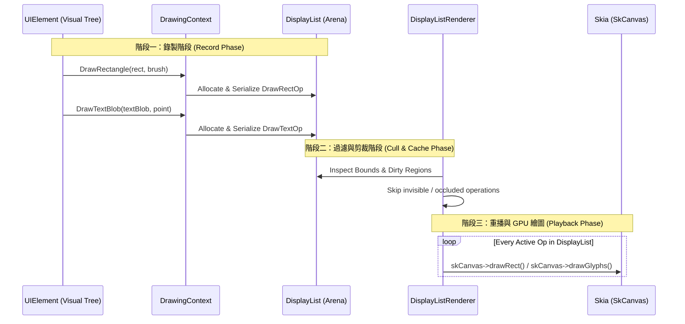

# CPPUI 設計規範 03：命令錄製、DisplayList 與記憶體架構 (Rendering & Memory Pipeline)

## 1. 自研 DisplayList 核心理念

在傳統原生 UI（如老式 WinForms 或直接呼叫 GDI/DirectX）中，元件往往在 `OnPaint(Graphics g)` 內直接呼叫 API 繪製。這會帶來諸多弊端：
1. **難以做髒區域剪裁 (Dirty Culling)**：無法在 GPU 繪製前獲知即將繪製的所有圖元邊界。
2. **多執行緒與並行障礙**：GPU Context 通常綁定單一執行緒，UI 邏輯與 GPU 呼叫強耦合導致無法在背景非同步計算視覺樹。
3. **無快取能力**：靜態子樹無法輕易儲存錄製結果以利複用。

CPPUI 採用 **DisplayList 命令錄製機制**：
* UI 元件的 `Render(DrawingContext& ctx)` **僅產生輕量化的繪製指令流**（Command Stream），不碰任何 GPU API。
* 指令流儲存在極速的記憶體池（Linear Arena Allocator）中。
* 隨後由 `DisplayListRenderer` 統一調度、剪裁、排序並驅動 `SkCanvas` 執行硬體繪製。

---

## 2. Linear Arena Allocator 記憶體結構

為了消除每秒數十萬個繪製命令帶來的堆積記憶體（Heap Allocation）碎片與鎖定代價，DisplayList 全程運行在連續的平坦記憶體池上：

```
+-----------------------------------------------------------------------------------+
|  DrawOpHeader  |   DrawRectPayload   |  DrawOpHeader  |      DrawTextPayload      | ...
| (Type, Size)   | (Rect, Brush, etc.) | (Type, Size)   | (Font, GlyphIDs, Offsets) | ...
+-----------------------------------------------------------------------------------+
^                                                                                   ^
BasePtr                                                                           Offset
```

### 資料結構規格：
```cpp
namespace cppui::rendering {

enum class DrawOpType : uint16_t {
    Save,
    Restore,
    PushClipRect,
    PopClip,
    PushTransform,
    PopTransform,
    DrawRectangle,
    DrawRoundedRectangle,
    DrawLine,
    DrawTextBlob,
    DrawImage
};

#pragma pack(push, 4)
struct DrawOpHeader {
    DrawOpType type;
    uint16_t   flags;
    uint32_t   size; // 包含 Header 本身與後續 Payload 的總字節數 (保證 4 或 8 字節對齊)
};
#pragma pack(pop)

} // namespace cppui::rendering
```

### 生命週期與重用規範：
1. **Frame Allocator 機制**：DisplayList 持有一個或多個 Page（預設每頁 64KB ~ 256KB）。
2. **分配指針推進**：錄製操作時，僅執行 `offset += alignedSize` 的指標累加運算，時間複雜度為嚴格的 $O(1)$。
3. **幀末重設**：當幀渲染完成（Swap Buffers 後），呼叫 `arena.Reset()`，僅將 `offset` 歸零，**不釋放實體記憶體**，下一幀直接原地覆蓋，實現**零 GC、零 Heap 分配**。

---

## 3. 渲染管線三部曲 (The 3-Stage Pipeline)



---

## 4. 無效化標記與 Dirty Tracking 機制

為了達成 120+ FPS 的極速反應，框架嚴格分離三種無效化信號，禁止無意義的全樹排版重算：

| 無效化方法 | 觸發時機 | 傳播行為 | 後續處理代價 |
| :--- | :--- | :--- | :--- |
| **`InvalidateVisual()`** | 僅顏色、陰影、透明度改變，但尺寸與幾何邊界完全不變 | 僅將該節點的 `m_isVisualDirty` 標記為 true，不通知父節點排版 | **極低**：佈局階段直接跳過，僅在繪製階段重新錄製該節點的 DisplayList。 |
| **`InvalidateArrange()`** | 幾何位置（X/Y）或局部邊界改變，但自身 `DesiredSize` 測量未改變 | 沿樹標記 `m_isArrangeDirty` | **低**：跳過第一階段 Measure，直接進入第二階段 Arrange 計算 FinalRect。 |
| **`InvalidateMeasure()`** | 內容尺寸改變（例如文字加長、子節點增刪、Margin 改變） | 向上沿著 Parent 鏈一路標記直到根節點或具備固定寬高的容器節點 | **中**：必須重新執行雙階段 Measure 與 Arrange 計算。 |

### 核心原則：
任何控制項在變更屬性時，必須精確調用最小受影響範圍的無效化函式。例如：
- 滑鼠 Hover 觸發按鈕背景色變深 $\rightarrow$ **只能呼叫 `InvalidateVisual()`**！
- 修改按鈕文字字串 $\rightarrow$ 觸發文字長度改變 $\rightarrow$ 呼叫 `InvalidateMeasure()`。
