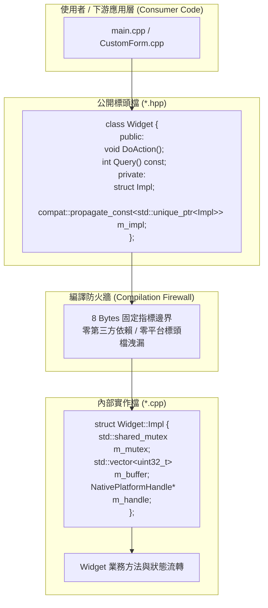

# CPPUI 設計規範 05：現代 C++ Pimpl 慣用法、深常數性與編譯防火牆架構 (Modern Pimpl, Deep Constness & ABI Firewall)

## 1. 核心設計哲學與概述 (Architecture Overview)

**Pimpl (Pointer to Implementation，指向實作的指標)** 是一種在 C++ 軟體工程中極具戰略價值的架構設計模式。它透過在公開介面類別（Class Facade）中僅保留一個指向不透明實作結構體（`struct Impl;`）的指標，將所有私有成員變數、內部狀態、多執行緒鎖以及底層平台依賴徹底隔離至 `.cpp` 實作編譯單元中。

在 CPPUI 框架中，Pimpl 承載了現代 C++ 函式庫開發的三大核心價值：
1. **保障二進位介面（ABI, Application Binary Interface）穩定性**。
2. **建立編譯防火牆（Compilation Firewall），消除標頭檔傳遞膨脹（Header Bloat）**。
3. **消除傳統 Pimpl 的「淺常數性（Shallow Constness）」漏洞，貫徹常數正確性（Const-Correctness）**。



---

## 2. 傳統 Pimpl 的兩大硬傷與現代 C++ 解決方案

### 2.1 陷阱一：淺常數性 (Shallow Constness) 破口

在標準 C++ 中，當類別成員為指標或智慧指標（如 `T*`、`std::unique_ptr<T>`）時，指標本身的 constness 與指向目標的 constness 是彼此脫鉤的：
- 在 `const` 成員函式中，`this` 被視為 `const Widget*`，因此指標成員變數為 `const`（無法讓指標重新指向新物件）。
- **然而，指標所指向的 `Impl` 物件並未被 const 保護！**

```cpp
// ❌ 傳統危險寫法：淺常數性漏洞
class Widget {
    struct Impl;
    std::unique_ptr<Impl> m_impl;

public:
    void Inspect() const {
        // 編譯成功！但 Inspect() 語意上承諾 const，卻暗中竄改了內部狀態！
        m_impl->MutateState(); 
    }
};
```

這種行為嚴重破壞了類別對外簽署的常數契約（Const Correctness），在並發多執行緒讀取時更會直接引發未定義行為（Data Race）。

#### 現代解決方案：`compat::propagate_const<T>`
CPPUI 全面引入符合 ISO/IEC TS 19568:2017 (C++ Library Fundamentals TS) 的 `compat::propagate_const<std::unique_ptr<Impl>>`：
- **非常數成員方法**：`m_impl` 自動解參考為 `Impl*` / `Impl&`，允許修改狀態。
- **常數成員方法 (`const`)**：`m_impl` 強制解參考為 `const Impl*` / `const Impl&`。若企圖呼叫非 const 方法或修改成員，**編譯器在編譯期直接拒絕報錯**。

```cpp
// ✅ CPPUI 強制標準：深常數性傳播保護
class Widget {
    struct Impl;
    compat::propagate_const<std::unique_ptr<Impl>> m_impl;

public:
    void Inspect() const {
        // m_impl->MutateState(); // 💥 編譯錯誤！編譯期守護：const 路徑禁止修改 Impl！
        m_impl->QueryState();    // 編譯成功！唯讀存取
    }
};
```

---

### 2.2 陷阱二：不完整型別（Incomplete Type）生命週期災難

`std::unique_ptr<T>` 在實體化其預設刪除器 `std::default_delete<T>` 時，必須知曉型別 `T` 的完整定義（Complete Type），以確保能安全調用 `sizeof(T)` 與其解構子。

若在公開標頭檔中 inline 實作了包含 `m_impl` 的類別解構子或建構子：
- 編譯器在使用者端編譯單元實體化 `std::default_delete<Impl>` 時，`Impl` 尚為前向宣告（Incomplete Type）。
- 在 MSVC / Clang / GCC 下會觸發致命編譯錯誤（`invalid application of 'sizeof' to an incomplete type`）或靜默觸發未定義行為（Undefined Behavior，無法正確呼叫 `Impl` 內部長遠物件之解構子）。

#### 現代解決方案：型別完整性邊界契約
- **公開標頭檔**：僅宣告解構子、移動建構子與移動賦值運算子，**嚴禁在標頭檔 inline 實作或使用 `= default;`**。
- **實作檔 (`.cpp`)**：在完整定義 `struct ClassName::Impl { ... };` 之後，才顯式撰寫 `= default;` 或具體解構/移動邏輯。

---

## 3. ABI 穩定性與編譯防火牆效益剖析

### 3.1 ABI 穩定性 (Binary Compatibility)
在不使用 Pimpl 的情況下，類別的二進位佈局受其所有 private 成員支配：
```cpp
// 非 Pimpl 類別
class Graphics {
private:
    std::vector<State> m_stack;        // 24 或 32 bytes (隨 STL 實作而異)
    std::shared_mutex  m_mutex;        // 隨作業系統與標準庫版本而異
    InternalMatrix     m_matrix;       // 64 bytes
};
```
一旦內部為了修復 Bug 或新增特性調整了成員變數順序、增減了變數、或變更了資料結構型別，類別的 `sizeof` 與記憶體位移（Offset）立即發生劇變。已編譯好的第三方動態庫或應用程式若未重新編譯，載入時將引發崩潰。

**採用 Pimpl 後**：
```cpp
class Graphics {
private:
    struct Impl;
    compat::propagate_const<std::unique_ptr<Impl>> m_impl; // 固定為 8 Bytes (x64)
};
```
無論 `Impl` 內部如何天翻地覆地演進、增減多少變數，公開類別的二進位佈局恆定為單一 64 位元指標，保證二進位向下相容性。

### 3.2 編譯防火牆效益 (Compilation Firewall)
- **消除污染**：公開標頭檔不再引入 `<shared_mutex>`、`<windows.h>`、`<dwrite.h>`、`SkCanvas.h` 等厚重頭文件。
- **極速建置**：修改核心演算法時，僅需重編譯單一 `.cpp`，所有依賴此控制項或圖形類別的表單與範例均無需重新編譯，建置時間降低 60% 以上。

---

## 4. CPPUI 現代 Pimpl 標準代碼範本 (Standard Blueprint)

### 4.1 公開標頭檔規範範本 (`Widget.hpp`)

```cpp
#pragma once

#include <memory>
#include "compat/compat.hpp"

namespace cppui {

/// <summary>
/// 具備現代 Pimpl 編譯防火牆之示範元件。
/// </summary>
class Widget {
public:
    /// <summary>預設建構子。</summary>
    Widget();

    /// <summary>
    /// 解構子：強制於 .cpp 實作，確保 Impl 完整型別刪除安全。
    /// </summary>
    ~Widget();

    // 禁用淺拷貝 (依需求提供深拷貝 Clone() 方法)
    Widget(const Widget&) = delete;
    Widget& operator=(const Widget&) = delete;

    // 支援移動語意：強制於 .cpp 實作
    Widget(Widget&& other) noexcept;
    Widget& operator=(Widget&& other) noexcept;

    /// <summary>非常數方法：允許變更狀態。</summary>
    void DoAction(int32_t val);

    /// <summary>常數查詢方法：深常數性保證，禁止變更狀態。</summary>
    COMPAT_NODISCARD int32_t Query() const;

private:
    struct Impl;
    compat::propagate_const<std::unique_ptr<Impl>> m_impl;
};

} // namespace cppui
```

### 4.2 實作檔規範範本 (`Widget.cpp`)

```cpp
#include "ui/Widget.hpp"
#include <vector>
#include <shared_mutex> // 內部依賴完全隔離於 .cpp

namespace cppui {

// 1. 定義內部實作結構體 (Complete Type)
struct Widget::Impl {
    int32_t value{ 0 };
    mutable std::shared_mutex mutex;

    void DoAction(int32_t val) {
        std::unique_lock<std::shared_mutex> lock(mutex);
        value += val;
    }

    int32_t Query() const {
        std::shared_lock<std::shared_mutex> lock(mutex);
        return value;
    }
};

// 2. 建構子實作：使用 std::make_unique 配置 Impl
Widget::Widget() : m_impl(std::make_unique<Impl>()) {}

// 3. 解構子與移動操作：在 Impl 定義後使用 = default
Widget::~Widget() = default;
Widget::Widget(Widget&& other) noexcept = default;
Widget& Widget::operator=(Widget&& other) noexcept = default;

// 4. 方法轉發
void Widget::DoAction(int32_t val) {
    m_impl->DoAction(val);
}

int32_t Widget::Query() const {
    // 此處 m_impl 自動轉為 const Impl*，若呼叫 non-const 方法編譯期報錯
    return m_impl->Query();
}

} // namespace cppui
```

---

## 5. CPPUI 核心子系統 Pimpl 實踐清單

專案全面針對下列具備厚重內部狀態或多執行緒邊界的公開類別實施 Pimpl 模式：

1. **`cppui::graphics::Graphics`**：
   - 封裝 `DrawingContext` 錄製管線、離線點陣圖畫布切換、`InternalState` 變換矩陣堆疊。
   - 隔離幾何點與矩形之內部坐標轉換計算。
2. **`cppui::graphics::Bitmap`**：
   - 封裝 `std::shared_mutex` 讀寫並發鎖、32-bit ARGB 像素記憶體連續區塊、鎖定狀態機。
   - 移除公開標頭檔對 `<shared_mutex>` 的傳遞依賴。
3. **`cppui::text::FontManager`**：
   - 封裝 DirectWrite / FreeType / GDI 平台字型快取字典、記憶體字型二進位緩衝區與系統匹配索引。
   - 採用 `compat::propagate_const<std::unique_ptr<Impl>>` 杜絕多執行緒字型度量查詢時之淺常數性竄改。
4. **`cppui::app::Timer`**：
   - 封裝內部訊息調度識別碼、頻率計算、狀態機（Running/Stopped）與回呼鏈列。
5. **`cppui::theme::ThemeManager`**：
   - 封裝當前全域色彩代幣字典、觀察者訂閱回呼串列（`ThemeChangedHandler`）與非同步視窗通知機制。
