# CPPUI 設計規範 06：視覺化表單設計器核心架構 (Visual Form Designer Architecture)

## 1. 核心設計願景與動機 (Vision & Philosophy)

在傳統 C++ 桌面應用程式開發中，UI 開發長期面臨兩大痛點：
1. **龐大沈重的外部 DSL 或 XML/XAML 編譯流程**（如 Qt QML / WPF XAML）：引入複雜的中繼編譯器 (MOC) 或執行期反射，拉長建置時間並犧牲型別安全。
2. **純代碼 RAD 缺乏直覺可視化**：雖然 Fluent Builder DSL 大幅簡化手寫排版，但在複雜企業級多欄位後台或精密對齊排版中，缺乏即時視覺反饋與拖曳互動。

**CPPUI Visual Form Designer** 旨在提供兼具 **Windows Forms 的極速直覺拖曳** 與 **現代 C++ 宣告式 Fluent DSL 強大威力** 的無妥協設計體驗：
* **純 C++ 核心 AST 模型**：零第三方視窗相依，所有領域邏輯與幾何計算均可在純記憶體或 Headless CI 環境中高速單元測試。
* **深常數性 (Deep Constness) Pimpl**：全體公開類別採用 `compat::propagate_const<std::unique_ptr<Impl>>` 封裝，徹底杜絕淺常數性漏洞與 ABI 脆弱性。
* **雙向無損多目標發射**：單一 AST 樹同時支援輸出宣告式 Fluent DSL、Classic Code-Behind (.designer.hpp/.hpp/.cpp) 與 CMakeLists.txt，並具備雙向 SourceMap 行號追蹤。
* **增量使用者程式碼保護 (Incremental User Code Protection)**：在覆寫生成視窗佈局的同時，絕不破壞使用者在 `.cpp` 撰寫的商業邏輯與全域變數，僅安全追加新事件處理常式存根。

---

## 2. 五階段架構體系全貌 (Five-Phase Architecture)

```mermaid
graph TD
    subgraph "階段 1：核心 AST 領域模型 (cppui_designer_core)"
        Doc["FormDocumentNode (文件根)"] --> Root["WidgetNode (深常數 AST 樹)"]
        Root --> Card["CardinalityValidator (基數/循環驗證)"]
        Root --> IdVal["IdentifierValidator (C++語法/命名消歧義)"]
        Root --> Prop["PropertyValue (型別安全變體)"]
        Root --> Reg["PropertyMetadataRegistry (預設值剔除)"]
        Doc --> Bus["DesignerEvent (反應式異動匯流排)"]
        Doc --> Hist["CommandHistoryManager (Undo/Redo 狀態機)"]
        Doc --> Ser["FormSerializer (無損確定性 .cppui.json)"]
    end

    subgraph "階段 2：程式碼生成引擎 (Codegen Engine)"
        Pipeline["FormCodegenPipeline (主編排管道)"]
        Doc --> Pipeline
        Pipeline --> DslEmit["FluentDslEmitter (宣告式 Fluent DSL)"]
        Pipeline --> ClassEmit["FormClassEmitter (Partial Class / Code-Behind)"]
        Pipeline --> CMakeEmit["CMakeSnippetEmitter (CMake 構建腳本)"]
        ClassEmit --> SMap["SourceMap & SymbolInfo (UUID ↔ 變數名 / 行號)"]
    end

    subgraph "階段 3：視覺化畫布設計表面 (Design Surface)"
        Surface["DesignSurface (繼承 Control 主表面)"]
        Sel["SelectionModel (單選/多選/主選取UUID)"]
        Hit["DesignerHitTest (8向控制點與階層節點命中)"]
        Snap["SnapEngine (網格與邊緣/中心智慧導引線)"]
        Adorn["AdornerOverlay (DisplayList 飾條與導引線渲染)"]
        
        Surface --> Sel
        Surface --> Hit
        Surface --> Snap
        Surface --> Adorn
        Surface --> Hist
        Surface --> Doc
    end

    subgraph "階段 4：屬性與事件檢查器 (Inspector)"
        Inspector["InspectorPanel (主檢查器控制項)"]
        InheritReg["InheritanceMetadataRegistry (繼承鏈聚合與多選交集)"]
        Editors["PropertyEditors & PropertyValidators (專屬型別編輯器與極端值防禦)"]
        
        Inspector --> InheritReg
        Inspector --> Editors
        Inspector --> Sel
        Inspector --> Doc
        Inspector --> Hist
    end

    subgraph "階段 5：即時代碼預覽、實例試運行與專案匯出 (Preview & Exporter)"
        PreviewPanel["LiveCodePreviewPanel (5 模式多分頁程式碼與 SourceMap 高亮)"]
        Runner["LiveFormRunner (無裝飾器純粹 Form 實例化與深淺色主題切換)"]
        Exporter["ProjectExporter (標準 CMake 樹輸出與使用者代碼增量保護)"]

        PreviewPanel --> Pipeline
        PreviewPanel --> Sel
        PreviewPanel --> Doc
        Runner --> Doc
        Exporter --> Doc
        Exporter --> Pipeline
    end
```



---

## 3. 分層架構與技術實作細節

### 3.1 階段 1：核心 AST 領域模型 (`cppui::designer::model`)
* **`WidgetNode`**：
  * 代表表單上任何可視化控制項或佈局容器。
  * 擁有拓撲指標（弱引用 `WidgetNode* m_parent`、強引用唯一擁有權 `std::vector<std::unique_ptr<WidgetNode>> m_children`），徹底根除智慧指標循環引用（Circular Shared-Ptr Reference）所產生的記憶體洩漏。
  * 屬性字典 `std::unordered_map<std::string, PropertyValue>` 與附加屬性字典 `m_attachedProperties`。
* **`CardinalityValidator`**：
  * 純靜態無副作用檢驗函式。
  * 針對 `ContentControl`、`Border`、`ScrollViewer` 嚴格限制最多 1 個子節點；針對一般容器（`Panel`、`Grid`、`StackPanel`、`Canvas`）支援多子節點；對葉節點控制項（`Button`、`TextBox`）禁止掛載子元件。
  * 包含循環依賴檢測，防止父子指標形成閉環。
* **`IdentifierValidator`**：
  * 內建全套 C++20 關鍵字與保留字字典（`int`, `class`, `default`, `template`, `const` 等）。
  * 若使用者輸入非法字元或重複命名，自動執行 ASCII 淨化並依序派發消歧義序號（如 `button1`, `button2`）。
* **`FormSerializer`**：
  * 以純 C++ 實作 `.cppui.json` 讀寫。
  * 屬性鍵值排序輸出，保證序列化結果具有位元組級別的確定性 (Byte-level Determinism)。
* **`CommandHistoryManager`**：
  * 實作命令模式（`IUndoableCommand`），支援 `AddWidgetCommand`、`RemoveWidgetCommand`、`MoveWidgetCommand`、`ChangePropertyCommand`。
  * 支援複合命令 `MacroCommand`，在多選批次修改或拖曳合併時，撤銷堆疊僅記錄一筆操作，確保極致的使用者體驗。

### 3.2 階段 2：程式碼生成管線與 SourceMap (`cppui::designer::codegen`)
* **`FormCodegenPipeline`**：
  * 統一調度 `FluentDslEmitter`、`FormClassEmitter`、`CMakeSnippetEmitter`。
* **`FluentDslEmitter`**：
  * 深度優先遞迴走訪 AST，生成宣告式 `VStack(...)`, `HStack(...)`, `Grid(...)`, `Button(...)` 鏈式調用程式碼。
* **`FormClassEmitter`**：
  * 遵循微軟標準二分法架構：
    1. `<FormName>.designer.hpp`：由設計器全權掌控的元件宣告、幾何佈局、事件綁定與初始化函式 `InitializeComponent()`。
    2. `<FormName>.hpp`：使用者自訂類別介面定義。
    3. `<FormName>.cpp`：使用者業務邏輯檔與事件處理常式存根（Event Handlers）。
* **`SourceMap`**：
  * 記錄每行輸出的起訖位置對應至哪一個 AST 節點 UUID，實現與 IDE 或設計面板雙向行號高亮選取。

### 3.3 階段 3：視覺化設計表面 (`cppui::designer::surface`)
* **`DesignSurface`**：
  * 繼承自 `cppui::controls::Control`，可作為普通 UI 元件無縫嵌入任何 CPPUI 視窗。
  * 繪製高對比網格線（Grid Lines）與背景。
* **`SelectionModel`**：
  * 支援點擊單選、Ctrl 複選、點擊空白處取消選取。
  * 維護首選節點（Primary Selected），供屬性檢查器精確導航。
* **`DesignerHitTest`**：
  * 8 向錨點（Handle）命中判別：
    * `TopLeft (NW)`、`Top (N)`、`TopRight (NE)`、`Right (E)`
    * `BottomRight (SE)`、`Bottom (S)`、`BottomLeft (SW)`、`Left (W)`
  * 元件本體（`Body`）拖曳移動判別。
* **`SnapEngine`**：
  * 內建邊緣（Left/Right/Top/Bottom）與幾何中心（CenterX/CenterY）磁吸引導演算法。
  * 當拖曳元件與相鄰兄弟元件或父容器邊緣小於設定閥值（如 6 像素）時，自動吸附並產出 `SnapGuide` 導引線集合。
* **`AdornerOverlay`**：
  * 不污染真實控制項視覺結構，在最上層透過 `DisplayList` 繪製高對比霓虹外框、錨點圓角矩形與洋紅色吸附導引虛線。

### 3.4 階段 4：屬性與事件檢查器 (`cppui::designer::inspector`)
* **`InheritanceMetadataRegistry`**：
  * 靜態聚合 C++ 類別繼承鏈：`Visual` $\to$ `UIElement` $\to$ `Control` $\to$ `ContentControl` $\to$ 具體元件。
  * **多選交集計算 (`ComputePropertyIntersection`)**：
    * 當多選多個元件時，僅顯示它們共同擁有的屬性（如 Width, Height, Margin, Opacity）。
    * 當不同元件的值相異時，顯示 `<Multiple Values>` 佔位符。
  * **動態附加屬性感測 (`GetAttachedPropertiesForParent`)**：
    * 父容器為 `Canvas` 時，動態掛載 `Canvas.Left` 與 `Canvas.Top`。
    * 父容器為 `Grid` 時，動態掛載 `Grid.Row`, `Grid.Column`, `Grid.RowSpan`, `Grid.ColumnSpan`。
* **`PropertyValidators`**：
  * 針對數值欄位執行極限值防禦，杜絕 `NaN`、`Inf`、負數寬高，防範記憶體溢出與不合法輸入。
* **主題語意代幣集成**：
  * 色彩與字型輸入支援直接下拉選取 `theme::ColorTokens`（如 `ColorTokens::Primary()`）與 `MetricTokens`，確保設計成果於深淺色主題切換時完美適配。

### 3.5 階段 5：即時預覽、試運行與 CMake 專案匯出 (`cppui::designer::preview` & `exporter`)
* **`LiveCodePreviewPanel`**：
  * 具備 5 種即時檢視模式：
    1. `FluentDsl` (`.hpp`)
    2. `ClassicDesignerHpp` (`.designer.hpp`)
    3. `ClassicHeader` (`.hpp`)
    4. `ClassicSource` (`.cpp`)
    5. `CMakeLists` (`CMakeLists.txt`)
  * 訂閱 AST 異動信號，拖曳或修改屬性時自動觸發背景代碼重新發射，並依 `SourceMap` 精確滾動聚焦至選取元件對應行號。
* **`LiveFormRunner`**：
  * 將 AST 轉換為真實、無 Adorner 裝飾層的 `app::Form`。
  * 支援真實互動：按鈕點擊觸發、文字輸入框輸入、ComboBox 下拉層、Tab 鍵焦點流轉、以及深淺色主題熱切換。
* **`ProjectExporter`**：
  * 生成標準跨平台 CMake 專案結構：
    ```text
    MyProject/
    ├── CMakeLists.txt
    ├── .gitignore
    ├── assets/
    ├── include/
    │   └── MyNamespace/
    │       ├── MyForm.designer.hpp  (全量覆寫)
    │       └── MyForm.hpp           (類別定義)
    └── src/
        ├── MyForm.cpp               (增量保留使用者代碼)
        └── main.cpp                 (程式進入點)
    ```
  * **增量保護實作**：匯出時檢測 `MyForm.cpp` 是否已存在。若已存在，逐行掃描既有事件處理常式名稱，僅在檔案末端追加 AST 中新定義的事件存根（Stubs），使用者原有的邏輯、輔助函式與全域變數獲得 100% 完整保留。

---

## 4. 品質標準與驗證策略 (Quality & Verification)

* **零警告原則**：在 MSVC `/W4`、GCC `-Wall -Wextra -Wpedantic`、Clang 嚴格編譯設定下維持 **0 Errors / 0 Warnings**。
* **完整單元與整合測試覆蓋**：
  * `designer_ast_model_test` (AST 基數、命名、複製)
  * `designer_property_signal_test` (屬性變更與信號廣播)
  * `designer_command_undo_test` (命令 Undo/Redo 狀態機與宏命令合併)
  * `designer_serialization_test` (無損 JSON 序列化與邊界測試)
  * `designer_codegen_test` (Fluent DSL, Classic C++, CMake 發射)
  * `designer_surface_test` (選取、8 向命中、Snap 智慧導引線求解)
  * `designer_inspector_test` (繼承鏈聚合、多選交集、附加屬性、非法輸入攔截)
  * `designer_e2e_integration_test` (完整後台管理表單組裝、即時預覽、試運行按鈕觸發、主題切換、CMake 目錄結構匯出與增量保護)
