# CPPUI 範例專案全覽手冊 (Examples Gallery & Catalog)

本目錄包含 **CPPUI** 框架的 19 個官方模組化範例專案。所有範例均具備真實圖形視窗與完整的可執行程式碼，從最基礎的視窗起步、現代 UI 設計模式、巨量資料渲染瓶頸突破，一路延伸至底層平台抽象與文字塑形管線。

---

## 🧭 範例架構與分類導覽

```mermaid
flowchart TD
    subgraph LayerApp["1. 起步入門與實戰教學 (Quickstart & Tutorials)"]
        EX_HW["hello_world<br/>(極簡起步)"]
        EX_BMI["bmi_calculator<br/>(卡片深色 BMI)"]
        EX_GFX["graphics_drawing_demo<br/>(2D 向量與灰階濾鏡)"]
    end

    subgraph LayerGalleries["2. 高階功能展示庫 (Feature Galleries)"]
        EX_CARD["drawing_cardioid_example<br/>(心臟線幾何自繪)"]
        EX_DLG["dialog_gallery<br/>(MessageBox & FileDialog)"]
        EX_POP["popup_gallery<br/>(Popup & Floating Controls)"]
        EX_VIRT["virtualized_list_demo<br/>(100k 虛擬化 & 樹狀表格)"]
        EX_DEV["devtools_gallery<br/>(F12 Visual Tree Inspector)"]
    end

    subgraph LayerArch["3. 架構與非同步調度 (Architecture & Asynchronous)"]
        EX_MVVM["mvvm_example<br/>(ViewModel & RelayCommand)"]
        EX_IOC["ioc_example<br/>(ServiceCollection 依賴注入)"]
        EX_ASYNC["async_events_example<br/>(Dispatcher 跨執行緒派送)"]
        EX_SKIA["platform_skia_example<br/>(Skia GPU/CPU 後端切換)"]
    end

    subgraph LayerMilestone["4. 核心里程碑技術驗證 (Milestone Architecture Demos)"]
        EX_M1["m1_window_demo<br/>(PAL 原生視窗)"]
        EX_M2["m2_displaylist_demo<br/>(DisplayList 串流錄製)"]
        EX_M3["m3_text_demo<br/>(HarfBuzz/BiDi 文字管線)"]
        EX_M4["m4_layout_demo<br/>(Measure/Arrange 排版求解)"]
        EX_M5["m5_input_demo<br/>(雙軌路由事件 & 焦點)"]
        EX_M6["m6_fluent_rad_demo<br/>(Fluent DSL & Signals)"]
        EX_M7["m7_mvvm_app_demo<br/>(Form 狀態機 & 綜合架構)"]
    end

    LayerApp --> LayerGalleries
    LayerGalleries --> LayerArch
    LayerArch --> LayerMilestone
```



---

## 📋 範例清單與技術特徵對照表

### 1. 起步入門與實戰教學 (Quickstart & Tutorials)

| 範例名稱 | 說明文件 | 執行檔 | 核心技術重點 |
| :--- | :--- | :--- | :--- |
| **Hello World** | [📄 `examples/hello_world/README.md`](hello_world/README.md) | `hello_world.exe` | `Application::Run`、`Form`、Fluent DSL 宣告式極簡起步 |
| **BMI 計算機** | [📄 `examples/bmi_calculator/README.md`](bmi_calculator/README.md) | `bmi_calculator.exe` | 卡片式深色主題、數值安全校驗、狀態色彩動態回饋 |
| **2D 圖形與影像濾鏡** | [📄 `examples/graphics_drawing_demo/README.md`](graphics_drawing_demo/README.md) | `graphics_drawing_demo.exe` | GDI+ 風格 `Graphics`、抗鋸齒幾何、多執行緒灰階影像濾鏡 |

---

### 2. 高階功能展示庫 (Feature Galleries)

| 範例名稱 | 說明文件 | 執行檔 | 核心技術重點 |
| :--- | :--- | :--- | :--- |
| **心臟線幾何自繪** | [📄 `examples/drawing_cardioid_example/README.md`](drawing_cardioid_example/README.md) | `drawing_cardioid_example.exe` | 自訂畫布 `OnRender`、DisplayList 錄製、碎形幾何弦線 |
| **對話框展示庫** | [📄 `examples/dialog_gallery/README.md`](dialog_gallery/README.md) | `dialog_gallery.exe` | MessageBox、OpenFileDialog、SaveFileDialog、雙後端智慧派送 |
| **彈出層與浮動控制項** | [📄 `examples/popup_gallery/README.md`](popup_gallery/README.md) | `popup_gallery.exe` | `OverlayLayer`、ToolTip、ContextMenu、ComboBox、Auto-Flip |
| **UI 虛擬化與高階控制項** | [📄 `examples/virtualized_list_demo/README.md`](virtualized_list_demo/README.md) | `virtualized_list_demo.exe` | `ListBox` 100k 筆零卡頓、`TreeView`、`DataGrid`、原生剪貼簿 |
| **DevTools 視覺診斷工具** | [📄 `examples/devtools_gallery/README.md`](devtools_gallery/README.md) | `devtools_gallery.exe` | F12 HUD 懸浮窗、Visual Tree 檢視、吸管拾取、Dirty Rect 高亮 |

---

### 3. 架構與非同步調度 (Architecture & Asynchronous)

| 範例名稱 | 說明文件 | 執行檔 | 核心技術重點 |
| :--- | :--- | :--- | :--- |
| **現代 MVVM 計數器** | [📄 `examples/mvvm_example/README.md`](mvvm_example/README.md) | `mvvm_example.exe` | `ViewModelBase`、`RelayCommand` 雙向綁定、狀態解耦 |
| **IoC 購物車訂單** | [📄 `examples/ioc_example/README.md`](ioc_example/README.md) | `ioc_example.exe` | `ServiceCollection`、Singleton/Transient 生命週期依賴注入 |
| **非同步調度與計時器** | [📄 `examples/async_events_example/README.md`](async_events_example/README.md) | `async_events_example.exe` | `Dispatcher` 跨執行緒安全派送、高精度背景 `Timer` |
| **Skia 雙後端切換** | [📄 `examples/platform_skia_example/README.md`](platform_skia_example/README.md) | `platform_skia_example.exe` | `AppBuilder::UseSkia()` 強制 GPU/CPU 渲染策略宣告 |

---

### 4. 核心里程碑技術驗證 (Milestone Architecture Demos)

| 範例名稱 | 說明文件 | 執行檔 | 核心技術重點 |
| :--- | :--- | :--- | :--- |
| **M1 原生視窗範例** | [📄 `examples/m1_window_demo/README.md`](m1_window_demo/README.md) | `m1_window_demo.exe` | PAL 原生視窗抽象、跨平台事件循環泵 `RunLoop` |
| **M2 DisplayList 錄製** | [📄 `examples/m2_displaylist_demo/README.md`](m2_displaylist_demo/README.md) | `m2_displaylist_demo.exe` | 二進位命令串流、Arena 記憶體池、渲染解耦重播 |
| **M3 文字塑形排版** | [📄 `examples/m3_text_demo/README.md`](m3_text_demo/README.md) | `m3_text_demo.exe` | HarfBuzz 塑形、BiDi 雙向分析、CJK 標點避頭尾斷詞規範 |
| **M4 佈局求解管線** | [📄 `examples/m4_layout_demo/README.md`](m4_layout_demo/README.md) | `m4_layout_demo.exe` | Measure / Arrange 雙階段排版求解、髒標記增量重繪 |
| **M5 路由事件與焦點** | [📄 `examples/m5_input_demo/README.md`](m5_input_demo/README.md) | `m5_input_demo.exe` | Tunneling / Bubbling 路由通道、鍵盤 Tab 焦點尋路 |
| **M6 宣告式 RAD 綜合** | [📄 `examples/m6_fluent_rad_demo/README.md`](m6_fluent_rad_demo/README.md) | `m6_fluent_rad_demo.exe` | Fluent Builder DSL、`Signal<T>` 響應式資料流連動 |
| **M7 高階架構整合** | [📄 `examples/m7_mvvm_app_demo/README.md`](m7_mvvm_app_demo/README.md) | `m7_mvvm_app_demo.exe` | Form 生命週期狀態機、關閉確認攔截、IoC 完整整合 |

---

## 🛠️ 建置與執行指南

### 1. 編譯所有範例專案
```bash
# 生成建置配置 (預設開啟所有範例)
cmake -B build -DCMAKE_BUILD_TYPE=Release

# 平行編譯所有範例
cmake --build build --config Release
```

### 2. 單獨編譯指定範例
若僅想針對特定範例進行編譯（例如 `virtualized_list_demo`）：
```bash
cmake --build build --config Release --target virtualized_list_demo
```

### 3. 一鍵批量擷取所有範例視窗截圖
專案內建自動化真實視窗擷取腳本：
```powershell
powershell.exe -ExecutionPolicy Bypass -File tools/capture_all_examples.ps1
```
此腳本將自動啟動各範例並定位真實視窗，產出高解析度 PNG 預覽影像至 `docs/images/` 目錄。
