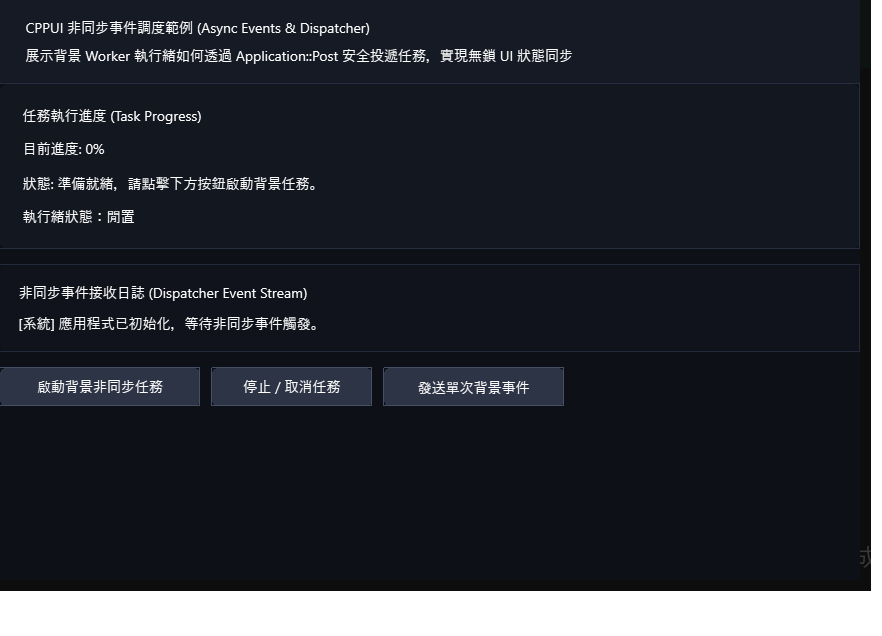

# 非同步調度與跨執行緒事件範例 (Async Events & Dispatcher)

本範例展示 **CPPUI** 的跨執行緒安全調度器 [`Dispatcher`](../../docs/api/classes/app_dispatcher.md) 與低延遲計時器 [`Timer`](../../docs/api/classes/pal_timer.md)。展示如何在背景執行緒處理耗時工作（如網路下載、繁重計算）後，將資料安全派送回主 UI 執行緒更新介面。

---

## 1. 成果預覽 (Preview)



---

## 2. 範例定位與功能特色

- **跨執行緒安全派送 (`Dispatcher::Post`)**：底層整合 Win32 `PostMessage` 與 Linux 自定義管線，保證任何背景執行緒的回調均在主執行緒（UI Thread）安全執行，消除競態條件。
- **高精度跨平台計時器 (`Timer`)**：提供周期性事件觸發，精準控制動畫或時鐘更新頻率。
- **背景模擬工作**：啟動 `std::thread` 執行模擬進度運算，並即時透過進度條與文字回饋進度。

---

## 3. 核心原始碼解析

### 3.1 跨執行緒派送資料回主執行緒
```cpp
// 於背景工作執行緒中執行耗時操作
std::thread([this]() {
    for (int32_t progress = 1; progress <= 100; ++progress) {
        std::this_thread::sleep_for(std::chrono::milliseconds(30));

        // 安全派送回主執行緒更新 UI 元件
        cppui::app::Application::Post([this, progress]() {
            m_progressBar->SetValue(static_cast<float>(progress));
            m_statusLabel->SetText("正在處理中... " + std::to_string(progress) + "%");
        });
    }

    cppui::app::Application::Post([this]() {
        m_statusLabel->SetText("✅ 背景任務處理完畢！");
        m_startBtn->SetEnabled(true);
    });
}).detach();
```

### 3.2 低延遲計時器應用
```cpp
m_timer = std::make_unique<cppui::pal::Timer>();
m_timer->SetInterval(std::chrono::milliseconds(1000));
m_timer->SetCallback([this]() {
    UpdateClockDisplay();
});
m_timer->Start();
```

---

## 4. 建置與執行方式

### 透過 CMake 建置
```bash
cmake -B build -DCMAKE_BUILD_TYPE=Release
cmake --build build --config Release --target async_events_example
```

### 執行範例
```powershell
# Windows
.\build\bin\Release\async_events_example.exe

# Linux
./build/bin/async_events_example
```
