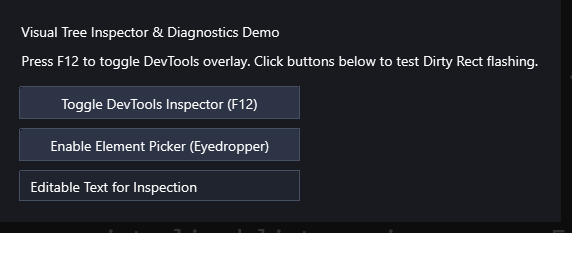

# 視覺化診斷工具與 Visual Tree Inspector 展示 (DevTools Gallery)

本範例展示 **CPPUI** 內建的工業級除錯與診斷子系統。透過按下 `F12` 熱鍵，即可即時喚起內嵌式 DevTools 診斷面板、查看視覺元件樹階層深度、使用吸管模式（Element Picker）即時拾取元件幾何邊界，以及啟用重繪區域（Dirty Rect）半透明高亮視覺追蹤。

---

## 1. 成果預覽 (Preview)



---

## 2. 範例定位與功能特色

- **零侵入式 F12 診斷懸浮層**：在 Debug 與展示階段按下 `F12` 隨時開關半透明 HUD 檢視器，不影響應用程式原有業務邏輯。
- **視覺樹即時檢查 (Visual Tree Inspector)**：遞迴列舉視窗內所有節點名稱、元件型別、實際長寬 (`ActualWidth`, `ActualHeight`) 與邊界坐標。
- **吸管拾取模式 (Element Picker / Eyedropper)**：滑鼠移動時即時以藍色半透明外框高亮目標元件，並顯示尺寸資訊標籤，點擊即鎖定檢視。
- **重繪區域閃爍提示 (Dirty Rect Overlay)**：每次局部重繪時繪製動態色彩外框，直觀驗證局部重繪與避免全螢幕過度重繪 (Overdraw)。

---

## 3. 核心原始碼解析

### 3.1 啟用診斷開關 (`AppBuilder`)
在應用程式建構時配置全域診斷選項：

```cpp
#include "ui/app/AppBuilder.hpp"
#include "ui/diagnostics/DiagnosticsOptions.hpp"

auto app = cppui::app::Application::CreateBuilder()
    .WithDiagnostics(cppui::diagnostics::DiagnosticsOptions{
        .enable_dirty_rect_overlay = true,
        .show_fps_counter = true
    })
    .Build();
```

### 3.2 程式化控制 DevTools 檢視器
除了按下 `F12` 熱鍵之外，亦可透過 API 程式化切換：

```cpp
#include "ui/diagnostics/VisualTreeInspector.hpp"

// 切換 DevTools HUD 開關
cppui::diagnostics::VisualTreeInspector::Get().Toggle();

// 啟動吸管拾取模式
cppui::diagnostics::VisualTreeInspector::Get().EnablePickerMode(true);
```

---

## 4. 建置與執行方式

### 透過 CMake 建置
```bash
cmake -B build -DCMAKE_BUILD_TYPE=Release
cmake --build build --config Release --target devtools_gallery
```

### 執行範例
```powershell
# Windows
.\build\bin\Release\devtools_gallery.exe

# Linux
./build/bin/devtools_gallery
```

> **操作提示**：進入程式後，按下鍵盤上的 **F12** 鍵即可即時開啟或關閉 DevTools 診斷面板！
