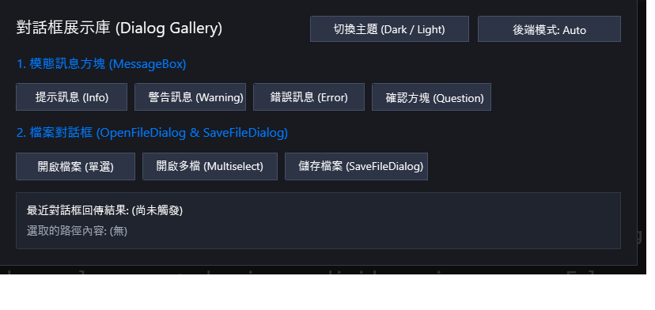

# 對話框展示庫範例 (Dialog Gallery)

本範例完整展示 **CPPUI** 智慧派送對話方塊系統 [`MessageBox`](../../docs/api/classes/dialogs_messagebox.md)、[`OpenFileDialog`](../../docs/api/classes/dialogs_openfiledialog.md) 與 [`SaveFileDialog`](../../docs/api/classes/dialogs_savefiledialog.md)。涵蓋模態視窗生命週期、深色/淺色主題切換以及 Auto / Native / BuiltIn 後端派送模式。

---

## 1. 成果預覽 (Preview)



---

## 2. 範例定位與功能特色

- **智慧派送架構 (Smart Dispatching)**：
  - **Auto 模式**：Windows 平台優先調用原生 COM Shell (`IFileOpenDialog` / `IFileSaveDialog`)；Linux 或測試環境自動回退至自繪主題視窗 (`FileDialogForm`)。
  - **BuiltIn 模式**：強制使用 CPPUI 現代向量自繪對話框，體驗全跨平台一致的像素級外觀與深淺色主題。
  - **Native 模式**：強制調用作業系統原生對話框。
- **MessageBox 全方位按鈕配置**：支援 `OK`, `OKCancel`, `YesNo`, `YesNoCancel`, `RetryCancel` 組合與語意圖示 (`Information`, `Warning`, `Error`, `Question`)。
- **副檔名過濾與多選檔案**：支援自訂 Filter（例如 `圖片檔案 (*.png;*.jpg)|*.png;*.jpg|所有檔案 (*.*)|*.*`）與多檔案選取。
- **動態主題切換**：可一鍵切換深色 (`Dark`) 與淺色 (`Light`) 主題，所有對話框即時自適應色彩代幣。

---

## 3. 核心原始碼解析

### 3.1 呼叫自訂 MessageBox
```cpp
auto res = dialogs::MessageBox::Show(
    this,
    "您即將執行重要操作，是否確定繼續？",
    "確認操作",
    dialogs::MessageBoxButtons::YesNo,
    dialogs::MessageBoxIcon::Question
);

if (res == app::DialogResult::Yes) {
    UpdateStatus("使用者點擊了 [是]");
}
```

### 3.2 呼叫 OpenFileDialog 選取檔案
```cpp
dialogs::OpenFileDialog dialog;
dialog.SetTitle("請選擇圖片檔案");
dialog.SetFilter("圖片檔案 (*.png;*.jpg)|*.png;*.jpg|所有檔案 (*.*)|*.*");
dialog.SetMultiselect(false);
dialog.SetBackendMode(m_currentMode); // Auto / BuiltIn / Native

if (dialog.ShowDialog(this) == app::DialogResult::OK) {
    std::string selectedFile = dialog.GetFileName();
    UpdatePathDisplay("開啟檔案", selectedFile);
}
```

---

## 4. 建置與執行方式

### 透過 CMake 建置
```bash
cmake -B build -DCMAKE_BUILD_TYPE=Release
cmake --build build --config Release --target dialog_gallery
```

### 執行範例
```powershell
# Windows
.\build\bin\Release\dialog_gallery.exe

# Linux
./build/bin/dialog_gallery
```
