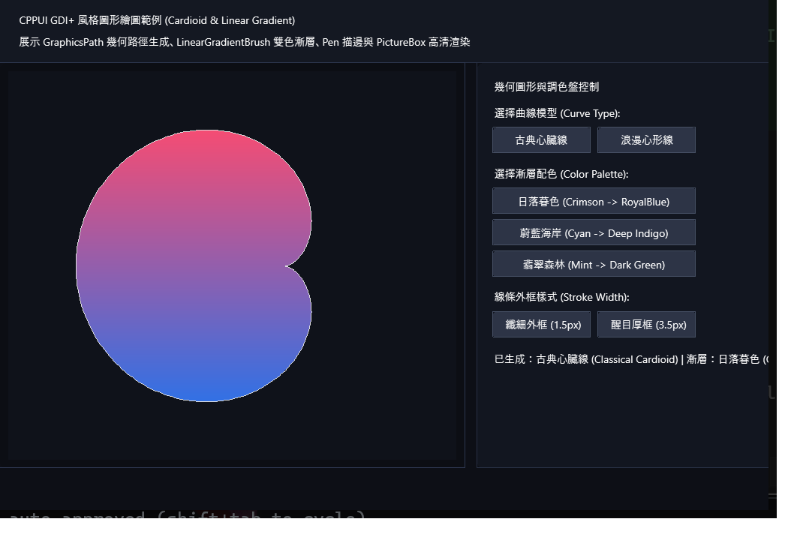

# 心臟線幾何動畫與漸層繪圖範例 (Cardioid Drawing)

本範例展示 **CPPUI** 的自訂渲染畫布與數學幾何曲線運算。透過自訂 `Control::OnRender` 與 `DrawingContext`，在視窗中即時繪製高精度心臟線（Cardioid）碎形弦線幾何圖案與線性漸層色彩。

---

## 1. 成果預覽 (Preview)



---

## 2. 範例定位與功能特色

- **自訂畫布繪製 (Custom Painting)**：繼承 `Control` 並覆寫 `OnRender(DrawingContext& dc)`，直接錄製 DisplayList 繪圖指令。
- **數學幾何運算**：展示在圓周上等分 $N$ 點，將第 $i$ 點與第 $(i \times \text{multiplier}) \pmod N$ 點相連產生經典心臟線/環形弦線包絡面。
- **線性漸層效果**：展示搭配色彩漸層畫筆，隨角度與索引動態映射色彩光譜。

---

## 3. 核心原始碼解析

### 3.1 幾何曲線求解與 DisplayList 繪製
在自訂控制項的 `OnRender` 中進行向量運算與弦線繪製：

```cpp
void CardioidCanvas::OnRender(rendering::DrawingContext& dc) {
    const float cx = GetActualWidth() * 0.5f;
    const float cy = GetActualHeight() * 0.5f;
    const float radius = std::min(cx, cy) * 0.85f;

    const int32_t totalPoints = 200;
    const float multiplier = 2.0f; // 心臟線乘數

    // 繪製外環基準圓
    dc.DrawEllipse(nullptr, &m_circlePen, core::Point(cx, cy), radius, radius);

    // 依序計算並連接各弦線
    for (int32_t i = 0; i < totalPoints; ++i) {
        float theta1 = (2.0f * 3.14159265f * i) / totalPoints;
        float x1 = cx + radius * std::cos(theta1);
        float y1 = cy + radius * std::sin(theta1);

        float j = std::fmod(i * multiplier, static_cast<float>(totalPoints));
        float theta2 = (2.0f * 3.14159265f * j) / totalPoints;
        float x2 = cx + radius * std::cos(theta2);
        float y2 = cy + radius * std::sin(theta2);

        // 動態色彩映射畫筆
        rendering::Pen chordPen(ComputeRainbowColor(i, totalPoints), 1.0f);
        dc.DrawLine(chordPen, core::Point(x1, y1), core::Point(x2, y2));
    }
}
```

---

## 4. 建置與執行方式

### 透過 CMake 建置
```bash
cmake -B build -DCMAKE_BUILD_TYPE=Release
cmake --build build --config Release --target drawing_cardioid_example
```

### 執行範例
```powershell
# Windows
.\build\bin\Release\drawing_cardioid_example.exe

# Linux
./build/bin/drawing_cardioid_example
```
