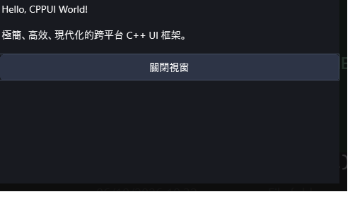

# Hello World 極簡起步範例 (HelloWorld)

本範例展示如何使用 **CPPUI** 建立最純粹的極簡桌面視窗應用程式。透過高階抽象 [`Application`](../../docs/api/classes/app_application.md)、[`Form`](../../docs/api/classes/app_form.md) 與宣告式 **Fluent RAD DSL**，以現代 C++ 語法在數行程式碼內完成視窗建立、排版與事件互動。

---

## 1. 成果預覽 (Preview)



---

## 2. 範例定位與功能特色

- **極速起步 (Zero Boilerplate)**：封裝 Win32 / Linux 原生事件迴圈與視窗註冊，免除底層樣板代碼。
- **Fluent RAD DSL 佈局**：使用 `VStack`、`Label`、`Button` 進行流式語法排版，宣告即所得。
- **直覺事件監聽**：透過 Lambda 表達式直接掛載 `.OnClick(...)` 點擊事件，即時變更元件狀態並自動重繪。

---

## 3. 核心原始碼解析

### 3.1 表單介面定義 (`HelloWorldForm.hpp`)
繼承自 `cppui::app::Form`，封裝獨立視窗行為：

```cpp
#pragma once
#include "ui/app/Form.hpp"

class HelloWorldForm : public cppui::app::Form {
public:
    HelloWorldForm();
    ~HelloWorldForm() override = default;
};
```

### 3.2 宣告式介面組合 (`HelloWorldForm.cpp`)
在建構函式中設定視窗尺寸與標題，並透過 `SetContent()` 組合視覺節點：

```cpp
#include "HelloWorldForm.hpp"
#include "ui/dsl/Fluent.hpp"

HelloWorldForm::HelloWorldForm() {
    using namespace cppui::dsl;

    SetTitle("CPPUI - Hello World");
    SetWidth(480);
    SetHeight(320);

    auto label = Label("歡迎使用 CPPUI 現代化 C++ UI 框架！")
        .FontSize(16)
        .Build();

    auto button = Button("點擊體驗互動")
        .Padding(16, 8)
        .OnClick([label]() {
            label->SetText("🎉 成功觸發事件！體驗流暢響應。");
        })
        .Build();

    SetContent(
        VStack({ label, button })
            .Spacing(20)
            .Center()
            .Build()
    );
}
```

### 3.3 進入點 (`main.cpp`)
呼叫 `Application::Run<HelloWorldForm>()` 啟動跨平台主執行緒調度循環：

```cpp
#include "ui/app/Application.hpp"
#include "HelloWorldForm.hpp"

int main() {
    return cppui::app::Application::Run<HelloWorldForm>();
}
```

---

## 4. 建置與執行方式

### 透過 CMake 建置
```bash
cmake -B build -DCMAKE_BUILD_TYPE=Release
cmake --build build --config Release --target hello_world
```

### 執行範例
```powershell
# Windows
.\build\bin\Release\hello_world.exe

# Linux
./build/bin/hello_world
```
