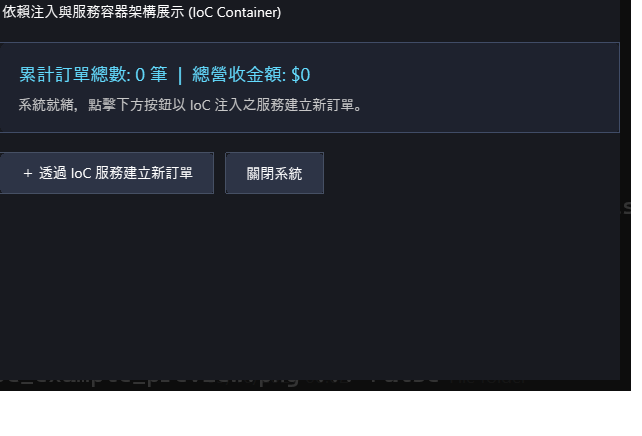

# 依賴注入 (IoC) 購物車訂單範例 (IoC Container)

本範例展示 **CPPUI** 內建的微型依賴反轉容器 [`ServiceCollection`](../../docs/api/classes/ioc_servicecollection.md) 與服務提供者 [`IServiceProvider`](../../docs/api/classes/ioc_iserviceprovider.md)。以現代購物車訂單系統為情境，展示服務註冊、Singleton 與 Transient 生命週期管理以及自動構造依賴注入。

---

## 1. 成果預覽 (Preview)



---

## 2. 範例定位與功能特色

- **企業級依賴反轉 (IoC / DI)**：遵循微軟 ASP.NET Core 架構風格之 `ServiceCollection` API。
- **生命週期精確控制**：
  - **Singleton**：全域唯一實例（如 `ILogger`）。
  - **Transient**：每次請求時實例化全新物件（如 `IOrderService`, `OrderViewModel`, `OrderForm`）。
- **完全介面導向設計**：視圖模型與業務邏輯僅依賴抽象介面，便於單元測試以 Mock 物件替換。

---

## 3. 核心原始碼解析

### 3.1 服務註冊與應用程式建構 (`main.cpp`)
```cpp
#include "ui/app/Application.hpp"
#include "ui/app/AppBuilder.hpp"
#include "services/ConsoleLogger.hpp"
#include "services/OrderService.hpp"
#include "viewmodels/OrderViewModel.hpp"
#include "views/OrderForm.hpp"

int main() {
    auto builder = cppui::app::Application::CreateBuilder();

    // 1. 註冊 Singleton 日誌服務
    builder.Services().AddSingleton<ILogger, ConsoleLogger>();

    // 2. 註冊 Transient 訂單服務（由 IoC 工廠自動注入 ILogger）
    builder.Services().AddTransient<IOrderService>([](cppui::ioc::IServiceProvider& sp) {
        return std::make_shared<OrderService>(sp.GetRequiredService<ILogger>());
    });

    // 3. 註冊 ViewModel 與 Form
    builder.Services().AddTransient<OrderViewModel>([](cppui::ioc::IServiceProvider& sp) {
        return std::make_shared<OrderViewModel>(sp.GetRequiredService<IOrderService>());
    });

    builder.Services().AddTransient<OrderForm>([](cppui::ioc::IServiceProvider& sp) {
        return std::make_shared<OrderForm>(sp.GetRequiredService<OrderViewModel>());
    });

    // 4. 構建 Host 並啟動表單
    auto app = builder.Build();
    return app.Run<OrderForm>();
}
```

---

## 4. 建置與執行方式

### 透過 CMake 建置
```bash
cmake -B build -DCMAKE_BUILD_TYPE=Release
cmake --build build --config Release --target ioc_example
```

### 執行範例
```powershell
# Windows
.\build\bin\Release\ioc_example.exe

# Linux
./build/bin/ioc_example
```
