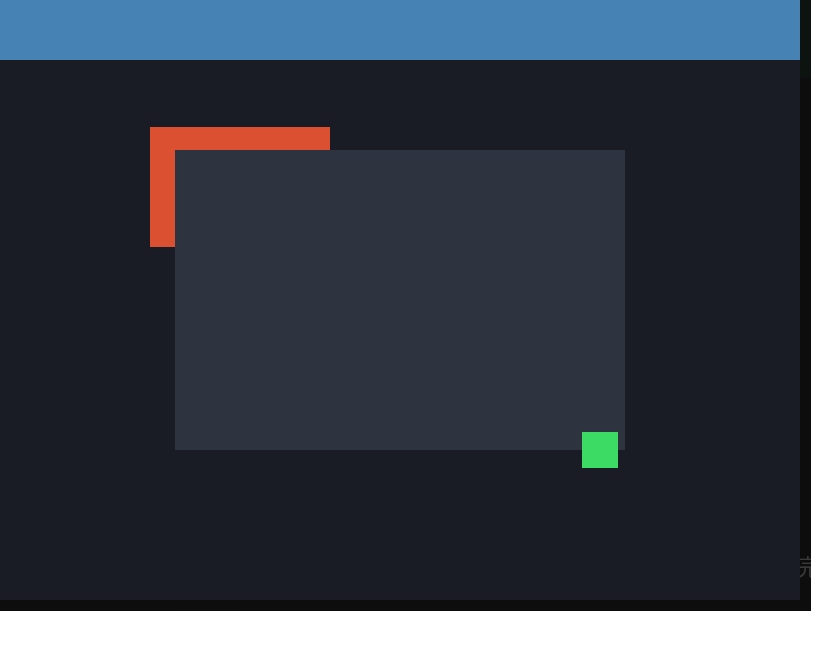

# M1 平台抽象原生視窗與渲染管線範例 (M1 Window Demo)

本範例為 **CPPUI** 里程碑 1（Milestone 1）的驗證專案，展示最底層的平台抽象層（PAL, Platform Abstraction Layer）原生視窗建立、跨平台事件循環泵（RunLoop）以及 Skia 渲染後端 Context 的初始掛載。

---

## 1. 成果預覽 (Preview)



---

## 2. 範例定位與功能特色

- **底層 PAL 工廠 (`PlatformWindowFactory`)**：依據目標平台自動實例化 `PlatformWindowWin32` 或 `PlatformWindowX11`。
- **高 DPI 感知與座標轉換**：即時回報螢幕 DPI 縮放係數 (`GetDpiScale()`) 與 Framebuffer 實體解析度。
- **基本滑鼠事件追蹤**：監聽原生 RawInputEvent 並即時印出滑鼠軌跡。

---

## 3. 核心原始碼解析

```cpp
#include "ui/pal/IPlatformWindow.hpp"
#include "ui/pal/PlatformWindowFactory.hpp"
#include "ui/pal/RunLoop.hpp"

int main() {
    using namespace cppui::pal;

    // 1. 建立平台原生視窗
    WindowDesc desc;
    desc.title = "CPPUI M1 - Window & Render Backend Demo";
    desc.width = 800;
    desc.height = 600;
    desc.resizable = true;

    auto window = PlatformWindowFactory::Create(desc);

    // 2. 設定原生事件回呼
    window->SetEventCallback([](const RawInputEvent& e) {
        if (e.type == RawEventType::MouseMove) {
            // 處理滑鼠移動
        }
    });

    // 3. 執行原生事件循環
    RunLoop runLoop;
    return runLoop.Run();
}
```

---

## 4. 建置與執行方式

```bash
cmake --build build --config Release --target m1_window_demo
.\build\bin\Release\m1_window_demo.exe
```
