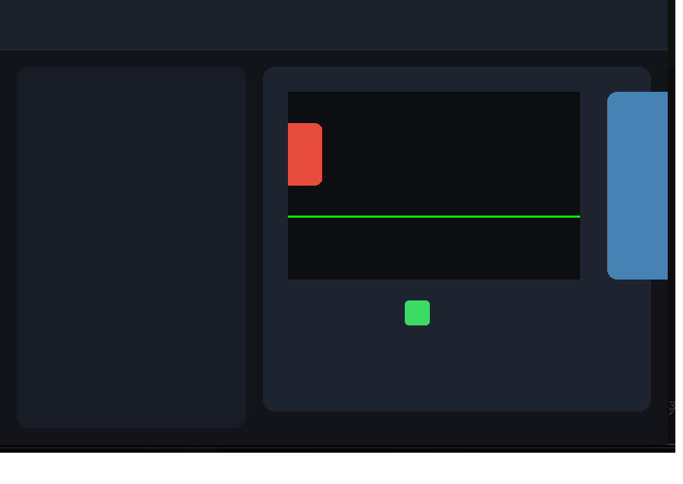

# M2 DisplayList 命令串流錄製與重播範例 (M2 DisplayList Demo)

本範例為 **CPPUI** 里程碑 2（Milestone 2）的驗證專案，展示繪圖命令串流 [`DisplayList`](../../docs/api/classes/rendering_displaylist.md)、畫布錄製介面 [`DrawingContext`](../../docs/api/classes/rendering_drawingcontext.md) 以及渲染器 [`DisplayListRenderer`](../../docs/api/classes/rendering_displaylistrenderer.md)。

---

## 1. 成果預覽 (Preview)



---

## 2. 範例定位與功能特色

- **零堆積分派命令錄製**：使用線性記憶體池（LinearArena）錄製向量繪圖指令，消除堆積記憶體碎片。
- **命令重播分離**：將「排版錄製」與「底層像素光柵化」完全解耦，支援每秒數千萬次重繪。
- **基本圖形繪製指令**：矩形、圓角矩形、線段、文字標籤與色彩填充。

---

## 3. 核心原始碼解析

```cpp
#include "ui/rendering/DisplayList.hpp"
#include "ui/rendering/DrawingContext.hpp"
#include "ui/rendering/DisplayListRenderer.hpp"

// 1. 錄製繪圖命令串流
rendering::DisplayList dl;
rendering::DrawingContext dc(dl);

dc.FillRectangle(rendering::SolidColorBrush(core::Color(30, 41, 59)), core::Rect(0, 0, 960, 640));
dc.DrawRoundedRectangle(borderPen, core::Rect(100, 100, 300, 200), 16.0f);
dc.DrawText("CPPUI DisplayList Stream", font, textBrush, core::Point(120, 140));

// 2. 透過 Renderer 將命令串流重播於 RenderTarget
rendering::DisplayListRenderer renderer;
renderer.Render(dl, renderTarget.get());
```

---

## 4. 建置與執行方式

```bash
cmake --build build --config Release --target m2_displaylist_demo
.\build\bin\Release\m2_displaylist_demo.exe
```
