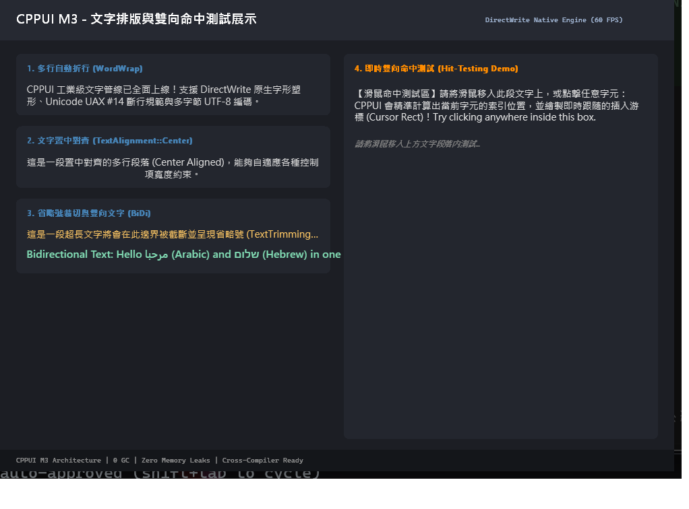

# M3 文字塑形、排版與命中測試範例 (M3 Text Demo)

本範例為 **CPPUI** 里程碑 3（Milestone 3）的驗證專案，展示工業級文字排版管線：整合 HarfBuzz 字形塑形器、Unicode UAX #9 雙向文字分析器（BiDi LTR / RTL）、Unicode UAX #14 換行斷詞規範（CJK 避頭尾禁則）以及多行文字佈局 [`TextLayout`](../../docs/api/classes/text_textlayout.md)。

---

## 1. 成果預覽 (Preview)



---

## 2. 範例定位與功能特色

- **複合語系文字塑形**：混合英文、繁體中文、阿拉伯文（RTL）雙向流暢排版。
- **CJK 標點禁則斷詞**：遵守標點符號不落於行首、不開於行尾之標準排版規範。
- **高精度命中測試 (Hit-Testing)**：支援亞像素座標轉換與字元游標位置反查。

---

## 3. 核心原始碼解析

```cpp
#include "ui/text/FontManager.hpp"
#include "ui/text/TextLayoutEngine.hpp"

auto& fm = text::FontManager::Get();
auto font = fm.GetDefaultChineseFont(16.0f);

text::TextLayoutEngine engine;
auto layout = engine.CreateLayout(
    "CPPUI 具備工業級文字塑形管線，支援 HarfBuzz、BiDi 雙向文字與 CJK 避頭尾換行禁則！",
    font,
    500.0f // 最大換行約束寬度
);

// 執行排版並取得邊界
layout->Measure();
```

---

## 4. 建置與執行方式

```bash
cmake --build build --config Release --target m3_text_demo
.\build\bin\Release\m3_text_demo.exe
```
