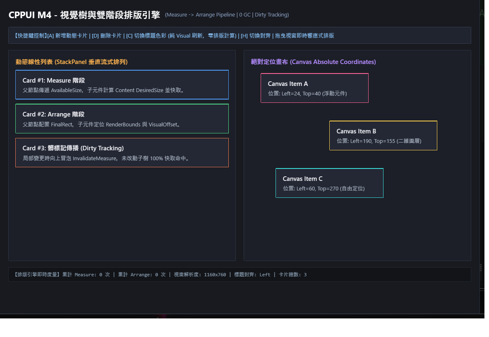

# M4 佈局排版管線展示範例 (M4 Layout Demo)

本範例為 **CPPUI** 里程碑 4（Milestone 4）的驗證專案，展示雙階段佈局管線（Measure / Arrange）、佈局管理器 [`LayoutManager`](../../docs/api/classes/layout_layoutmanager.md) 以及核心面板容器 [`StackPanel`](../../docs/api/classes/layout_stackpanel.md)、[`Border`](../../docs/api/classes/layout_border.md) 與 [`Canvas`](../../docs/api/classes/layout_canvas.md)。

---

## 1. 成果預覽 (Preview)



---

## 2. 範例定位與功能特色

- **雙階段排版求解 (Measure/Arrange Pipeline)**：
  - **Measure Pass**：由下而上遞迴計算各元件之期望尺寸 (`DesiredSize`)。
  - **Arrange Pass**：由上而下賦予最終幾何矩形 (`ActualRect`)。
- **髒標記演算法 (Dirty Layout Flagging)**：局部元件尺寸改變時僅對受影響的子樹執行重新排版，達到 $O(\log N)$ 極速求解。
- **邊距與對齊 (Margin & Alignment)**：支援 Top, Bottom, Left, Right, Center, Stretch 彈性對齊策略。

---

## 3. 核心原始碼解析

```cpp
#include "ui/layout/StackPanel.hpp"
#include "ui/layout/Border.hpp"
#include "ui/layout/LayoutManager.hpp"

auto rootStack = std::make_shared<layout::StackPanel>(layout::Orientation::Vertical);
rootStack->SetSpacing(12.0f);

auto cardBorder = std::make_shared<layout::Border>();
cardBorder->SetPadding(core::Thickness(16.0f));
cardBorder->SetCornerRadius(8.0f);
cardBorder->SetChild(childElement);

rootStack->AddChild(cardBorder);

// 觸發全域排版求解
layout::LayoutManager::Get().UpdateLayout(*rootStack, core::Size(800, 600));
```

---

## 4. 建置與執行方式

```bash
cmake --build build --config Release --target m4_layout_demo
.\build\bin\Release\m4_layout_demo.exe
```
