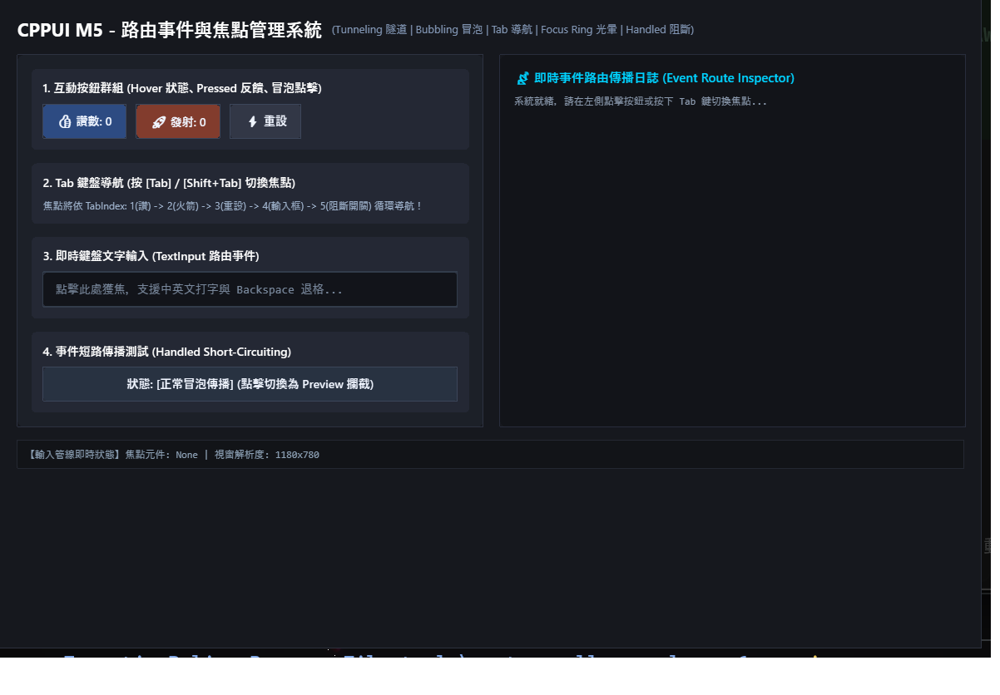

# M5 路由事件與焦點管理範例 (M5 Input & Routed Events Demo)

本範例為 **CPPUI** 里程碑 5（Milestone 5）的驗證專案，展示 WPF 風格的高階路由事件體系（Routed Events）、滑鼠捕獲、輸入管理器 [`InputManager`](../../docs/api/classes/input_inputmanager.md) 與鍵盤焦點巡覽管理器 [`FocusManager`](../../docs/api/classes/input_focusmanager.md)。

---

## 1. 成果預覽 (Preview)



---

## 2. 範例定位與功能特色

- **雙軌路由事件傳遞 (Routing Strategy)**：
  - **Tunneling (通道階段)**：自視覺樹根節點向下探詢至目標節點 (`PreviewMouseDown`)。
  - **Bubbling (冒泡階段)**：自目標節點向上冒泡回溯至根節點 (`MouseDown`)。
- **事件攔截機制 (`e.SetHandled(true)`)**：任意節點可隨時標記已處理，終止後續冒泡。
- **鍵盤 Tab 焦點尋路**：依照 `TabIndex` 屬性流暢進行鍵盤切換與視覺焦點框繪製。

---

## 3. 核心原始碼解析

```cpp
#include "ui/input/InputManager.hpp"
#include "ui/input/FocusManager.hpp"

// 監聽冒泡路由事件
panel->AddHandler(input::UIElement::MouseDownEvent, [](core::UIElement& sender, input::PointerEventArgs& e) {
    compat::println("冒泡捕捉到 MouseDown 來源: {}", sender.GetTypeName());
    // 可選擇是否終止冒泡
    // e.SetHandled(true);
});
```

---

## 4. 建置與執行方式

```bash
cmake --build build --config Release --target m5_input_demo
.\build\bin\Release\m5_input_demo.exe
```
