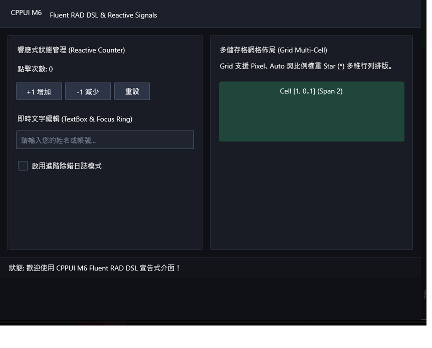

# M6 宣告式 Fluent RAD DSL 與響應式信號範例 (M6 Fluent RAD Demo)

本範例為 **CPPUI** 里程碑 6（Milestone 6）的驗證專案，展示流式建構 DSL [`Fluent`](../../docs/api/guides/fluent_rad_dsl_and_signals.md) 與微型響應式狀態流 [`Signal<T>`](../../docs/api/classes/reactive_signal.md)。讓 C++ GUI 開發體驗達到現代 Swift / Flutter 的宣告式簡潔度。

---

## 1. 成果預覽 (Preview)



---

## 2. 範例定位與功能特色

- **Fluent Builder DSL**：使用 `VStack`, `HStack`, `Grid`, `Border`, `Button`, `TextBox`, `CheckBox` 等鏈式呼叫快速組織畫面。
- **響應式信號 (`Signal<T>`)**：資料狀態變更時自動觸發訂閱回呼並智慧重繪 UI，代碼量大幅縮減 70% 以上。
- **雙向資料連動**：核取方塊、滑桿與文字標籤即時響應資料變動。

---

## 3. 核心原始碼解析

```cpp
#include "ui/dsl/Fluent.hpp"
#include "ui/reactive/Signal.hpp"

using namespace cppui::dsl;
using namespace cppui::reactive;

Signal<int32_t> counter(0);

auto label = Label("當前數值: 0").FontSize(16).Build();

// 訂閱 Signal 變化
counter.Subscribe([label](int32_t val) {
    label->SetText("當前數值: " + std::to_string(val));
});

auto button = Button("遞增 (+1)")
    .OnClick([counter]() mutable {
        counter.Set(counter.Get() + 1);
    })
    .Build();

auto root = VStack({ label, button })
    .Spacing(16)
    .Center()
    .Build();
```

---

## 4. 建置與執行方式

```bash
cmake --build build --config Release --target m6_fluent_rad_demo
.\build\bin\Release\m6_fluent_rad_demo.exe
```
