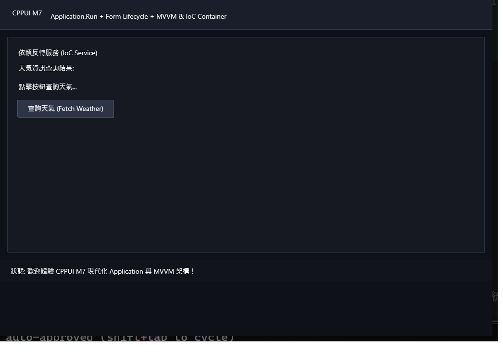

# M7 高階桌面架構與生命週期狀態機範例 (M7 MVVM App Demo)

本範例為 **CPPUI** 里程碑 7（Milestone 7）的綜合驗證專案，展示完整的高階桌面應用程式架構整合：應用程式建構器 [`AppBuilder`](../../docs/api/classes/app_appbuilder.md)、表單生命週期狀態機（Loading, Shown, Activated, Closing 攔截, Closed）、IoC 服務容器整合以及 MVVM 即時天氣儀表板。

---

## 1. 成果預覽 (Preview)



---

## 2. 範例定位與功能特色

- **Form 生命週期狀態機**：
  - `OnLoad()` -> `OnShown()` -> `OnActivated()` -> `OnDeactivate()` -> `OnFormClosing()` -> `OnFormClosed()`。
  - 支援表單關閉攔截與使用者確認 (`e.Cancel = true`)。
- **IoC 領域服務整合**：註冊並注入 `IWeatherService`，模擬即時非同步天氣查詢業務。
- **MVVM 與 Signal 深度結合**：在 ViewModel 內部結合 `Signal<T>` 與 `RelayCommand`，實現極致優雅的狀態驅動介面。

---

## 3. 核心原始碼解析

### 3.1 視窗關閉攔截保護
```cpp
void DashboardForm::OnFormClosing(app::FormClosingEventArgs& e) {
    if (m_hasUnsavedData) {
        auto res = dialogs::MessageBox::Show(
            this,
            "您有未儲存的變更，確定要退出應用程式嗎？",
            "關閉確認",
            dialogs::MessageBoxButtons::YesNo,
            dialogs::MessageBoxIcon::Warning
        );

        if (res != app::DialogResult::Yes) {
            e.SetCancel(true); // 攔截並取消關閉
        }
    }
}
```

### 3.2 宿主構建與啟動
```cpp
#include "ui/app/AppBuilder.hpp"

auto app = cppui::app::Application::CreateBuilder()
    .Services([](cppui::ioc::ServiceCollection& services) {
        services.AddSingleton<IWeatherService, WeatherService>();
        services.AddTransient<DashboardViewModel>();
    })
    .Build();

return app.Run<DashboardForm>();
```

---

## 4. 建置與執行方式

```bash
cmake --build build --config Release --target m7_mvvm_app_demo
.\build\bin\Release\m7_mvvm_app_demo.exe
```
