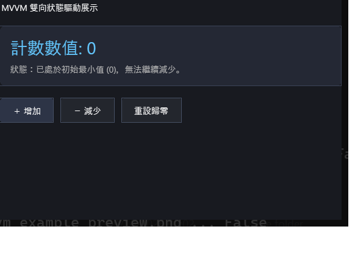

# 現代 MVVM 雙向資料綁定範例 (MVVM Counter)

本範例展示 **CPPUI** 內建的微軟架構標準 MVVM（Model-View-ViewModel）體系。包含 [`ViewModelBase`](../../docs/api/classes/mvvm_viewmodelbase.md)、雙向指令 [`RelayCommand`](../../docs/api/classes/mvvm_relaycommand.md) 與屬性變更通知，徹底解耦業務資料邏輯與 UI 視覺元件。

---

## 1. 成果預覽 (Preview)



---

## 2. 範例定位與功能特色

- **標準三層架構分離 (Strict SoC)**：
  - **Model** (`CounterModel`)：純粹資料模型與計數業務。
  - **ViewModel** (`CounterViewModel`)：繼承 `ViewModelBase`，維護展示狀態並暴露 `RelayCommand`。
  - **View** (`CounterForm`)：宣告式表單，透過事件與指令綁定 ViewModel，無任何底層業務計算。
- **命令模式 (Command Pattern)**：透過 `RelayCommand` 提供 `Execute()` 與 `CanExecute()`，自動管理按鈕啟用/停用狀態。

---

## 3. 核心原始碼解析

### 3.1 視圖模型 (`CounterViewModel.hpp`)
```cpp
#include "ui/mvvm/ViewModelBase.hpp"
#include "ui/mvvm/RelayCommand.hpp"

class CounterViewModel : public cppui::mvvm::ViewModelBase {
public:
    CounterViewModel() {
        m_incrementCommand = std::make_shared<cppui::mvvm::RelayCommand>([this]() {
            SetCount(m_count + 1);
        });

        m_decrementCommand = std::make_shared<cppui::mvvm::RelayCommand>([this]() {
            if (m_count > 0) SetCount(m_count - 1);
        }, [this]() {
            return m_count > 0; // 當 Count == 0 時自動禁用按鈕
        });
    }

    int32_t GetCount() const { return m_count; }
    void SetCount(int32_t value) {
        if (m_count != value) {
            m_count = value;
            RaisePropertyChanged("Count");
            m_decrementCommand->RaiseCanExecuteChanged();
        }
    }

    std::shared_ptr<cppui::mvvm::RelayCommand> GetIncrementCommand() const { return m_incrementCommand; }
    std::shared_ptr<cppui::mvvm::RelayCommand> GetDecrementCommand() const { return m_decrementCommand; }

private:
    int32_t m_count = 0;
    std::shared_ptr<cppui::mvvm::RelayCommand> m_incrementCommand;
    std::shared_ptr<cppui::mvvm::RelayCommand> m_decrementCommand;
};
```

### 3.2 視圖表單綁定 (`CounterForm.cpp`)
```cpp
auto btnAdd = Button("增加 (+1)")
    .OnClick([this]() { m_viewModel->GetIncrementCommand()->Execute(); })
    .Build();

auto btnSub = Button("減少 (-1)")
    .OnClick([this]() { m_viewModel->GetDecrementCommand()->Execute(); })
    .Build();

// 監聽 ViewModel 屬性通知並自動更新文字
m_viewModel->AddPropertyChangedListener([this](compat::string_view propName) {
    if (propName == "Count") {
        m_labelCount->SetText("當前計數: " + std::to_string(m_viewModel->GetCount()));
    }
});
```

---

## 4. 建置與執行方式

### 透過 CMake 建置
```bash
cmake -B build -DCMAKE_BUILD_TYPE=Release
cmake --build build --config Release --target mvvm_example
```

### 執行範例
```powershell
# Windows
.\build\bin\Release\mvvm_example.exe

# Linux
./build/bin/mvvm_example
```
