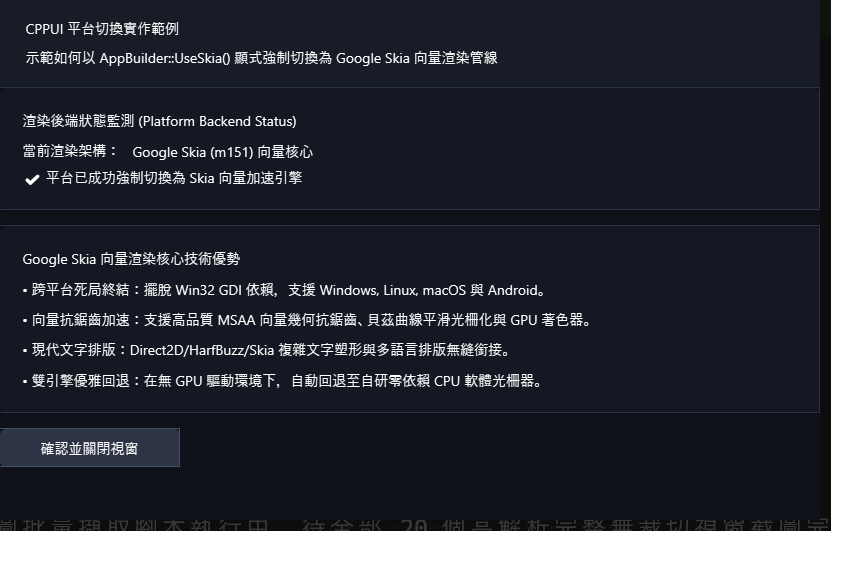

# 渲染後端切換展示範例 (Platform Backend Switching / Skia)

本範例展示 **CPPUI** 的雙渲染核心架構：Google Skia (m151) 硬體加速向量繪圖引擎與純 C++ 軟體光柵器（SoftwareRenderTarget）。展示如何透過宣告式應用程式建構器 [`AppBuilder`](../../docs/api/classes/app_appbuilder.md) 顯式宣告後端策略。

---

## 1. 成果預覽 (Preview)



---

## 2. 範例定位與功能特色

- **雙核心架構 (Dual-Engine Pipeline)**：
  - **Skia (m151)**：利用現代向量光柵核心，支援 Direct3D / Metal / Vulkan / OpenGL 硬體加速。
  - **Software Fallback**：零第三方依賴，在虛擬機、CI 或低資源設備上平滑回退。
- **建構期流式配置 (`AppBuilder::UseSkia()`)**：一行程式碼即可強制鎖定 Skia 後端或軟體光柵後端。

---

## 3. 核心原始碼解析

### 3.1 強制啟用 Skia 渲染後端 (`main.cpp`)
```cpp
#include "ui/app/Application.hpp"
#include "ui/app/AppBuilder.hpp"
#include "SkiaDemoForm.hpp"

int main() {
    using namespace cppui::app;
    using namespace platform_skia_example;

    auto builder = Application::CreateBuilder();

    // 顯式宣告：強制使用 Google Skia 向量加速渲染後端
    builder.UseSkia();

    // 註冊表單至 IoC 容器
    builder.Services().AddTransient<SkiaDemoForm>();

    // 構建 Host 宿主並啟動視窗循環
    auto host = builder.Build();
    return host.Run<SkiaDemoForm>();
}
```

---

## 4. 建置與執行方式

### 透過 CMake 建置
```bash
cmake -B build -DCMAKE_BUILD_TYPE=Release
cmake --build build --config Release --target platform_skia_example
```

### 執行範例
```powershell
# Windows
.\build\bin\Release\platform_skia_example.exe

# Linux
./build/bin/platform_skia_example
```
