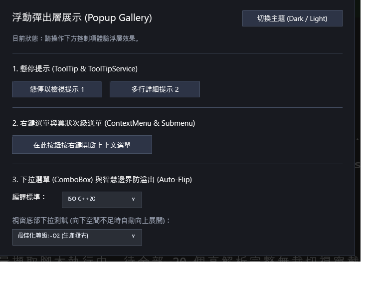

# 彈出層與浮動控制項展示庫 (Popup & Floating Controls Gallery)

本範例展示 **CPPUI** 的頂層懸浮圖層體系 [`OverlayLayer`](../../docs/api/classes/controls_overlaylayer.md) 與浮動控制項群，包含 [`Popup`](../../docs/api/classes/controls_popup.md)、[`ToolTip`](../../docs/api/classes/controls_tooltip.md)、[`ContextMenu`](../../docs/api/classes/controls_contextmenu.md) 與 [`ComboBox`](../../docs/api/classes/controls_combobox.md)。涵蓋全域座標轉換、智慧定位、邊界溢出自動翻轉 (Auto-Flip) 與外部點擊收合 (Light-Dismiss)。

---

## 1. 成果預覽 (Preview)



---

## 2. 範例定位與功能特色

- **視窗內頂層浮層 (`OverlayLayer`)**：獨立於主內容排版樹，保證浮動元件永遠繪製於最上層，免除父節點 `ClipToBounds` 邊界截斷問題。
- **智慧邊界計算引擎 (Smart Placement Engine)**：
  - 支援 `PlacementMode::Bottom`, `Top`, `Left`, `Right`, `Mouse`。
  - 當下方空間不足時，自動智慧翻轉至上方（Auto-Flip）；水平方向自動鉗制於視窗邊界內（Auto-Clamp）。
- **外部點擊自動關閉 (Light-Dismiss)**：非強制浮窗在使用者點擊外部空白區域時自動流暢收合。
- **豐富的浮動控制項實踐**：
  - **ToolTip**：滑鼠懸停延遲觸發提示氣泡。
  - **ContextMenu**：元件右鍵彈出式選單，支援圖示、快速鍵與分隔線。
  - **ComboBox**：現代下拉清單方塊，展開時動態彈出選項。

---

## 3. 核心原始碼解析

### 3.1 建立 ComboBox 下拉選單
```cpp
auto combo = std::make_shared<controls::ComboBox>();
combo->SetWidth(240);
combo->AddItem("繁體中文 (Traditional Chinese)");
combo->AddItem("English (US)");
combo->AddItem("日本語 (Japanese)");
combo->AddItem("Deutsch (German)");
combo->SetSelectedIndex(0);

combo->OnSelectionChanged([](int32_t index, compat::string_view text) {
    compat::println("切換語言選項: #{} - {}", index, text);
});
```

### 3.2 掛載 ContextMenu 右鍵選單
```cpp
auto menu = std::make_shared<controls::ContextMenu>();
menu->AddItem("複製 (Copy)", []() { compat::println("觸發複製操作"); });
menu->AddItem("貼上 (Paste)", []() { compat::println("觸發貼上操作"); });
menu->AddSeparator();
menu->AddItem("重新整理 (Refresh)", []() { compat::println("觸發刷新"); });

targetControl->SetContextMenu(menu);
```

### 3.3 為元件設定 ToolTip 工具提示
```cpp
controls::ToolTipService::SetToolTip(myButton.get(), "點擊此按鈕將儲存當前所有變更");
```

---

## 4. 建置與執行方式

### 透過 CMake 建置
```bash
cmake -B build -DCMAKE_BUILD_TYPE=Release
cmake --build build --config Release --target popup_gallery
```

### 執行範例
```powershell
# Windows
.\build\bin\Release\popup_gallery.exe

# Linux
./build/bin/popup_gallery
```
