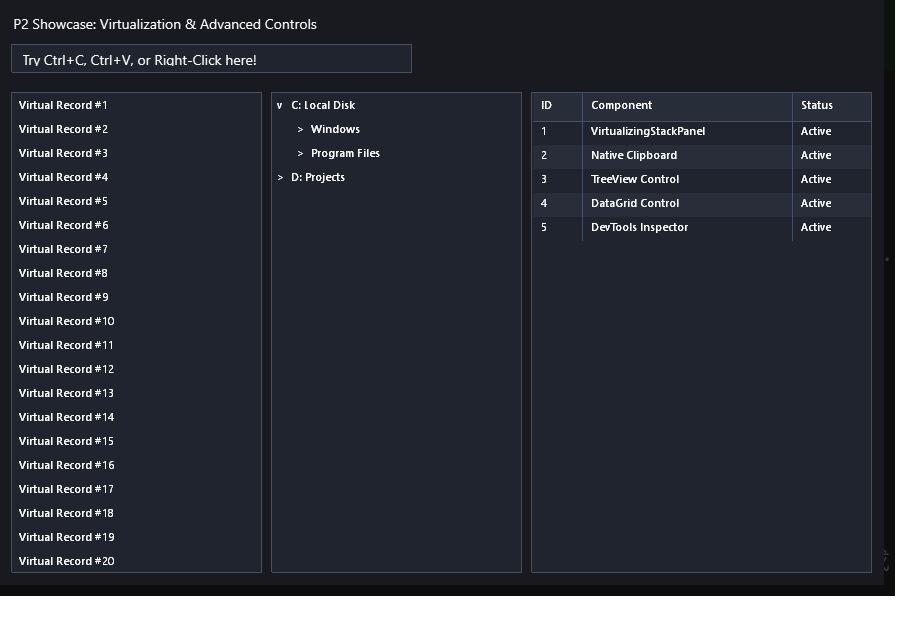

# UI 虛擬化與高階展示控制項範例 (Virtualized List & Advanced Controls)

本範例展示 **CPPUI** 突破巨量資料渲染瓶頸的核心技術：UI 虛擬化容器 [`VirtualizingStackPanel`](../../docs/api/classes/layout_virtualizingstackpanel.md)、百萬級資料清單方塊 [`ListBox`](../../docs/api/classes/controls_listbox.md)、階層式樹狀檢視 [`TreeView`](../../docs/api/classes/controls_treeview.md)、多欄表格資料網格 [`DataGrid`](../../docs/api/classes/controls_datagrid.md) 以及具備系統原生剪貼簿支援的 [`TextBox`](../../docs/api/classes/controls_textbox.md)。

---

## 1. 成果預覽 (Preview)



---

## 2. 範例定位與功能特色

- **百萬筆巨量資料零延遲滾動 (UI Virtualization)**：
  - `ListBox` 裝載 **100,000 筆資料**。
  - `VirtualizingStackPanel` 僅對當前可見視區（Viewport）範圍內的資料索引實例化 UI 元件，移出視區者自動推入容器池重複回收使用（Pool Recycling），記憶體配置開銷為 $O(1)$。
- **階層式樹狀檢視 (`TreeView`)**：
  - 支援多層級節點嵌套、展開/折疊動畫與圖示自訂，提供流暢的樹狀階層巡覽。
- **多欄表格資料網格 (`DataGrid`)**：
  - 支援 Auto, Pixel, Star 彈性欄寬設定、斑馬線背景與點擊欄位標題自動排序指示。
- **系統原生剪貼簿整合 (`IClipboard`)**：
  - `TextBox` 完整支援 `Ctrl+C`、`Ctrl+V`、`Ctrl+X`、`Ctrl+A` 快速鍵與右鍵快顯功能表，與作業系統剪貼簿完全互通。

---

## 3. 核心原始碼解析

### 3.1 虛擬化清單方塊配置 (100,000 筆資料)
```cpp
auto list = std::make_shared<controls::ListBox>();
list->SetWidth(260.0f);
list->SetHeight(480.0f);
list->SetVirtualizationEnabled(true); // 啟用虛擬化

// 快速載入 100,000 筆項目
for (size_t i = 1; i <= 100000; ++i) {
    list->AddItem("Virtual Record #" + std::to_string(i));
}
```

### 3.2 階層樹狀檢視配置 (TreeView)
```cpp
auto tree = std::make_shared<controls::TreeView>();
auto rootItem = tree->CreateItem("專案根目錄 (Root Project)");
rootItem->SetExpanded(true);

auto srcFolder = rootItem->AddChild("src");
srcFolder->AddChild("main.cpp");
srcFolder->AddChild("Application.cpp");

auto includeFolder = rootItem->AddChild("include");
includeFolder->AddChild("compat.hpp");
includeFolder->AddChild("Form.hpp");
```

### 3.3 多欄資料網格配置 (DataGrid)
```cpp
auto grid = std::make_shared<controls::DataGrid>();
grid->AddColumn("ID", 60.0f);
grid->AddColumn("名稱 (Name)", 140.0f);
grid->AddColumn("狀態 (Status)", 90.0f);

grid->AddRow({ "001", "Core Engine", "Active" });
grid->AddRow({ "002", "Text Pipeline", "Ready" });
grid->AddRow({ "003", "Skia Backend", "Optimal" });
```

---

## 4. 建置與執行方式

### 透過 CMake 建置
```bash
cmake -B build -DCMAKE_BUILD_TYPE=Release
cmake --build build --config Release --target virtualized_list_demo
```

### 執行範例
```powershell
# Windows
.\build\bin\Release\virtualized_list_demo.exe

# Linux
./build/bin/virtualized_list_demo
```
